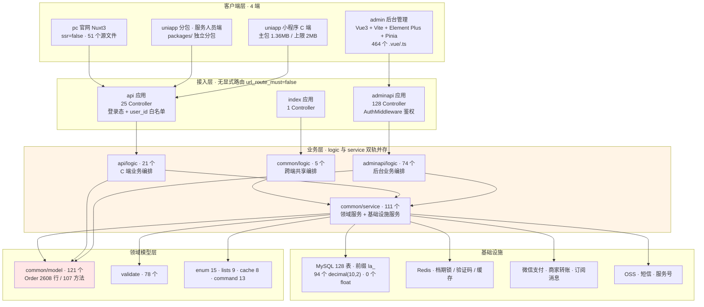
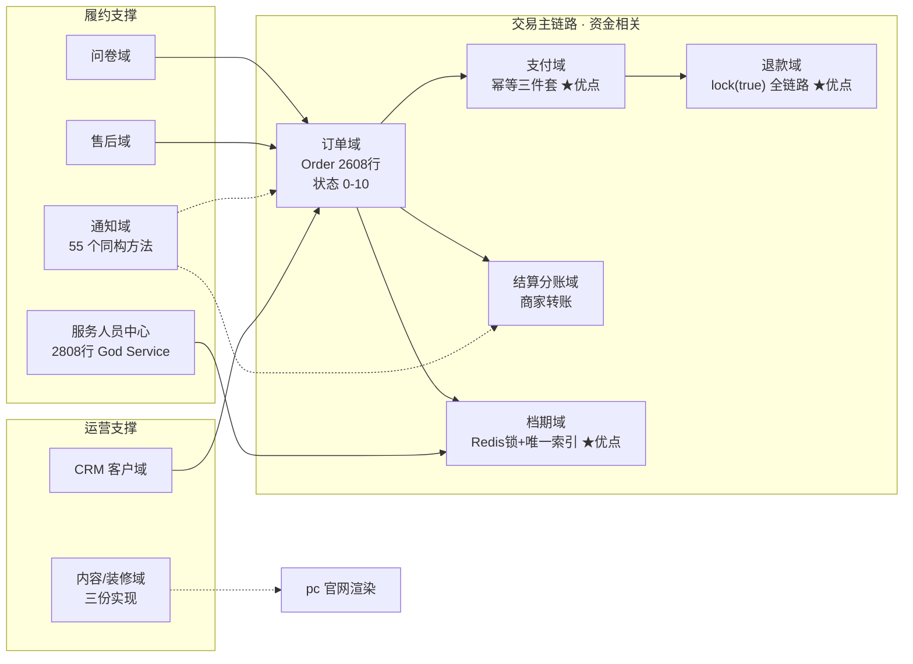
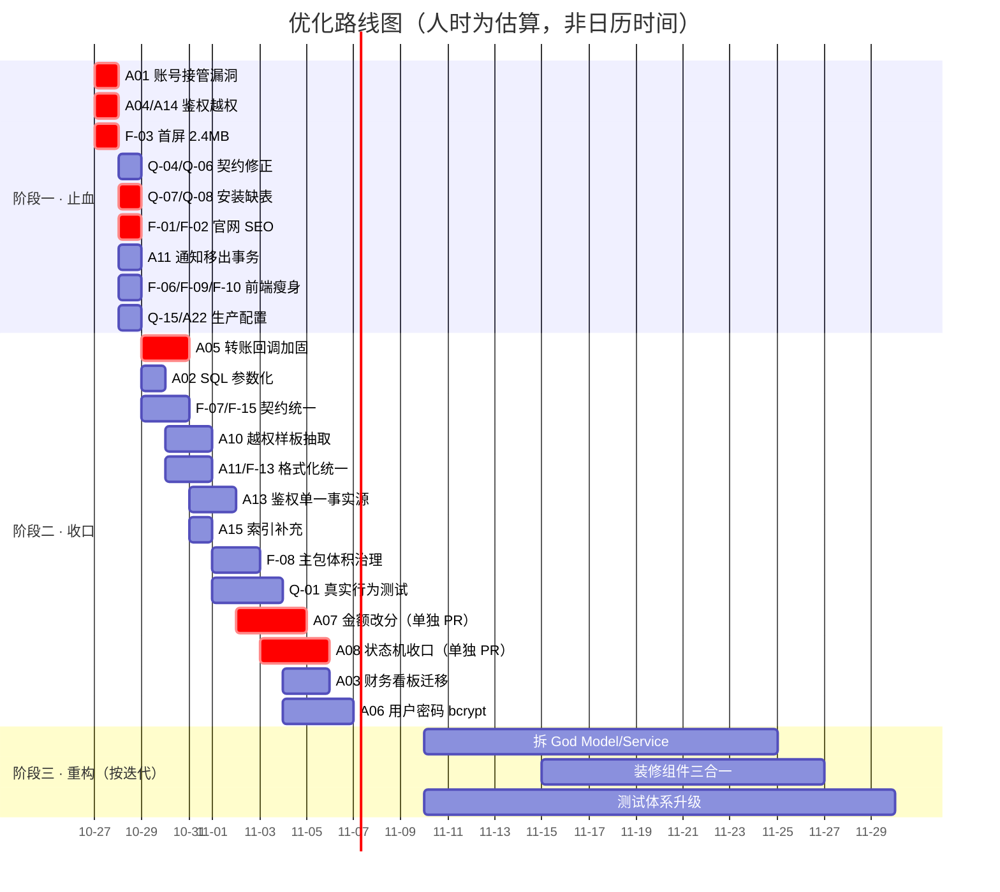
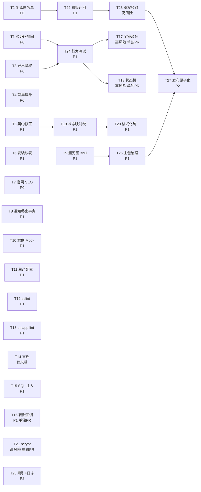

# 婚庆服务预约系统 · 功能架构审计与优化路径

> 审计对象：`wedding-management` 四端单体仓库（server / admin / uniapp / pc）
> 审计日期：2026-10-26
> 审计方式：全量只读代码侦查 + 关键结论抽样复核（7 处 ★ 项逐一取证复现）
> 问题总量：后端 25 项（A）· 前端 25 项（F）· 工程质量 24 项（Q）= **74 项**
> 报告定位：前半部分面向业务方（评分 / 成熟度 / 路径），后半部分面向工程师（登记册 / 施工清单）

---

## 1. TL;DR

**整体健康度：2.3 / 5（可用但不可放心扩写）**

系统「能跑、能收钱、主链路没崩」，但**安全边界和工程质量是明显短板**：一个 P0 级账号接管漏洞（短信验证码只写不读 + 4 位码 + 重置密码仅凭手机号）、一个 P0 级首屏 2.4MB 的加载缺陷、一个 P0 级官网 SEO 完全失效（5 个路由产出同一份 1341 字节空壳）。74 项问题里 **28 项 P0/P1**，其中 **约 40% 可以在 1-2 天内以「改一处、无架构影响」的方式止血**。

**最该先做的 3 件事：**

1. **堵住账号接管**（A01）——`SmsDriver::verify` 的 `check_num` 只递增不校验，验证码仅 4 位，`resetPassword` 仅凭 `mobile + code` 即可改任意账号密码。5 分钟内可爆破。**这是全仓唯一可直接导致用户资产损失的漏洞。**
2. **掐掉首屏 2.4MB**（F-03）——`admin/src/install/index.ts:3` 用 `import.meta.glob('./**/*',{eager:true})` 同步吃掉 echarts(804KB)+zrender(210KB)+element-plus(509KB)，而 echarts 只在 2 个页面用到。改 3 行即可释放约 1MB。
3. **恢复官网可被搜索**（F-01/F-02）——`ssr:false` + `nuxt generate` 让官网 5 个路由全部输出同一份 1341B SPA 空壳（已实测 4 个 HTML 文件 MD5 完全相同），叠加无 sitemap、无 per-page meta、robots.txt 空规则，官网在搜索引擎眼里等于不存在。

**关键取舍**：本报告第 6 节明确列出 **「不建议现在做」** 的 8 件事（PHP 8.0→8.3、nuxt 3.6→3.12、拆 2800 行 `StaffCenterLogic`、全量 OpenAPI 补全等）。用户要的是**优化路径**，不是「什么都改」。

---

## 2. 功能架构全景

### 2.1 四端 + 后端分层总览



**这张图最需要被看见的两件事：**

1. **`logic` 与 `service` 双业务层并存**（A09/A10 的根因）。`app/adminapi/logic/`(74) + `app/api/logic/`(21) + `app/common/logic/`(5) = **100 个 logic 类**，与 `app/common/service/` 的 **111 个 service 类**职责重叠、边界模糊。同一个业务（如服务人员录单）既可能在 `StaffCenterLogic`（2808 行）里，也可能在 `StaffManualOrderService` 里。这直接导致**改一个功能要在两个地方找代码**，是全部「重复实现」类问题（F-14/F-15/A19）的结构性根源。
2. **`common` 反向依赖 `adminapi` 5 处**（A24）：`AdminAuthCache.php:17`、`GenerateLossWarnings.php:10`、`AccountBindingService.php:88`、`StaffManualOrderService.php:29`、`AdminDashboardLogic.php:10-11`。分层是「名义上单向、实际双向」，`common` 无法独立复用/测试。

### 2.2 业务域切分



### 2.3 分层职责与体量对照

| 层 | 目录 | 文件数 | 职责 | 审计评价 |
|---|---|---|---|---|
| 接入 | `app/adminapi/controller` | 128 | 后台 HTTP 入口 | 单文件最重 1508 行 / 68 action（A10） |
| 接入 | `app/api/controller` | 25 | C 端 HTTP 入口 | `StaffCenterController` 901 行 / 61 action |
| 接入 | `app/index/controller` | 1 | 官网落地 | 极薄，正常 |
| 编排 | `app/adminapi/logic` | 74 | 后台业务编排 | 与 service 边界模糊 |
| 编排 | `app/api/logic` | 21 | C 端业务编排 | `StaffCenterLogic` 2808 行 / 126 方法 |
| 编排 | `app/common/logic` | 5 | 跨端共享 | 数量最少，说明共享抽象不足 |
| 领域 | `app/common/service` | 111 | 领域 + 基础设施服务 | 拆分较细，是全仓最健康的一层 |
| 模型 | `app/common/model` | 121 | ORM 模型 | `Order` 是 God Model（A09） |
| 校验 | `validate`（三处合计） | 78 | 参数校验 | 覆盖良好 |
| 枚举 | `app/common/enum` | 15 | 枚举常量 | 前端枚举未与之对齐（F-15） |

---

## 3. 业务域成熟度矩阵

评分口径：1 = 缺失/危险，3 = 可用但有明显隐患，5 = 可作为标杆。**「—」表示该维度对该域不适用。**

| 业务域 | 实现完整度 | 资金安全 | 并发安全 | 可测试性 | 可维护性 | 综合 |
|---|:---:|:---:|:---:|:---:|:---:|:---:|
| **支付** | 5 | **5** | **5** | 3 | 4 | **4.4** ★标杆 |
| **退款** | 5 | **5** | **5** | 3 | 3 | **4.2** ★标杆 |
| **档期** | 5 | — | **5** | 3 | 3 | **4.0** ★标杆 |
| 订单 | 5 | 3 | 4 | 2 | **2** | 3.2 |
| 问卷 | 4 | — | 3 | 2 | 3 | 3.0 |
| 售后 | 4 | 3 | 3 | 2 | 3 | 3.0 |
| CRM 客户 | 4 | — | 3 | 2 | 3 | 3.0 |
| 通知 | 4 | — | **2** | 2 | **1** | 2.3 |
| 内容/装修 | 4 | — | — | **1** | **1** | 2.0 |
| **结算分账** | 4 | **2** | 3 | 2 | 2 | **2.6** ⚠ |
| **服务人员中心** | 5 | 3 | 3 | **1** | **1** | **2.6** ⚠ |

**怎么读这张表（给业务方）：**

- **绿色地带**：支付、退款、档期是**全仓最强的三个域**，值得作为其他域的改造范本。它们的共同做法是「事务 + 固定锁序 + 状态校验 + 数据库唯一索引兜底」四件套。
- **红色地带**：
  - **结算分账**资金安全仅 2 分——微信商家转账回调 `StaffSettlementService.php:532-553` **无金额校验、无 mchid 校验、无事务、无行锁**，与支付回调（`Payment.php:261-360` 做得很完备）形成刺眼对比。这是**资金链路上唯一的短板**，也是攻击者最想找的入口。
  - **服务人员中心**可维护性仅 1 分——2808 行 `StaffCenterLogic` + 1508 行 `StaffController`（含 23 段完全相同的越权校验样板）。**任何新需求进来都要动这个巨型文件**，改动风险与代码行数成正比。
  - **内容/装修**可维护性 1 分——同一套装修组件有 **3 份实现**（admin 37 个 / uniapp 22 个 / pc `index.vue` 1600 行），加一个组件要写三遍。

---

## 4. 架构问题诊断（按主题归纳）

> 74 条问题不逐条罗列（完整登记册见第 7 节），此处归纳为 6 个根因主题。每个主题按「现象 → 根因 → 后果（业务语言）→ 治理方向」展开。

### 主题 1 · 安全与鉴权边界失效

**现象**

| 编号 | 位置 | 问题 |
|---|---|---|
| **A01 ★P0** | `SmsDriver.php:186-219`<br/>`SmsLogic.php:48`<br/>`UserLogic.php:228-251` | `verify()` 中 `check_num` **只递增、从不校验**（已复核：`:210`、`:217` 均只 `+1`，全函数无任何 `check_num >=` 判断）；验证码 `mt_rand(1000,9999)` 仅 **4 位**（9000 种）；`resetPassword` 仅凭 `mobile + code` 直接 `update password` |
| A03 | `AdminDashboardController.php:78-81`<br/>`AdminDashboardLogic.php:30-57,93-118` | 客户端 `api` 应用内置**财务看板**，用配置里的 `user_id` 白名单代替 RBAC，并直调 `adminapi/logic/financial/FinancialReportLogic`，**绕过后台 `AuthMiddleware`** |
| A04 | `ConfigController.php:27`<br/>`ConfigLogic.php:70` | `getConfig` 在 `$notNeedLogin` 中，且返回 `admin_dashboard_user_ids` 白名单——**未登录即可拿到财务看板的授权名单** |
| A05 | `StaffSettlementService.php:532-553` | 转账回调无金额/mchid 校验、无事务、无 `lock(true)` |
| A06 | `common.php:14-17`<br/>`LoginLogic.php:49` | 用户侧密码 `md5(salt.md5(pwd.salt))`；后台已升级 `PasswordService`（bcrypt + needsRehash），**两套并存** |
| A14 | `DownloadController.php:24` | `$notNeedLogin = ['export']`，**未登录可下载导出文件** |
| A21 | `UploadService.php:54,136,205` | 上传仅校验扩展名，**不校验 MIME** |
| A22 | `public/install/install.php` | 安装脚本留在 web 根；`install.lock` 被 `.gitignore` 排除 → 每次部署都可能重新开放安装入口 |
| F-16 | `pc/pages/information/detail/[id].vue:65`<br/>`pc/pages/policy/[type].vue:9` | `v-html` 渲染后端富文本，**无净化** |
| F-19 | `admin/utils/cache.ts:15`<br/>`admin/utils/request/index.ts:26` | token 存 localStorage + 自定义 `token` 头 |

**根因**：鉴权来源有 **3 套并存**（A13）——节点表权限 + `AuthMiddleware.php:126-243` 里**硬编码的 90+ URI 数组** + 配置白名单。三套之间没有单一事实源，于是每加一个接口都可能从「漏掉的那套」溜过去。A03/A04/A14 都是这个结构性缺陷的具体表现：**开发者为绕开复杂的 RBAC，各自发明了「白名单」这条捷径。**

**后果（业务语言）**：
- A01 = **任何人只要知道你的手机号，5 分钟内可以改掉你的登录密码并接管账号**，进而查看你的订单、地址、联系方式。这是唯一一个「攻击成本极低、损失确定」的漏洞，必须今天修。
- A04 + A03 = 未登录访客可拿到「谁是财务看板授权人」，结合 A03 的弱校验，**财务报表存在被外部拉取的风险**。
- A14 = 后台导出的订单/客户数据（含手机号）只要拿到下载链接，**无需登录即可下载**。
- A05 = 伪造转账回调可能让**结算状态被错误推进**（虽然微信侧有对账，但代码层没有防线）。

**治理方向**：
1. 立即（阶段一）：A01 三处一起改（读 `check_num` + 6 位码 + 重置密码加图形/频控）；A04 把 `admin_dashboard_user_ids` 从 `getConfig` 返回值中剥离；A14 移出 `notNeedLogin`。
2. 收口（阶段二）：A13 收敛为**单一事实源**（节点表为准，删除 `AuthMiddleware` 硬编码数组），A03 财务看板**迁回 `adminapi`** 走正常 RBAC，A05 对齐支付回调范式。
3. 重构（阶段三）：A06 用户密码 bcrypt 化（需在线迁移方案）。

---

### 主题 2 · 资金精度与状态机失控

**现象**

| 编号 | 位置 | 问题 |
|---|---|---|
| **A07 ★P1** | 全仓 194 处 `round((float)`、414 处 `(float)`/`floatval`<br/>`Order.php:508`（`calculatePaymentSplit(float)`）<br/>`Order.php:1937-1946`、`:246`（float 比较判已付清） | PHP 层用 float 做金额运算；`MoneyService::yuanToFen` **仅 26 次调用** |
| A08 | `Order.php:51-62`（常量 0-10）<br/>24 处 `order_status` 写入点各自校验<br/>`ActivityRegistrationService.php:745`、`StaffSettlementRepayService.php:285`（魔法数字 `0`） | **无集中状态流转表**，每个写入点自己判断「能不能改」 |
| A11 | `OrderLogic.php:520-521`<br/>`Refund.php:220,303,365-392` | **通知在事务内发送**（已复核：`Db::startTrans()` 之后、`Db::commit()` 之前调用 `OrderNotificationService::notify*`）。正确范式见 `PayNotifyLogic.php:42-46`（after-commit） |
| F-07 ★P1 | `shared/contracts/core.ts:144`（权威）<br/>`uniapp/pages/order/order.vue:358-372`<br/>`staff_order_list.vue:248-274`<br/>`staff_order_detail.vue:543-567`<br/>`OrderCard.vue:169-180` | 订单状态映射 **5 份拷贝**且键类型混用；已复核 `order.vue` 的 map **缺状态 9**（USER_DELETED），`staff_order_detail` 把「2 待服务」映射成 `paid` |

**根因**：数据库层做对了（94 个 `decimal(10,2)`、**0 个 float**），但 **PHP 层从未被约束**。`MoneyService` 存在却只有 26 次调用——说明它是后来补的「正确做法」，但历史代码（194 处 `round((float)`）没有回填。状态机同理：常量定义集中了，但**流转规则没有集中**，24 个写入点各自为政。

**后果（业务语言）**：
- A07 = 金额在 PHP 里是浮点数，`0.1 + 0.2 !== 0.3`。**对账时可能出现「差 1 分钱」的订单**，且「是否已付清」用 float 比较（`Order.php:246`）可能在边界值上误判——**该收的钱显示已收齐，或已收齐的显示欠款**。
- A08 = 没有统一状态机意味着**任何一处改动都可能产生非法状态跃迁**（如已退款 → 已完成）。已发现 2 处直接用魔法数字 `0` 而非常量。
- A11 = 通知在事务内发送：**短信/服务号已发出去了，但事务回滚了**。用户收到「订单创建成功」但系统里根本没有这个订单。
- F-07 = **同一个订单在小程序订单列表显示「待服务」、在服务人员详情页显示「已支付」**。用户投诉时无法解释。

**治理方向**：
1. 阶段二（**高风险，单独 PR**）：A07 以 `MoneyService` 为准，按「先新代码、后热路径、最后全量」三步回填，每步配回归测试。
2. 阶段二（**高风险，单独 PR**）：A08 建立 `OrderStatusMachine`（允许跃迁表 + `assertCanTransit()`），24 个写入点逐个替换。
3. 阶段一（低风险）：A11 把 3 处通知调用移到 `commit` 之后（参考 `PayNotifyLogic` 现成范式）；F-07 让 4 份拷贝统一 `import` `shared/contracts/core.ts`。

---

### 主题 3 · 分层模糊与巨型类

**现象**

| 编号 | 位置 | 体量 |
|---|---|---|
| **A09 ★P1** | `app/common/model/order/Order.php` | **2608 行 / 107 方法**（已复核），同时承担状态机 + 金额计算 + 档期 + 建单 + 文案生成 |
| **A10 ★P1** | `api/logic/StaffCenterLogic.php`<br/>`adminapi/controller/staff/StaffController.php`<br/>`api/controller/StaffCenterController.php` | **2808 行 / 126 方法**<br/>**1508 行 / 68 action**，含 **23 段完全相同的 `StaffService::getStaffScopeId` 越权样板**<br/>901 行 / 61 action |
| A19 | `common/service/OrderNotificationService.php` | **1916 行 / 55 个同构 notify 方法** |
| A20 | `adminapi/logic/MaterialCleanupLogic.php:37-638` | 602 行内联数据表 |
| A24 | 5 处 `common → adminapi` 反向依赖 | 分层倒挂 |
| F-14 | `admin/views/decoration/component/widgets/`(37)<br/>`uniapp/src/components/widgets/`(22)<br/>`pc/pages/index.vue`(1600 行) | 装修组件 **3 份实现**，交集 21 个 |
| F-17 | admin 11 个 SFC >1000 行（`staff/lists/edit.vue` 1980）<br/>uniapp 40/109 页 >800 行（`order_detail.vue` 3301、`dynamic_detail.vue` 3177） | 巨型 SFC |

**根因**：`logic` 与 `service` 双轨并存（见 2.1）→ **没有明确「谁负责编排、谁负责领域逻辑」的规则** → 新功能倾向于往「已经能跑的那个类」里塞 → 类持续膨胀。`StaffController` 的 23 段相同越权样板是典型信号：**缺少一个中间件/基类来做这件事，于是复制粘贴了 23 次。**

**后果（业务语言）**：
- 改动成本随文件大小线性上升。`StaffCenterLogic` 2808 行意味着**改任何服务人员相关需求，都要在一个 2808 行的文件里定位**，且 23 处越权样板要同步改 23 次（漏一处就是越权漏洞）。
- 装修组件 3 份实现 → **后台配好的样式，小程序和官网显示不一致**，且每加一个组件要开发三遍、测三遍。
- F-17 的 3301 行 `order_detail.vue` → 一个页面承载 3301 行逻辑，**任何一个小改动都可能牵连整个订单详情页**。

**治理方向**：阶段三。**本报告不建议现在拆**（见第 6 节）——但在阶段二先做两件「低风险降熵」：A10 的 23 段越权样板抽成基类/中间件（改 1 处替换 23 处，**净减约 400 行且直接消除越权风险**）；A19 的 55 个同构方法抽成 1 个 `notify(string $template, array $payload)`。

---

### 主题 4 · 跨端契约漂移与重复实现

**现象**

| 编号 | 位置 | 问题 |
|---|---|---|
| **Q-04 ★P1** | `docs/contracts/openapi-core.yaml:55` 与 `:165` | `/ops.order/auditVoucher` **重复定义两次**（已复核），后者覆盖前者 → `receipt_id` 契约丢失，但代码 `OrderController.php:445` 确实支持 `receipt_id` |
| Q-06 | `shared/contracts/core.ts:5-27` vs `openapi:443-449` | 类型定义缺 `refundable_amount` / `can_user_refund` / `can_user_complete`，而后端 `OrderLogic.php:405,412-414` 确实返回、`order_detail.vue:833,1599` 确实在用 |
| F-15 | `shared/contracts/core.ts:65`<br/>`admin/enums/requestEnums.ts:13`<br/>`uniapp/enums/requestEnums.ts:13`<br/>`pc/enums/requestEnums.ts:5` | 枚举 **4 份漂移**：`FAIL` vs `LOGIN_FAILURE` vs `FAILED`，`FORM_DATA` 值不同 |
| F-07 ★P1 | 5 份订单状态映射 | 见主题 2 |
| F-13 | admin 10 份 + uniapp 19 份 = **29 份金额格式化**；**24 份日期格式化**，无日期库 | 行为不一致 |
| Q-05 | OpenAPI 覆盖 **24/864 接口（2.8%）**，无 operationId / tag | 契约形同虚设 |

**根因**：`shared/contracts/core.ts` **已经是权威源，但没有任何机制强制引用**。它躺在仓库里，各端仍然各自手写。加上 OpenAPI 覆盖率仅 2.8%，**契约层实际上处于「有文件、无约束」状态**。

**后果（业务语言）**：
- 金额显示不一致（29 份实现）→ **同一个订单金额在后台显示「¥1,234.50」，在小程序显示「1234.5」**，用户截图投诉时无法解释。
- 枚举漂移 → 前端判 `FAILED`，后端返回 `FAIL`，**错误提示永远不显示**，用户只看到「操作失败」四个字。
- Q-04 契约重复 → **按文档对接的第三方会漏传 `receipt_id`**，导致凭证关联丢失。

**治理方向**：
1. 阶段一（极低风险）：Q-04 删掉重复的 `:55` 定义（保留含 `receipt_id` 的那份）；Q-06 补齐 `core.ts` 3 个字段。
2. 阶段二：F-07/F-15 让 4 端全部 `import` `shared/contracts/core.ts`，删除本地拷贝，加一条 **CI 检查**（`grep` 各端不得出现本地状态映射字面量）；F-13 收敛到单一 `formatMoney` / `formatDate`。

---

### 主题 5 · 工程基线与可验证性缺失

**现象**

| 编号 | 位置 | 问题 |
|---|---|---|
| **Q-01 ★P1** | `tests/qa/*.js:5` 自述 | 根级 61 项「契约检查」**100% 是源码文本/正则断言**（已复核：`assertIncludes` / `assertRegex` 读 `fs.readFileSync`），**无任何 HTTP/DB/行为验证**。真实缺陷（OpenAPI 重复键、安装缺表）**全部漏检，仍 61/61 PASS** |
| Q-02 | 无 PHPUnit / 无 vitest | 覆盖率不可度量，测试/源码 ≈ **1.2%** |
| **Q-07 ★P1** | `migrations/20260922_mnp_subscribe_notification_init.php:46,65` | 订阅通知两张表（`la_wechat_mnp_notification_template`、`la_wechat_mnp_notification_log`）**只存在于迁移脚本**，`like.sql` 中缺失（已复核：`like.sql` 里 2 处 `mnp` 均为 `channel.mnp_settings` 菜单，与本功能无关）→ **全新安装后该功能直接不可用** |
| Q-08 | `la_system_menu` 无 mnp 记录 | 该功能**后台菜单/权限未登记**，默认拒绝策略下非超管 403 |
| Q-03 | `.github/workflows/quality.yml`<br/>`scripts/qa-all.mjs:35` | CI 漏 3 个后端回归 + 全部 uniapp 测试；`qa-all.mjs` 漏 `oa-status.test.cjs` |
| Q-17 | `config/log.php:30` | `max_files=0` 无轮转 |

**根因**：CI 的「61/61 PASS」制造了**虚假的安全感**。因为它断言的是「源码里有这段字符串」，所以只要代码不被删，测试永远绿——**它无法发现「代码在、但逻辑错」的问题**。Q-07 就是最典型的受害者：功能代码齐全、测试全绿、但**新客户装完系统就是不能用**。

**后果（业务语言）**：
- **新客户交付风险**：全新部署后「小程序订阅消息」功能不可用（Q-07）+ 菜单看不到（Q-08）。这是**交付即故障**级别的问题，而且现有 61 项检查**永远不会报出来**。
- 没有单元测试 → **任何重构都是裸奔**。这也是为什么第 6 节说「现在不要拆巨型类」——拆了没有回归测试兜底。

**治理方向**：
1. 阶段一：Q-07 把两张表的 DDL 补进 `like.sql`（同时保留迁移脚本，二者对齐）；Q-08 补菜单与权限记录。
2. 阶段二：Q-01 引入**至少 5 条真实行为测试**（HTTP 层，覆盖登录/下单/支付回调/退款/结算），作为「不绿不许合并」的门禁；Q-02 起 PHPUnit 骨架 + vitest 骨架。

---

### 主题 6 · 交付与运维盲区

**现象**

| 编号 | 位置 | 问题 |
|---|---|---|
| **F-01 ★P0** | `pc/nuxt.config.ts:16` `ssr: !!envConfig.ssr`<br/>`pc/.env.production` **无 `NUXT_SSR`**<br/>`pc/scripts/build.mjs:8` | **已实测**：`pc/dist` 下 `index.html` / `200.html` / `404.html` / `information/index.html` **4 个文件 MD5 完全相同**（`15fe592d…`），均为 **1341 字节**。官网内容搜索引擎完全不可见 |
| **F-02 P0** | `pc/app.vue:44`（唯一一处 `useHead`）<br/>`pc/public/robots.txt`（`Disallow:` 空规则） | 无 per-page meta、无 JSON-LD、**无 sitemap**（未装 `@nuxtjs/sitemap`）、robots.txt 无 `Sitemap:` 声明 |
| **Q-15 P1** | `config/app.php:31` `show_error_msg => true`（已复核） | 生产环境**回显异常信息**（含堆栈/路径/SQL） |
| Q-16 | 无监控 / 告警 / 健康检查 / 错误上报 | 故障靠用户投诉发现 |
| Q-18 | `.github/workflows/quality.yml:28` | PHP **8.0 已 EOL**，CI 与生产均固定 8.0 |
| Q-24 | CI 无部署流水线 / 制品归档 / dependabot / OpenAPI 校验 | 发布靠手工 |
| F-24 | `admin/scripts/release.mjs:7`<br/>`pc/scripts/build.mjs:10` | 发布**直接覆盖服务器静态目录**，不可回溯 |
| Q-10 | `admin/scripts/release.mjs:8-20` | `npm run build` **先删** `server/public/gelinshe0318` / `pc` 再复制 → 复制失败即站点空白 |
| Q-13 | `.gitignore:59` 排除 `docs/线上部署记录-20260920.md` | 发布事实不入库 |

**根因**：**没有「生产」这个概念**。配置里 `show_error_msg => true`、`install.php` 留在 web 根、发布靠 `rm -rf` + `cp`、PHP 版本 EOL——这些都指向同一个事实：**系统是按「开发环境」标准交付到生产的**。

**后果（业务语言）**：
- F-01/F-02 = **官网在百度/谷歌里搜不到**。花在官网设计和内容上的投入，**流量收益接近零**。这是本次审计中**业务损失最直接、修复收益最高**的一项。
- Q-15 = 生产报错时把**数据库表名、文件路径、SQL 语句**直接展示给访客，等于免费给攻击者做信息收集。
- Q-10/F-24 = 发布过程中如果复制失败，**站点直接白屏**，且无法回滚到上一版本。

**治理方向**：
1. 阶段一：Q-15 改为按 `APP_DEBUG` 环境变量；F-02 补 `sitemap` 模块 + `robots.txt` + 关键页 `useHead`；A22 下线 `install.php`。
2. 阶段一/二：F-01 开启 SSR（需先验证 `pc` 页面在 SSR 下的兼容性，见 T13 风险说明）。
3. 阶段二：Q-10 改为「先复制到临时目录 → 原子切换」，F-24 制品归档。

---

## 5. 优化路径（三阶段路线图）



### 阶段一 · 止血（1-2 天，纯低风险，改一处可立即验证）

| 项 | 投入 | 收益 | 风险 | 依赖 |
|---|---|---|---|---|
| A01 账号接管 | 3 人时 | 消除唯一可致资产损失的漏洞 | 极低 | 无 |
| A04/A14 鉴权越权 | 2 人时 | 堵住未登录读财务名单/下载导出 | 极低 | 无 |
| F-03 首屏 2.4MB | 2 人时 | 首屏 JS 减约 1MB，后台打开速度质变 | 极低 | 无 |
| Q-04/Q-06 契约 | 1 人时 | 恢复 `receipt_id` 契约，类型补 3 字段 | 极低 | 无 |
| Q-07/Q-08 安装缺表 | 2 人时 | 消除「新客户装完即故障」 | 低 | 无 |
| F-01/F-02 官网 SEO | 4 人时 | 官网重新被搜索引擎收录 | 中（SSR 兼容性） | 无 |
| A11 通知移出事务 | 2 人时 | 消除「通知已发但订单回滚」 | 低 | 无 |
| F-06/F-09/F-10 前端瘦身 | 3 人时 | 删 15MB 死图；主包释放 125KB | 低 | 无 |
| Q-15/A22 生产配置 | 1 人时 | 生产不再回显堆栈；安装入口关闭 | 极低 | 无 |
| **小计** | **≈20 人时** | | | |

### 阶段二 · 收口（3-5 天，需设计，需回归）

| 项 | 投入 | 收益 | 风险 | 依赖 |
|---|---|---|---|---|
| A05 转账回调加固 | 6 人时 | 资金链路最后一块短板补齐 | 中 | 无 |
| A02 SQL 参数化 | 2 人时 | 消除注入面 | 低 | 无 |
| F-07/F-15 契约统一 | 8 人时 | 4 端状态/枚举单一事实源 | 中 | 阶段一 Q-04 |
| A10 越权样板抽取 | 8 人时 | 净减 ~400 行 + 消除 23 处越权风险 | 中 | 无 |
| A11/F-13 格式化统一 | 8 人时 | 金额/日期 29+24 份收敛 | 中 | 无 |
| A13 鉴权单一事实源 | 8 人时 | 删除 90+ 硬编码 URI 数组 | **高** | A03 |
| A15 索引补充 | 3 人时 | 热路径查询提速 | 低 | 无 |
| F-08 主包体积治理 | 8 人时 | 主包释放余量，解除发布阻塞 | 中 | F-09 |
| Q-01 真实行为测试 | 16 人时 | 从「文本断言」升级为「行为验证」 | 低 | 无 |
| **A07 金额改分** | **20 人时** | 消除对账 1 分钱差异 | **高** | Q-01 先落地 |
| **A08 状态机收口** | **16 人时** | 消除非法状态跃迁 | **高** | Q-01 先落地 |
| A03 财务看板迁移 | 10 人时 | 走正常 RBAC，删白名单后门 | 中 | A13 |
| A06 用户密码 bcrypt | 12 人时 | 密码存储对齐后台标准 | **高**（需在线迁移） | 无 |
| **小计** | **≈125 人时** | | | |

### 阶段三 · 重构（按迭代，不在本次修复范围）

拆 God Model / God Service（A09/A10 剩余部分）、装修组件三合一（F-14）、测试体系升级到覆盖率门禁（Q-02）、PHP 版本升级（Q-18）、依赖现代化（Q-19/Q-20）、监控告警体系（Q-16）。**详见第 6 节判断。**

---

## 6. 不建议现在做的事（反向清单）

> 这一节和上面同样重要。用户要的是**优化路径**，不是「什么都改」。以下 8 件事在**当前状态下性价比为负**，明确不建议进入本次修复范围。

| # | 不建议做的事 | 为什么现在不做 | 什么条件下再做 |
|---|---|---|---|
| 1 | **PHP 8.0 → 8.3 升级**（Q-18） | 8.0 确实 EOL（安全补丁停更），但升级会触及全部 680 个 PHP 文件，`thinkphp 8.1.4` 需同步验证，**且当前没有任何单元测试兜底**（Q-02）。裸奔升级 = 用 1 天换 2 周不确定故障。 | 等 Q-01/Q-02 落地、有 ≥30% 核心链路覆盖率之后，单独一个迭代做。安全上可先用「网络层 WAF + 限制 `display_errors`」缓解。 |
| 2 | **nuxt 3.6.5 → 3.12+ 升级**（Q-19/Q-20） | `pc` 现在连 SSR 都没开（F-01），**升级一个「只输出空壳」的站点没有收益**。且 `nuxt 3.6.5 + @nuxt/webpack-builder 3.10.0` 版本错配，升级等于重做构建链。 | **先完成 F-01 开 SSR + F-02 SEO**，验证官网确有流量价值后，再评估升级。若官网业务权重低，甚至可以反向决策：**降级为纯静态站**，彻底移除 nuxt 运行时。 |
| 3 | **拆 2808 行 `StaffCenterLogic`**（A10） | 拆分类是纯重构，**不产生任何用户可见收益**，但风险极高（无测试兜底）。而同一个文件里 **23 段越权样板是可以低成本先抽掉的**（阶段二 A10 项），抽掉后文件自然瘦身。 | 等阶段二 A10「越权样板抽取」完成 + Q-01 行为测试覆盖服务人员主链路后，再按「订单/档期/结算/资料」四个子域拆。 |
| 4 | **拆 2608 行 `Order` God Model**（A09） | 同上。且 `Order` 被 100+ 处引用，改动面极大。**A07（金额改分）和 A08（状态机）本身就会把 Order 里最危险的两块逻辑外移**，做完这两项，Order 自然降到 ~1800 行。 | A07/A08 完成后再评估。届时优先外移的是「金额计算」和「档期占用」，而非一次性拆完。 |
| 5 | **OpenAPI 从 2.8% 补全到 100%**（Q-05） | 864 个接口手写 OpenAPI 是**数十人日**的纯文档工作，且极易与代码漂移（现在就已经漂了：Q-04/Q-06）。收益远低于同等投入做真实行为测试。 | 只补「跨端共用 + 对外/第三方对接」的接口（估计 <60 个），其余用**代码注解自动生成**（如 `zircote/swagger-php`）而非手写。 |
| 6 | **uniapp UI 三套并存 → 统一**（F-21） | 自建 base 38 个 + vk-uview-ui(1.4MB) + tnui 三套并存确实混乱，但**统一 UI 库 = 重写 109 个页面**，是产品级工程。而其中真正紧急的只有 tnui 的 125KB 全局 CSS（阶段一 F-09 已处理）。 | 等主包体积真的撞上 2MB 上限、或产品要大改版时，随改版一起做。 |
| 7 | **引入完整监控告警体系**（Q-16） | 上 Prometheus + 告警 + APM 是运维体系工程，需要服务器权限和长期维护投入。当前更痛的是「出错了根本不知道」而非「知道了没有仪表盘」。 | 先用最低成本手段：`show_error_msg=false`（阶段一 Q-15）+ 日志轮转（Q-17）+ 一个外部 URL 健康检查（10 分钟可配）。有真实 SRE 人力后再上体系。 |
| 8 | **43MB 字体迁 LFS + `.git` 390MB 瘦身**（Q-22/Q-23） | `git filter-repo` 改写历史是**不可逆的高危操作**，会影响所有协作者的本地仓库。收益只是克隆速度。 | 除非团队规模扩大或需要频繁全新克隆，否则不做。若做，必须单独排期 + 全员冻结提交 + 提前通知。 |

---

## 7. 附录：完整问题登记册

> 阶段标注：**一** = 阶段一止血 / **二** = 阶段二收口 / **三** = 阶段三重构 / **不** = 不建议现在做

### 7.1 后端（A01–A25）

| 编号 | 主题 | 问题 | 级别 | 证据位置 | 处置建议 | 阶段 |
|---|---|---|---|:---:|---|---|:---:|
| A01 | 安全 | 验证码 `check_num` 只写不读 + 4 位码 + 重置密码仅凭 mobile+code → 5 分钟爆破接管 | **P0** | `SmsDriver.php:186-219`、`SmsLogic.php:48`、`UserLogic.php:228-251` | 读 check_num 限 5 次；6 位码；重置密码加频控+失效旧码 | 一 |
| A02 | 安全 | 代码生成器 SQL 字符串拼接 | P1 | `DataTableLists.php:39,42,44`、`GenerateTableValidate.php:96` | 改参数绑定 / 白名单校验 | 二 |
| A03 | 鉴权 | 客户端 API 内置财务看板，用 user_id 白名单代 RBAC，绕过 AuthMiddleware | P1 | `AdminDashboardController.php:78-81`、`AdminDashboardLogic.php:30-57,93-118` | 迁回 adminapi 走 RBAC | 二 |
| A04 | 鉴权 | 未登录可读 `admin_dashboard_user_ids` 财务授权白名单 | P1 | `ConfigController.php:27`、`ConfigLogic.php:70` | 从 getConfig 返回值剥离 | 一 |
| A05 | 资金 | 转账回调无金额/mchid 校验、无事务、无 lock(true) | P1 | `StaffSettlementService.php:532-553` | 对齐 `Payment.php:261-360` 范式 | 二 |
| A06 | 安全 | 用户密码 md5 双层，与后台 bcrypt 双轨并存 | P1 | `common.php:14-17`、`LoginLogic.php:49` | 迁移 PasswordService + 登录时静默重算 | 二 |
| A07 | 资金 | PHP 层 float 金额：194 处 `round((float)`、414 处 floatval，MoneyService 仅 26 次调用 | P1 | `Order.php:508,1937-1946,246` | 以 MoneyService 为准分三步回填 | 二 |
| A08 | 资金 | 无集中状态流转表，24 处写入点各自校验，2 处魔法数字 0 | P1 | `Order.php:51-62`、`ActivityRegistrationService.php:745`、`StaffSettlementRepayService.php:285` | 建 OrderStatusMachine + assertCanTransit | 二 |
| A09 | 分层 | God Model：Order 2608 行 / 107 方法 | P1 | `app/common/model/order/Order.php` | A07/A08 完成后自然瘦身 | 三 |
| A10 | 分层 | God Service/Controller：2808 行 / 126 方法；1508 行 / 68 action 含 23 段越权样板 | P1 | `StaffCenterLogic.php`、`staff/StaffController.php`、`StaffCenterController.php` | 先抽越权样板，后拆子域 | 二/三 |
| A11 | 资金 | 通知在事务内发送（事务回滚但通知已发） | P1 | `OrderLogic.php:520-521`、`Refund.php:220,303,365-392` | 移至 after-commit，参考 `PayNotifyLogic.php:42-46` | 一 |
| A12 | 架构 | 无显式路由，`url_route_must=false` → API 面 = 所有 public 方法 | P2 | `route/app.php`、`config/route.php:17` | 逐步显式注册核心接口 | 三 |
| A13 | 鉴权 | 三套鉴权来源：节点表 + 90+ 硬编码 URI 数组 + 配置白名单 | P2 | `AuthMiddleware.php:126-243` | 收敛为节点表单一事实源 | 二 |
| A14 | 鉴权 | 未登录可下载导出文件 | P2 | `DownloadController.php:24` | 移出 notNeedLogin | 一 |
| A15 | 性能 | 热路径缺索引：`la_sms_log` 零索引等 4 张表 | P2 | `SmsDriver.php:188-201` | 补复合索引 | 二 |
| A16 | 运维 | 无外键/无分区/无归档，`la_operation_log` 每请求写无 TTL | P2 | — | 加 TTL 清理任务 | 三 |
| A17 | 运维 | 迁移体系薄弱，仅 10 文件，无版本表/回滚 | P2 | `server/database/migrations/` | 引入版本表 + 统一 runner | 三 |
| A18 | 性能 | 售后列表 N+1 | P2 | `AfterSaleLogic.php:57-63` | 预加载关联 | 二 |
| A19 | 分层 | 55 个同构 notify 方法 / 1916 行 | P2 | `OrderNotificationService.php` | 抽 `notify($template,$payload)` | 二 |
| A20 | 分层 | 602 行内联数据表 | P2 | `MaterialCleanupLogic.php:37-638` | 外置为配置/数据文件 | 三 |
| A21 | 安全 | 上传仅校验扩展名无 MIME | P2 | `UploadService.php:54,136,205` | 加 `finfo` MIME 校验 + 二次渲染检测 | 二 |
| A22 | 运维 | `install.php` 留 web 根，`install.lock` 被 gitignore | P2 | `public/install/install.php` | 部署后删除/deny 访问 | 一 |
| A23 | 运维 | `show_error_msg => true` 硬编码 | P2 | `config/app.php:30-31` | 绑定 APP_DEBUG | 一 |
| A24 | 分层 | common 反向依赖 adminapi 5 处 | P2 | 5 个文件（见主题 3） | 抽接口/事件解耦 | 三 |
| A25 | 文档 | 文档双轨：niucloud 文档 vs likeadmin 代码 | P2 | `docs/基于niucloud的…从零开发文档.md` | 归档或标注废弃 | 一（仅文档） |

### 7.2 前端（F-01–F-25）

| 编号 | 主题 | 问题 | 级别 | 证据位置 | 处置建议 | 阶段 |
|---|---|---|---|:---:|---|---|:---:|
| F-01 | 交付 | `ssr:false` + `nuxt generate` → 4 个路由产出同一份 1341B 空壳（MD5 实测相同） | **P0** | `pc/nuxt.config.ts:16`、`.env.production` 无 NUXT_SSR、`scripts/build.mjs:8` | 开 SSR 或改预渲染路由 | 一 |
| F-02 | 交付 | SEO 四缺：无 per-page meta / JSON-LD / sitemap / robots 空规则 | **P0** | `pc/app.vue:44`、`pc/public/robots.txt` | 装 sitemap 模块 + useHead + robots | 一 |
| F-03 | 性能 | `import.meta.glob(eager:true)` 同步加载 echarts 804KB + zrender 210KB + element-plus 509KB，首屏 ≈2.4MB | **P0** | `admin/src/install/index.ts:3` | echart/hljs 改按需 + defineAsyncComponent | 一 |
| F-04 | 工程 | eslint ^9 配 legacy `.eslintrc.cjs` → `npm run lint` 直接崩；CI 又不跑 lint | P1 | `admin/package.json:49`、`admin/.eslintrc.cjs` | 迁 flat config `eslint.config.js` + CI 接入 | 一 |
| F-05 | 工程 | 629 导出函数 / 479 处 any / types 仅 1 文件 | P1 | `admin/src/api/`、`admin/src/types/` | 逐步补类型，先补 order.ts | 三 |
| F-06 | 性能 | 22 张主题预览 PNG 共 15.3MB，全库零引用 | P1 | `admin/src/assets/images/` | 删除 | 一 |
| F-07 | 契约 | 订单状态映射 5 份拷贝，`order.vue` 缺状态 9，`staff_order_detail` 把待服务映射成 paid | P1 | `shared/contracts/core.ts:144`、`order.vue:358-372`、`staff_order_list.vue:248-274`、`staff_order_detail.vue:543-567`、`OrderCard.vue:169-180` | 全部 import 权威源 | 二 |
| F-08 | 性能 | 主包 1,424,402B（1.36MB）/ 门禁 1.4MB，仅余 42.9KB | P1 | `uniapp/scripts/validate-mp-weixin-main-size.js:10` | 依赖清理 + preloadRule | 二 |
| F-09 | 性能 | tnui 只用 1 个组件却全局 import 125KB CSS（实测 `app.wxss` 125.0KB 为主包第 4 大文件） | P1 | `uniapp/src/App.vue:26-27` | 移除全局 import，改组件内按需 | 一 |
| F-10 | 数据 | case.ts 内嵌 3 份 Mock，接口异常时**静默 fallback 到别家案例图**，`getNewCaseCount()` 硬编码 18 | P1 | `uniapp/src/api/case.ts:41,104,250,331,405` | 删除 Mock，异常走空态 | 一 |
| F-11 | 性能 | `pages.json` 无 preloadRule，60 页分包首进白屏 | P1 | `uniapp/src/pages.json` | 加 preloadRule | 二 |
| F-12 | 工程 | uniapp 无 lint 脚本，`.eslintrc.js` 从未被调用（实测 3 errors/74 warnings） | P1 | `uniapp/package.json` | 加 lint script + CI | 一 |
| F-13 | 契约 | 金额格式化 29 份 / 日期 24 份，无日期库 | P1 | admin 10 处、uniapp 19 处 | 收敛 formatMoney/formatDate | 二 |
| F-14 | 分层 | 装修组件三份实现（admin 37 / uniapp 22 / pc 1600 行） | P1 | 三处 widgets 目录 | 抽共享 schema + 渲染器 | 三 |
| F-15 | 契约 | 枚举 4 份漂移（FAIL/LOGIN_FAILURE/FAILED，FORM_DATA 值不同） | P1 | 4 个 requestEnums 文件 | 统一 import core.ts | 二 |
| F-16 | 安全 | pc `v-html` 渲染富文本无净化；`plugins/fetch.ts` 覆盖 `globalThis.$fetch` 破坏 SSR 契约 | P1 | `detail/[id].vue:65`、`policy/[type].vue:9`、`plugins/fetch.ts:8-17` | 引入 sanitize；恢复 fetch 契约 | 二 |
| F-17 | 分层 | 巨型 SFC：admin 11 个 >1000 行；uniapp 40/109 页 >800 行 | P1 | `staff/lists/edit.vue:1980`、`order_detail.vue:3301` | 抽子组件/hooks | 三 |
| F-18 | 安全 | 上传仅 `accept` 属性 | P2 | `admin/src/components/upload/index.vue:135-143` | 加前端类型/大小校验 | 二 |
| F-19 | 安全 | admin token 存 localStorage + 自定义 token 头 | P2 | `utils/cache.ts:15`、`utils/request/index.ts:26` | 评估 httpOnly cookie | 三 |
| F-20 | 工程 | `base:'/gelinshe0318/'` 与 release.mjs 硬耦合 | P2 | `admin/vite.config.ts:40`、`scripts/release.mjs:7` | 提为环境变量 | 二 |
| F-21 | 分层 | UI 三套并存（自建 38 + vk-uview 1.4MB + tnui） | P2 | — | 见第 6 节第 6 条 | 不 |
| F-22 | 性能 | 评论+回复双层 v-for 全量驻留；push 无上限 | P2 | `dynamic_detail.vue:354,427,1449`、`order_change/list.vue:350` | 虚拟列表/分页 | 三 |
| F-23 | 工程 | 未使用依赖：vue-i18n / uniapp-router-next-zm / tnuiv3p-* / lodash 双份 / plugin-legacy | P2 | 各 package.json | 清理 | 二 |
| F-24 | 交付 | 发布直接覆盖服务器静态目录，不可回溯 | P2 | `release.mjs:7`、`pc/scripts/build.mjs:10` | 原子切换 + 制品归档 | 二 |
| F-25 | 安全 | `manifest.json` 硬编码 AppID | P2 | `uniapp/src/manifest.json:9` | 提为构建变量 | 二 |

### 7.3 工程质量（Q-01–Q-24）

| 编号 | 主题 | 问题 | 级别 | 证据位置 | 处置建议 | 阶段 |
|---|---|---|---|:---:|---|---|:---:|
| Q-01 | 验证 | 61 项「契约检查」100% 源码文本断言，真实缺陷全漏检仍 61/61 PASS | P1 | `tests/qa/*.js:5` | 引入 ≥5 条 HTTP 行为测试 | 二 |
| Q-02 | 验证 | 无单元测试框架，覆盖率不可度量（≈1.2%） | P1 | — | PHPUnit + vitest 骨架 | 二 |
| Q-03 | 验证 | CI 漏 3 后端回归 + 全部 uniapp 测试；qa-all.mjs 漏 1 个 | P2 | `quality.yml`、`scripts/qa-all.mjs:35` | 补全 CI 矩阵 | 二 |
| Q-04 | 契约 | OpenAPI `/ops.order/auditVoucher` 重复定义，后者覆盖前者致 `receipt_id` 丢失 | P1 | `openapi-core.yaml:55,165` | 删除 `:55` 定义 | 一 |
| Q-05 | 契约 | OpenAPI 覆盖 24/864（2.8%），无 operationId/tag | P2 | `openapi-core.yaml` | 见第 6 节第 5 条 | 不 |
| Q-06 | 契约 | `core.ts` 缺 `refundable_amount`/`can_user_refund`/`can_user_complete` | P2 | `core.ts:5-27` vs `openapi:443-449` | 补 3 字段 | 一 |
| Q-07 | 交付 | 订阅通知 2 张表只在迁移脚本，`like.sql` 缺失 → 新装即故障 | P1 | `20260922_mnp_subscribe_notification_init.php:46,65` | 补进 like.sql | 一 |
| Q-08 | 交付 | 该功能后台菜单/权限未登记，非超管 403 | P1 | `la_system_menu` 无 mnp | 补菜单+权限记录 | 一 |
| Q-09 | 运维 | 迁移无版本表/统一 runner；1 个迁移无文档引用 | P2 | `server/database/migrations/` | 同 A17 | 三 |
| Q-10 | 交付 | build 先删服务器静态目录再复制，失败即白屏 | P2 | `release.mjs:8-20` | 临时目录 + 原子切换 | 二 |
| Q-11 | 文档 | 文档停在 2026-09-15 且自相矛盾（PHP 文件数 689/692/实测 680） | P2 | 多份 md | **仅改文档** | 一 |
| Q-12 | 文档 | 同上（PC 警告数、vendor 跟踪状态矛盾） | P2 | 多份 md | **仅改文档** | 一 |
| Q-13 | 文档 | 部署记录被 gitignore，发布事实不入库 | P2 | `.gitignore:59` | 移出忽略 + 脱敏入库 | 二 |
| Q-14 | 文档 | 引用不存在的 `docs/ops/database-migration.md`；3 个空目录 | P2 | `RequestContextService.php:17` | **仅改文档/建目录** | 一 |
| Q-15 | 运维 | `show_error_msg => true` 生产回显异常 | P1 | `config/app.php:31` | 绑定 APP_DEBUG | 一 |
| Q-16 | 运维 | 无监控/告警/健康检查/错误上报 | P2 | — | 见第 6 节第 7 条 | 不 |
| Q-17 | 运维 | `max_files=0` 日志无轮转 | P2 | `config/log.php:30` | 设 30 天轮转 | 二 |
| Q-18 | 运维 | PHP 8.0 已 EOL，CI 与生产固定 8.0 | P1 | `quality.yml:28` | 见第 6 节第 1 条 | 不 |
| Q-19 | 依赖 | axios 1.7.9 / esbuild 多版本 / nuxt 3.6.5 / uni-app 2023-03 | P2 | 各 package.json | 见第 6 节第 2 条 | 不 |
| Q-20 | 依赖 | pc nuxt 3.6.5 + webpack-builder 3.10.0 错配，vite 5.2/4.3 并存 | P2 | `pc/package.json` | 随 F-01 一并处理 | 三 |
| Q-21 | 依赖 | `engine-strict` 写在 package.json（无效） | P2 | `uniapp/package.json` | 移至 `.npmrc` | 二 |
| Q-22 | 仓库 | 43MB 字体入库无 LFS，`.git` 390MB | P2 | `NotoSerifSC-wght.ttf` | 见第 6 节第 8 条 | 不 |
| Q-23 | 仓库 | 巨型提交（3729 文件 / −59.5 万行） | P2 | `a7e394a8` | 制定提交规范 | 三 |
| Q-24 | 交付 | CI 无部署流水线/制品归档/dependabot/OpenAPI 校验 | P2 | `.github/workflows/` | 补 CI 能力 | 二 |

### 7.4 应当保留并作为范本的优点

审计不是只找问题。以下 12 项做法**质量高于行业平均**，改造时应作为范本而非一并推翻：

1. **支付回调幂等三件套**：事务 + 固定锁序 + 状态校验 + 唯一索引（`Payment.php:261-360`）——A05 应对齐这里。
2. **退款全链路 `lock(true)`**：`Refund.php` 全路径行锁。
3. **档期双保险**：Redis 锁 + `uk_staff_date_slot` 唯一索引。
4. **`MoneyService` 十进制实现**：正确做法已存在，只是调用不足（A07 是「推广」问题不是「重建」问题）。
5. **`la_staff` 生成列软删重建**：软删 + 唯一约束冲突的优雅解法。
6. **`request_id` 全链路**：`RequestContextService.php:23` + `BaseMiddleware.php:30` + `JsonService.php:97,117`。
7. **`Crontab.php:72-77` MySQL `GET_LOCK` 防重入**。
8. **7 个连真实 MySQL 的回归测试**：虽少，但方向正确（比纯 mock 更有价值）。
9. **默认拒绝的权限模型**：方向正确（问题是三套来源，不是模型本身）。
10. **前端三端 strict 开启且 type-check 通过**；零 `v-html`（admin/uniapp）；零 axios 直连。
11. **uniapp `utils/request/http.ts`**：缓存 + 去重 + 登录态检测，是三端最强请求封装。
12. **卫生状况良好**：零 TODO / 零调试残留 / 无 `.env` 泄露 / 无硬编码密钥 / 日志脱敏 / 无依赖产物入库。

---

## 8. 修复任务清单（交付工程师 · 仅阶段一 + 阶段二）

> **执行约定**
> - 严格按 T 编号顺序执行；标注「可并行」的可与相邻项同时开工。
> - 每项完成必须跑「验收」中给出的命令，**输出贴到 PR 描述里**。
> - 标注 **【高风险 · 单独 PR】** 的项（T16 / T17 / T21）**不得与其他项混在一个 PR**。
> - 标注 **【仅文档】** 的项不产生任何代码变更。
> - 全部项完成后跑一次 `node scripts/qa-all.mjs`，确认既有 61 项仍 PASS（防止回归）。

### 阶段一 · 止血（T1–T15，约 20 人时）

---

#### T1 · 修复短信验证码暴力破解导致账号接管 【P0 · 最高优先】

- **目标**：让验证码具备「位数足够 + 尝试次数受限 + 一次性失效」三要素，堵死 `mobile + code` 改任意账号密码的路径。
- **涉及文件**
  - `server/app/common/service/sms/SmsDriver.php`
  - `server/app/api/logic/SmsLogic.php`
  - `server/app/api/logic/UserLogic.php`
  - `server/app/common/enum/NoticeEnum.php`（如新增场景常量）
- **具体改法**
  1. `SmsDriver::verify()`（`:186-219`）在查库后、比对前插入次数闸门：
     ```php
     $maxCheck = 5;
     if ((int)$smsLog->check_num >= $maxCheck) {
         return false;                    // 已达上限，直接拒绝
     }
     ```
     并在「比对失败」分支（`:216-218`）保持递增，在「比对成功」分支（`:209-214`）维持 `is_verify = YES` 使其一次性失效。**注意：失败次数达上限后不要删除记录，让其自然过期，避免被用于探测「该手机号是否存在」。**
  2. `SmsLogic::sendCode()`（`:48`）把 `mt_rand(1000, 9999)` 改为 `random_int(100000, 999999)`（6 位；`random_int` 是 CSPRNG，`mt_rand` 不是）。
  3. `UserLogic::resetPassword()`（`:228-251`）增加两道闸门：
     - 重置成功后，把该用户**所有** `la_user_auth` 记录失效（强制重新登录）；
     - 同一 mobile 在 1 小时内重置次数上限 3 次（用 Redis `INCR` + `EXPIRE`，复用现有 `RedisLockService` 的连接）。
- **验收**
  - `php -l` 三个文件通过；
  - 手工验证：连续输错 5 次后第 6 次即使输对也返回 `验证码错误`；
  - 手工验证：重置密码成功后原 token 调 `/api/user/info` 返回未登录；
  - `node scripts/qa-all.mjs` 仍全 PASS。
- **预估改动**：约 45 行（3 文件）

---

#### T2 · 剥离未登录接口中的财务授权白名单 【P0】

- **目标**：`getConfig` 是未登录可访问接口，不得返回任何权限相关字段。
- **涉及文件**
  - `server/app/adminapi/logic/ConfigLogic.php`
  - 消费方：`admin/src/views/workbench/index.vue`（若依赖该字段需同步改）
- **具体改法**：`ConfigLogic::getConfig()`（`:60-80`）从 `feature_switch` 数组中**移除** `admin_dashboard_user_ids` 这一项。若前端需要判断「我是否有权看看板」，改由**登录后的独立接口**返回（如新增 `GET /adminapi/dashboard/permission` 走正常 `AuthMiddleware`），返回 `{can_view: bool}` 而非整个白名单数组。
- **验收**：`curl -s https://<host>/adminapi/config/getConfig | grep -c admin_dashboard_user_ids` 结果为 `0`；后台工作台看板功能仍正常显示。
- **预估改动**：约 20 行

---

#### T3 · 导出下载接口收回登录要求 【P0】

- **目标**：`DownloadController::export` 不再匿名可访问。
- **涉及文件**：`server/app/adminapi/controller/DownloadController.php`
- **具体改法**：删除 `:24` 的 `public array $notNeedLogin = ['export'];`。同时确认 `ExportCache` 的 key 已绑定当前 `admin_id`（若未绑定，追加 `admin_id` 到 key 前缀，防止越权取他人导出）。
- **验收**：未带 token 请求 `/adminapi/download/export?file=xxx` 返回 401；带 token 且为导出发起人正常下载；带 token 但非发起人返回 403。
- **预估改动**：约 10 行

---

#### T4 · admin 后台首屏瘦身：echarts / highlight.js 改按需加载 【P0】

- **目标**：首屏静态 JS 从 ≈2.4MB 降至 ≈1.3MB。
- **涉及文件**
  - `admin/src/install/index.ts`
  - `admin/src/install/plugins/echart.ts`
  - `admin/src/install/plugins/hljs.ts`
  - `admin/src/views/financial/overview/index.vue`
  - `admin/src/views/workbench/index.vue`
- **具体改法**
  1. `install/index.ts:3` 的 `import.meta.glob('./**/*', { eager: true })` 保留（它同时负责 directives 注册），但**把 `plugins/echart.ts` 与 `plugins/hljs.ts` 移出该 glob 目录**（移到 `admin/src/plugins/` 或改名加 `.async.ts` 后缀使其不被匹配），改为显式按需引入。
  2. 把 `echart.ts` 改造为**导出注册函数**而非默认插件：
     ```ts
     // admin/src/plugins/echart.ts
     let registered = false
     export async function ensureEcharts() {
         if (registered) return (await import('echarts/core')).default ?? await import('echarts/core')
         const [core, charts, comps, feats, rend] = await Promise.all([...])
         // echarts.use([...])
         registered = true
         return core
     }
     ```
  3. 在 `financial/overview/index.vue` 与 `workbench/index.vue` 中，把图表容器改成 `defineAsyncComponent(() => import('@/components/EChart.vue'))`，或在这两个页面的 `onMounted` 里 `await ensureEcharts()` 后再初始化。
  4. `hljs.ts`：若仅富文本预览用到，同样改为在对应组件内 `import('@highlightjs/vue-plugin')`；CSS 改由该组件 `import 'highlight.js/styles/github.css'`。
- **验收**
  - `cd admin && npm run build`；
  - `grep -o 'echarts[^"]*\.js' dist/assets/*.js | head` 应**只出现在异步 chunk**，不在 `index-*.js` 的 modulepreload 里；
  - 打开后台登录页，DevTools Network 面板首屏 JS 总量 < 1.5MB；
  - 打开财务报表页，图表正常渲染。
- **预估改动**：约 80 行（5 文件）

---

#### T5 · 修正 OpenAPI 重复定义与类型缺失 【P1 · 低风险】

- **目标**：恢复 `receipt_id` 契约；补齐前端类型 3 字段。
- **涉及文件**
  - `docs/contracts/openapi-core.yaml`
  - `shared/contracts/core.ts`
- **具体改法**
  1. `openapi-core.yaml`：删除 `:55` 处的 `/ops.order/auditVoucher` 整段（保留 `:165` 那份，因为它含 `receipt_id`）；删除后校验 YAML 无重复 key。
  2. `core.ts:5-27` 的订单详情类型补 3 个可选字段：`refundable_amount?: string`、`can_user_refund?: boolean`、`can_user_complete?: boolean`（与 `openapi:443-449` 对齐；金额用 `string` 与既有 decimal 序列化保持一致）。
- **验收**：`npx @redocly/cli lint docs/contracts/openapi-core.yaml`（或 `python -c "import yaml,sys;yaml.safe_load(open('docs/contracts/openapi-core.yaml'))"`）无重复键告警；`cd admin && npx vue-tsc --noEmit` 通过。
- **预估改动**：约 25 行

---

#### T6 · 补齐订阅消息的安装表与后台菜单权限 【P1 · 交付阻塞】

- **目标**：全新安装后「小程序订阅消息」功能可用、菜单可见。
- **涉及文件**
  - `server/public/install/db/like.sql`
  - `server/database/migrations/20260922_mnp_subscribe_notification_init.php`（仅作 DDL 来源，不改）
- **具体改法**
  1. 从迁移脚本 `:46` 与 `:65` 提取两张表的完整 `CREATE TABLE`（把 `{$templateTable}` / `{$logTable}` 替换为 `la_wechat_mnp_notification_template` / `la_wechat_mnp_notification_log`），**按 `like.sql` 既有格式**追加到文件末尾（含 `ENGINE=InnoDB DEFAULT CHARSET=utf8mb4`）。
  2. 在 `la_system_menu` 的 INSERT 区追加菜单记录与权限节点（参考现有 `channel.mnp_settings` 两条记录的字段结构，`pid` 挂在合适的父节点下，`perms` 与控制器实际 action 名一致）。
  3. 在迁移脚本顶部加注释，说明「本脚本与 `like.sql` 保持同步，任一侧变更需同步另一侧」。
- **验收**
  - 起一个全新 MySQL 空库，导入 `like.sql`，`SHOW TABLES LIKE 'la_wechat_mnp%'` 返回 2 行；
  - 用非超管账号登录后台，能看到订阅消息菜单且接口不 403；
  - `node scripts/qa-all.mjs` 全 PASS。
- **预估改动**：约 60 行（SQL）

---

#### T7 · 修复 pc 官网 SSR 与 SEO 【P0 · 需回归】

- **目标**：5 个路由各自产出**含真实内容**的 HTML；搜索引擎可索引。
- **涉及文件**
  - `pc/nuxt.config.ts`
  - `pc/.env.production`
  - `pc/public/robots.txt`
  - `pc/app.vue`
  - 各页面：`pc/pages/index.vue`、`information/index.vue`、`information/detail/[id].vue`、`policy/[type].vue`
- **具体改法**
  1. **先决策 SSR 还是预渲染**。二选一，不要都做：
     - **方案 A（推荐，改动小）**：保持 `ssr:false`，但改用 `nitro.prerender.routes` 显式列出 5 个路由做预渲染。缺点：详情页是动态 id，无法预渲染。
     - **方案 B（彻底）**：`pc/.env.production` 增加 `NUXT_SSR=true`，同时 `plugins/fetch.ts:8-17` 必须**移除对 `globalThis.$fetch` 的覆盖**（它破坏 SSR 契约），改用 `useFetch` / `$fetch` 正常调用。
     - 建议先试方案 B，若 SSR 下页面报错再退回方案 A + 详情页改 `ssr:false` 混合模式。
  2. `nuxt.config.ts` 增加 `@nuxtjs/sitemap` 模块（`npm i -D @nuxtjs/sitemap`），配置 `siteUrl`。
  3. `robots.txt` 改为：
     ```
     User-agent: *
     Allow: /
     Disallow: /api/
     Sitemap: https://www.gelinshe.com/sitemap.xml
     ```
  4. `app.vue` 的 `useHead` 保留全局默认值；每个页面加自己的 `useHead({ title, meta: [{name:'description',...}, {property:'og:title',...}] })`；首页与详情页加 JSON-LD（`Organization` / `Article`）。
- **验收**
  - `cd pc && npm run build`；
  - `for f in dist/index.html dist/information/index.html; do md5sum $f; done` → **MD5 必须不同**，且每个文件体积 > 5KB；
  - `grep -c '<title>' dist/information/index.html` ≥ 1 且 title 内容非空；
  - 构建产物含 `sitemap.xml`；
  - `curl -s https://<host>/ | grep -o '<h1[^>]*>[^<]*'` 能取到真实标题。
- **预估改动**：约 150 行（含 5 个页面的 useHead）

---

#### T8 · 通知移出数据库事务 【P1】

- **目标**：事务回滚时不再出现「通知已发、订单不存在」。
- **涉及文件**
  - `server/app/api/logic/OrderLogic.php`
  - `server/app/common/model/order/Refund.php`
- **具体改法**：参照现成范式 `server/app/common/logic/PayNotifyLogic.php:42-46`。把 `OrderLogic.php:520-521` 的两行 `OrderNotificationService::notify*` **移到 `Db::commit()` 之后**；`Refund.php:220,303,365-392` 同样处理。若通知失败不应影响主流程，用 `try { ... } catch (\Throwable $e) { Log::error(...) }` 包裹。
- **验收**：人为在 `commit` 前抛异常，确认**没有**通知发出（查 `la_notice_record` 无新增）；正常下单通知仍到达。
- **预估改动**：约 40 行

---

#### T9 · 删除零引用大图与 tnui 全局样式 【P1 · 双收益】

- **目标**：admin 仓库减重 15.3MB；小程序主包释放约 125KB（**实测 `app.wxss` 125.0KB，是主包第 4 大文件**）。
- **涉及文件**
  - 删除：`admin/src/assets/images/` 下 22 张主题预览 PNG（`blue1-3`、`green1-3`、`pink1-3`、`purple1-3`、`yellow1-3`、`red1-3`、`cyan1-3`、`orange1` 等，共 15,344,101B）
  - 保留：`icon_folder.png`、`theme_black.png`、`theme_white.png`、`no_perms.png`（这 4 个有引用）
  - `uniapp/src/App.vue`
- **具体改法**
  1. 先确认零引用：`grep -rn "blue1\|green1\|pink1\|purple1\|yellow1" admin/src --include=*.vue --include=*.ts` 应无结果，再删。
  2. `uniapp/src/App.vue:26-27` 删除两行全局 `@import`。改为在**实际使用 TnPopup 的 6 处组件**内局部引入对应样式（`<style>` 块 `@import` tnui 的 popup 样式，或直接把 TnPopup 换成项目自建 popup——项目已有 38 个自建 base 组件）。
  3. 同步清理 `uniapp/package.json` 中 `@tuniao/tn-style` / `@tuniao/tn-icon` 依赖（若 TnPopup 一并替换）。
- **验收**
  - `du -sb admin/src/assets/images` 从 15.3MB 降至 < 1MB；
  - `cd uniapp && npm run build:mp-weixin && node scripts/validate-mp-weixin-main-size.js` → 主包体积从 1.36MB 降至约 1.24MB，`app.wxss` 从 125.0KB 降至 < 30KB；
  - 小程序内所有弹窗视觉与交互正常（重点回归 6 处 TnPopup 使用点）。
- **预估改动**：约 30 行 + 22 个文件删除

---

#### T10 · 清理 uniapp 案例模块的 Mock 与静默降级 【P1】

- **目标**：接口失败时不再展示**别家公司的案例图**（这是真实的法律与品牌风险）。
- **涉及文件**：`uniapp/src/api/case.ts`
- **具体改法**
  1. 删除 `:41`、`:104`、`:250` 三处内嵌 Mock 数据常量。
  2. `getCaseList()`（`:322-381`）的 `catch (_) { // Fallback to rich mock data }`（`:331`）改为 `catch` 内返回 `{ list: [], total: 0 }` 并向上抛一个可识别的错误标记，由页面渲染空态。
  3. `getNewCaseCount()`（`:405`）的 `return 18` 改为 `return 0`，页面在 `count === 0` 时不显示角标。
  4. 检查全文件是否还有其他 `catch (_) {}` 静默吞异常（`:390`、`:404`），一并改为记录日志 + 空态。
- **验收**：断网/改错 baseURL 后打开案例列表页，显示空态文案而非图片；`grep -c "izhaowo.com" uniapp/src/api/case.ts` 为 `0`（该域名是第三方案例站）。
- **预估改动**：约 −200 行（净删除）

---

#### T11 · 生产配置硬化：错误回显与安装入口 【P1】

- **目标**：生产环境不泄露堆栈；安装脚本不可被重新触发。
- **涉及文件**
  - `server/config/app.php`
  - `server/public/install/`（部署脚本）
- **具体改法**
  1. `config/app.php:31` 改为 `'show_error_msg' => (bool) env('app.app_debug', false),`，并确认 `.env.production` 中 `APP_DEBUG = false`。
  2. `install.php` 处理：在 `install.php` 开头加锁文件检查——若 `install/install.lock` 存在则直接 `exit('已安装，请删除 install 目录');`；同时把 `install.lock` **从 `.gitignore` 移除并提交**（避免每次部署被重置）。更彻底的做法：部署脚本中 `rm -rf public/install`。
- **验收**：生产 `APP_DEBUG=false` 下访问一个不存在的路由，页面只显示「页面错误！请稍后再试～」无堆栈；存在 `install.lock` 时访问 `/install/install.php` 被拒绝。
- **预估改动**：约 15 行

---

#### T12 · 修复 admin eslint 配置使其可运行 【P1】

- **目标**：`npm run lint` 从「直接崩」变为「可运行」。
- **涉及文件**
  - `admin/eslint.config.js`（新建）
  - `admin/.eslintrc.cjs`（删除）
  - `admin/package.json`
  - `.github/workflows/quality.yml`
- **具体改法**：用 `npx @eslint/migrate-config .eslintrc.cjs` 生成 flat config，或手写 `eslint.config.js`（`@eslint/js` + `typescript-eslint` + `eslint-plugin-vue` + `globals`）。删除 `.eslintrc.cjs`。在 CI 的 `admin-quality` job 中加一步 `npm run lint`。
- **验收**：`cd admin && npm run lint` 退出码为 0（或仅剩 warning）；CI `admin-quality` 绿。
- **预估改动**：约 50 行（新配置文件）

---

#### T13 · 为 uniapp 接入 lint 【P1】

- **目标**：让既有的 `.eslintrc.js` 真正被执行（当前从未被调用，实测 3 errors / 74 warnings）。
- **涉及文件**：`uniapp/package.json`、`uniapp/.eslintrc.js`
- **具体改法**：在 `package.json` 加 `"lint": "eslint src --ext .js,.ts,.vue"`；先跑一次修掉 3 个 error（74 个 warning 可暂留）；CI 加 uniapp lint job。
- **验收**：`cd uniapp && npm run lint` 退出码 0（允许 warning）。
- **预估改动**：约 20 行

---

#### T14 · 文档修正（仅文档，零代码变更）【P2】

- **目标**：消除文档与代码矛盾，避免误导后续开发。
- **涉及文件**
  - `docs/基于niucloud的婚庆服务平台从零开发文档.md`（A25）
  - 各份 `线上部署记录-*.md`（Q-11/Q-12 中提到的 PHP 文件数 689/692 与实际 680 矛盾、PC 警告数矛盾、vendor 跟踪状态矛盾）
  - `server/app/common/service/RequestContextService.php:17` 引用的 `docs/ops/database-migration.md`（Q-14）
- **具体改法**：**只改文档**。① 给 niucloud 文档加顶部横幅「⚠ 本文档描述的是已废弃的 niucloud 架构，现行实现为 likeadmin 深度改造，请以 `docs/architecture/` 为准」；② 修正各部署记录中的文件数与警告数（以实测为准）；③ 创建 `docs/ops/database-migration.md`（哪怕只有一段说明迁移规范）。
- **验收**：文档内不再出现与实际不符的数字；`docs/ops/database-migration.md` 存在。
- **预估改动**：0 行代码

---

#### T15 · 修复代码生成器的 SQL 注入面 【P1 · 低风险】

- **目标**：`SHOW TABLE STATUS` 查询不再拼接用户输入。
- **涉及文件**
  - `server/app/adminapi/lists/tools/DataTableLists.php`
  - `server/app/adminapi/validate/tools/GenerateTableValidate.php`
- **具体改法**：`DataTableLists::queryResult()`（`:37-46`）改为**取全量后内存过滤**（表数量有限，`SHOW TABLE STATUS` 全量返回成本可接受），或改用 `Db::query('SHOW TABLE STATUS WHERE Name LIKE ?', ['%'.$name.'%'])` 参数绑定。`GenerateTableValidate.php:96` 同样处理。同时对 `name`/`comment` 做 `preg_replace('/[^\w\x{4e00}-\x{9fa5}]/u', '', $input)` 白名单过滤。
- **验收**：在后台代码生成器页面输入 `' OR 1=1 -- ` 不产生异常 SQL 且不返回全表；正常表名过滤功能不变。
- **预估改动**：约 25 行

---

### 阶段二 · 收口（T16–T27，约 125 人时）

---

#### T16 · 商家转账回调加固 【P1 · 资金 · 建议单独 PR】

- **目标**：转账回调达到与支付回调同等的安全等级。
- **涉及文件**：`server/app/common/service/StaffSettlementService.php`（`handleTransferNotify`，`:532-553`）
- **具体改法**：对齐 `server/app/common/model/order/Payment.php:261-360` 的四件套：
  1. **加事务**：整个处理包在 `Db::startTrans()` / `commit()` / `rollback()` 中。
  2. **加行锁**：`StaffSettlementTransfer::where('out_bill_no',$outBillNo)->lock(true)->find()`。
  3. **加金额校验**：`if (abs((int)$payload['transfer_amount'] - (int)$transfer->amount_fen) > 0) { Log::error(...); return false; }`（金额统一用分比较）。
  4. **加 mchid 校验**：比对 `$payload['mchid']` 与配置中的商户号，不一致直接拒绝并告警。
  5. **加状态幂等**：`if ($transfer->status === ALREADY_SUCCESS) return true;`（重复回调直接返回成功，避免重复刷新结算）。
- **验收**：单测覆盖 4 个分支（金额不符/mchid 不符/重复回调/正常）；用微信支付沙箱或伪造 payload 验证；`la_staff_settlement_transfer` 在重复回调下金额不被重复累加。
- **预估改动**：约 70 行

---

#### T17 · 金额改分：MoneyService 推广 【P1 · 高风险 · 单独 PR · 需 T24 先行】

- **目标**：PHP 层金额运算从 float 迁移到整数分，消除对账差异。
- **涉及文件**（分三批，**不要一次性改完**）
  - 批次 1（新增代码）：`server/app/common/service/MoneyService.php` 补齐 API
  - 批次 2（热路径）：`server/app/common/model/order/Order.php`（`:508` `calculatePaymentSplit`、`:1937-1946`、`:246` 已付清判定）
  - 批次 3（外围）：`server/app/common/model/order/Refund.php`、`StaffSettlementService.php`、其余 `round((float)` 调用点
- **具体改法**
  1. 先确认 `MoneyService` 已有 `yuanToFen` / `fenToYuan` / `add` / `sub` / `mul` / `compare`；缺则补齐（内部用 `bcmath` 或整数运算）。
  2. 批次 2 优先：把 `calculatePaymentSplit(float $payAmount)` 签名改为 `calculatePaymentSplit(int $payAmountFen): array`，内部全程整数；`:246` 的「已付清」判定改为 `MoneyService::compare($paidFen, $totalFen) >= 0`。
  3. 每改一处，**调用点同步转换**（入参 `MoneyService::yuanToFen($dbValue)`，出参 `MoneyService::fenToYuan()` 保持 API 响应格式不变）。
  4. **不要改数据库**：DB 侧 94 个 `decimal(10,2)` 是正确的，保持不变。
- **验收**：`grep -rn "round((float)" server/app | wc -l` 从 194 降至 < 20；新增单测覆盖「0.1+0.2」「定金比例 33.33%」「已付清边界值」三个 case；对同一批历史订单跑对账脚本，差异为 0。
- **预估改动**：约 400 行（分 3 个 PR）
- **⚠ 风险说明**：金额是资金链路核心，**必须在 T24（真实行为测试）落地后执行**，且每个批次独立 PR + 独立回归。

---

#### T18 · 订单状态机收口 【P1 · 高风险 · 单独 PR · 需 T24 先行】

- **目标**：状态跃迁有唯一规则表，非法跃迁被统一拦截。
- **涉及文件**
  - 新建：`server/app/common/service/order/OrderStatusMachine.php`
  - 改造：`server/app/common/model/order/Order.php`、`ActivityRegistrationService.php:745`、`StaffSettlementRepayService.php:285`，以及其余 24 处 `order_status` 写入点
- **具体改法**
  1. 新建 `OrderStatusMachine`，内含 `ALLOWED_TRANSITIONS` 常量表（`[STATUS_PENDING_PAY => [STATUS_PENDING_SERVICE, STATUS_CANCELLED], ...]`）与 `assertCanTransit(int $from, int $to): void`（非法则抛 `OrderStatusException`）。
  2. 提供唯一写入口 `transit(Order $order, int $to, string $reason, int $operatorId): void`——内部做「校验 + 更新 + 写操作日志」，**所有 24 处写入点改为调用它**。
  3. 替换 2 处魔法数字 `0` 为常量。
  4. 常量仍留在 `Order.php:51-62`（不迁移，减少改动面），`OrderStatusMachine` 引用它们。
- **验收**：单测覆盖「合法跃迁表全通过」+「非法跃迁抛异常」；`grep -rn "order_status.*=" server/app --include=*.php | grep -v OrderStatusMachine` 剩余写入点 < 5（均为初始化写入）；回归全部订单流程（下单→支付→服务→完成→评价）。
- **预估改动**：约 350 行

---

#### T19 · 统一订单状态映射与请求枚举 【P1 · 契约】

- **目标**：4 端状态/枚举唯一事实源，消除「同一订单不同端显示不同状态」。
- **涉及文件**
  - 权威源：`shared/contracts/core.ts`
  - 改造：`uniapp/src/pages/order/order.vue:358-372`、`uniapp/src/packages/pages/staff_order_list/staff_order_list.vue:248-274`、`uniapp/src/packages/pages/staff_order_detail/staff_order_detail.vue:543-567`、`uniapp/src/components/business/OrderCard.vue:169-180`
  - 枚举：`admin/src/enums/requestEnums.ts:13`、`uniapp/src/enums/requestEnums.ts:13`、`pc/enums/requestEnums.ts:5`
- **具体改法**
  1. 删除 4 处本地状态 map，统一改为 `import { ORDER_STATUS_NAME_MAP } from '@shared/contracts/core'`（确认各端已有 `@shared` 别名；若无则配置 vite/tsconfig paths）。
  2. **修正 `staff_order_detail.vue` 的错误映射**：把「2 待服务 → `paid`」改为 `ORDER_STATUS_NAME_MAP[2]`（即「待服务」）。
  3. 3 份 `requestEnums.ts` 改为 re-export `shared/contracts/core.ts` 的枚举，统一 `FAILED` 命名（`core.ts` 为准）。
  4. **加 CI 守卫**：在 `scripts/qa-all.mjs` 增加一条检查——4 端源码中不得再出现 `待确认.*待支付.*待服务` 这类状态字面量序列（防止未来又复制一份）。
- **验收**：`grep -rn "待确认" uniapp/src admin/src pc --include=*.vue --include=*.ts | grep -v "shared/contracts"` 结果为空；同一订单在订单列表与详情页显示一致；`node scripts/qa-all.mjs` 含新守卫且 PASS。
- **预估改动**：约 200 行（净删除为主）

---

#### T20 · 收敛金额与日期格式化 【P1 · 契约】

- **目标**：29 份金额格式化 + 24 份日期格式化收敛为各 1 份。
- **涉及文件**
  - 新建：`shared/utils/format.ts`（`formatMoney`、`formatDate`、`formatDateTime`）
  - 改造：admin 10 处、uniapp 19 处金额格式化点；24 处日期格式化点
- **具体改法**
  1. 新建 `shared/utils/format.ts`：`formatMoney(v, {decimals=2, symbol='¥', thousand=true})` 内部 `Number(v).toFixed(decimals)` 并加千分位；`formatDate(v, pattern='YYYY-MM-DD')` 手写轻量实现（**不引入 dayjs，避免增加包体积**，尤其 uniapp 主包只剩 42.9KB 余量）。
  2. 逐端替换本地实现为 import。**优先处理金额**（业务可见度最高）。
  3. 在 CI 守卫中禁止新增 `toFixed(2)` 字面量出现在页面组件里（允许出现在 `shared/utils/format.ts`）。
- **验收**：`grep -rn "toFixed(2)" admin/src uniapp/src pc --include=*.vue | wc -l` 从 29 降至 < 5；同一订单金额在后台/小程序/官网显示完全一致（含千分位与小数位）。
- **预估改动**：约 250 行

---

#### T21 · 用户密码升级为 bcrypt 【P1 · 高风险 · 单独 PR】

- **目标**：消除 md5 双层存储，与后台 `PasswordService` 对齐。
- **涉及文件**
  - `server/app/common.php:14-17`（`create_password`）
  - `server/app/api/logic/LoginLogic.php:49`
  - `server/app/api/logic/UserLogic.php`（`resetPassword` / `changePassword`）
  - `server/app/common/service/PasswordService.php`（复用）
- **具体改法**
  1. 新增 `verifyUserPassword(string $plain, string $stored): bool`——先按 bcrypt 校验，失败再按旧 md5 校验；旧格式校验通过时**立即用 bcrypt 重算并更新库**（静默迁移，用户无感）。
  2. 所有**写入**密码的地方改用 `PasswordService::hash()`。
  3. 保留旧 md5 校验逻辑至少一个发布周期（等活跃用户都登录过一次），之后再移除。
- **验收**：老用户（md5 密码）登录成功且库中密码字段变为 `$2y$` 开头；新用户注册即为 bcrypt；`resetPassword` 后密码为 bcrypt。
- **预估改动**：约 120 行
- **⚠ 风险说明**：涉及所有用户登录。必须灰度——先上线「双读」，观察 1 周错误率，再上线「只写 bcrypt」。

---

#### T22 · 财务看板迁回 adminapi 【P1 · 鉴权】

- **目标**：财务数据只经后台 RBAC 暴露，删除 user_id 白名单后门。
- **涉及文件**
  - 删除/改造：`server/app/api/controller/AdminDashboardController.php`、`server/app/api/logic/AdminDashboardLogic.php`
  - 目标位置：`server/app/adminapi/controller/dashboard/DashboardController.php`（新建）、`server/app/adminapi/logic/dashboard/DashboardLogic.php`（新建）
  - 前端：`uniapp` 相关页面改调 adminapi 域名/路径（服务人员端若需看板，走 staff 专属接口而非财务全量）
- **具体改法**
  1. 把 `AdminDashboardLogic` 的 `overview` / 其余方法整体迁到 `adminapi`，改为 `extends BaseAdminLogic`，走 `AuthMiddleware` + 节点权限。
  2. 删除对 `admin_dashboard_user_ids` 白名单的所有引用（T2 已剥离配置，此处删消费逻辑）。
  3. 删除 `app/api/controller/AdminDashboardController.php`。
  4. 在 `la_system_menu` 登记新节点权限。
- **验收**：未授权后台账号调该接口返回 403；授权账号正常；`grep -rn "admin_dashboard_user_ids" server/app` 为 0。
- **预估改动**：约 300 行（迁移）

---

#### T23 · 鉴权收敛为单一事实源 【P1 · 高风险 · 需 T22 先行】

- **目标**：删除 `AuthMiddleware` 中 90+ 硬编码 URI 数组，权限只由节点表决定。
- **涉及文件**：`server/app/adminapi/http/middleware/AuthMiddleware.php`（`:126-243`）
- **具体改法**
  1. 把硬编码数组中的每个 URI 与 `la_system_menu` 节点表逐条比对，缺失的补录节点（写一个一次性脚本 `server/database/migrations/xxx_sync_auth_uris.php`）。
  2. 比对完成后删除硬编码数组，保留 `isStaffSelfServicePermission()` 这类**有业务语义**的白名单（它不是绕过 RBAC，而是「staff 自助」的显式规则，应保留但加注释说明）。
  3. 保留配置白名单（`notNeedLogin`）但**逐条审计**，只留真正的匿名接口（登录、验证码、配置读取）。
- **验收**：`grep -c "'ops\." server/app/adminapi/http/middleware/AuthMiddleware.php` 从 90+ 降至 < 10；全部后台功能回归（重点：服务人员自助资料、订单审核、财务）；`node scripts/qa-all.mjs` 全 PASS。
- **预估改动**：约 180 行（净删除）

---

#### T24 · 引入真实行为测试（替代文本断言）【P1 · 前置依赖】

- **目标**：至少有 5 条「真跑 HTTP + 真连 DB」的测试，能抓到 Q-04/Q-07 这类真实缺陷。
- **涉及文件**
  - 新建：`server/tests/Feature/` 下 5 个测试（`LoginTest`、`CreateOrderTest`、`PayNotifyTest`、`RefundTest`、`SettlementTransferNotifyTest`）
  - `server/phpunit.xml`、`server/composer.json`
  - `scripts/qa-all.mjs`、`.github/workflows/quality.yml`
- **具体改法**
  1. 装 `phpunit/phpunit` + `topthink/think-testing`，配置测试库连接（复用既有 7 个连真实 MySQL 回归测试的连接方式）。
  2. 5 条测试必须覆盖：**A01 验证码 5 次上限**、**A05 转账回调金额不符被拒**、**订单创建→支付→状态跃迁**、**退款金额与状态**、**未登录访问 adminapi 返回 401**。
  3. `scripts/qa-all.mjs` 增加一步跑 PHPUnit；CI 中设为**必须通过**。
- **验收**：`cd server && ./vendor/bin/phpunit` 5 条全绿；故意把 T1 的次数闸门注释掉，`LoginTest` 必须**变红**（证明测试有效）。
- **预估改动**：约 400 行（测试代码）

---

#### T25 · 补热路径索引与日志轮转 【P2 · 低风险】

- **目标**：消除热路径全表扫描；日志不再无限增长。
- **涉及文件**
  - 新建：`server/database/migrations/xxx_add_hot_path_indexes.php`
  - `server/config/log.php:30`
- **具体改法**
  1. 补索引（先 `EXPLAIN` 确认）：
     - `la_sms_log`：`INDEX idx_mobile_scene_status (mobile, scene_id, send_status, is_verify)`
     - `la_notice_record`：按查询条件补复合索引
     - `la_article_collect`：`INDEX idx_user_article (user_id, article_id)`
     - `la_user_auth`：`INDEX idx_user_id (user_id)`
  2. `config/log.php:30` 的 `max_files` 从 `0` 改为 `30`。
- **验收**：`EXPLAIN` 上述查询 `type` 从 `ALL` 变为 `ref`/`range`；`grep max_files server/config/log.php` 为 30。
- **预估改动**：约 40 行

---

#### T26 · 小程序主包体积治理 【P1 · 需 T9 先行】

- **目标**：主包从 1,424,402B（余量仅 42.9KB）降至 < 1.25MB，解除发布阻塞。
- **涉及文件**
  - `uniapp/src/pages.json`（preloadRule）
  - `uniapp/package.json`（依赖清理）
  - `uniapp/vite.config.ts`（如涉及分包配置）
- **具体改法**
  1. T9 完成后复测体积（预期已降至约 1.30MB）。
  2. `pages.json` 增加 `preloadRule`：首页预加载 `order`、`staff_list`、`schedule_query` 三个高频分包；`preloadRule` 的 `network` 设为 `all`。
  3. 清理零引用依赖：`vue-i18n`、`uniapp-router-next-zm`、`tnuiv3p-*`（F-23），`npm uninstall` 后复测。
  4. 把主包内 >30KB 且非首屏必需的静态图迁到 OSS（`default_avatar.png` 31.9KB、`my_topbg.png` 10.6KB）。
  5. 修正 `uniapp/package.json` 的 `engine-strict`（应写在 `.npmrc`，Q-21）。
- **验收**：`node scripts/validate-mp-weixin-main-size.js` 主包 < 1.25MB，余量 > 150KB；分包首进无白屏（真机验证 3 个高频分包）。
- **预估改动**：约 60 行

---

#### T27 · 发布流程原子化与 CI 补全 【P2 · 交付】

- **目标**：发布失败不再导致站点白屏；CI 覆盖 lint + 测试 + 契约校验。
- **涉及文件**
  - `admin/scripts/release.mjs`、`pc/scripts/build.mjs`
  - `.github/workflows/quality.yml`、`scripts/qa-all.mjs`
  - `docs/ops/database-migration.md`（T14 已建）
- **具体改法**
  1. 发布改为：构建 → 复制到 `server/public/<name>.staging` → 校验文件数/关键文件存在 → `mv` 原子替换旧目录 → 保留上一版为 `<name>.prev`（可回滚）。**不要先 `remove` 目标目录**。
  2. `qa-all.mjs:35` 补上漏掉的 `oa-status.test.cjs`；CI 补 3 个后端回归（`AccountNotificationTest`/`StaffManualOrderTest`/`OaOrderTemplateTest`）+ uniapp 测试。
  3. CI 增加 OpenAPI 语法校验步骤（`npx @redocly/cli lint`）。
  4. 增加 `dependabot.yml`（仅 security 更新，避免噪音）。
- **验收**：模拟发布中途失败（手工删除 staging 中一个文件），站点仍正常访问上一版；CI 全绿且包含 lint/test/openapi 三个新步骤。
- **预估改动**：约 150 行

---

### 任务依赖关系



**可并行开工的批次**（供排期参考）
- 批次 A（无依赖，可立即并行）：T1 / T2 / T3 / T4 / T5 / T6 / T8 / T9 / T10 / T11 / T12 / T13 / T14 / T15
- 批次 B（依赖 A 的产出）：T7（需先决策 SSR 方案）/ T16 / T19 / T21 / T24 / T25
- 批次 C（依赖 B，高风险单独 PR）：T17 / T18 / T20 / T22 / T26
- 批次 D（收尾）：T23 / T27

---

## 附：本报告的复核记录

以下 7 处 ★ 关键结论已逐一取证复现（其余结论采信三路侦查结果）：

| 结论 | 复核方式 | 结果 |
|---|---|---|
| A01 验证码只写不读 | 通读 `SmsDriver.php:186-219` 全函数 | ✅ 确认：`check_num` 仅 `+1`（`:210`/`:217`），无任何上限判断 |
| A01 4 位验证码 | 读 `SmsLogic.php:48` | ✅ 确认：`mt_rand(1000, 9999)` |
| A01 重置密码仅凭 mobile+code | 读 `UserLogic.php:228-251` | ✅ 确认：无用户身份校验，直接 `User::where('mobile')->update` |
| F-01 官网 5 路由同一空壳 | 实测 `pc/dist` 下 4 个 HTML 的 MD5 与体积 | ✅ 确认：4 文件 MD5 均为 `15fe592d…`，体积均 **1341 B**；根因 `nuxt.config.ts:16` + `.env.production` 无 `NUXT_SSR` |
| F-03 首屏 2.4MB | 读 `install/index.ts:3` + `grep echarts` | ✅ 确认：`import.meta.glob(eager:true)`；echarts 仅被 `financial/overview` 与 `workbench` 两处使用 |
| F-07 状态映射 5 份且缺 9 | 对比 `core.ts:144` 与 `order.vue:358-372` | ✅ 确认：`order.vue` map 含 0-8 与 10，**缺 9** |
| F-08 主包 1.36MB | 实跑 `node uniapp/scripts/validate-mp-weixin-main-size.js` | ✅ 确认：主包 **1.36 MB**（= 总计 3,132,400 − 分包 1,707,998 = **1,424,402 B**），阈值 1.40 MB，465 文件，余量 42.9 KB |
| Q-04 OpenAPI 重复键 | `grep -n auditVoucher` | ✅ 确认：`:55` 与 `:165` 重复定义 |
| Q-07 安装缺表 | `grep mnp like.sql` + 读迁移脚本 | ✅ 确认：`like.sql` 中 2 处 `mnp` 均为菜单记录，**两张通知表缺失** |

> 补充实测数据（超出原侦查范围，用于加强结论）：
> - `uniapp` 主包内 `app.wxss` = **125.0 KB**，为第 4 大文件（印证 F-09 的 125KB 估算）
> - `admin/src/assets/images` = **15,344,101 B**（14.6 MB），22 张 PNG，仅 4 处引用且不含这些图
> - `Order.php` = **2608 行 / 107 个 function**
> - 后端 `app/` 下 PHP 文件 **680 个**（与文档中 689/692 均不符，印证 Q-11）

---

## 9. 修复落地状态（2026-10-26 交付，由交付总监汇编）

> 本节由主理人根据工程师交付与独立复核结果汇编，记录第 8 章任务清单的实际执行结果。
> 所有改动**均未提交**，保留在工作区等待评审。

### 9.1 总体

| 指标 | 结果 |
|---|---|
| 完成项 | 21 项（T1–T16、T19、T20、T22、T25、T26 部分） |
| 推迟项 | 6 项（T17、T18、T21、T23、T24、T27），见 9.4 |
| 改动规模 | 147 个路径变更，实质改动 133 文件 **+1278 / −1354**（净删除 76 行） |
| 契约检查 | **61/61 PASS**（35 + 15 + 11），且**未修改任何既有断言** |
| 新增守卫 | `scripts/check-contract-usage.mjs`，扫描 919 个文件，拦截状态映射与金额格式化的重复实现 |
| PHP 语法 | 改动文件全部 `php -l` 通过 |

### 9.2 关键指标改善（均为实测）

| 指标 | 修复前 | 修复后 | 对应项 |
|---|---|---|---|
| 官网首页 HTML 体积 | 1,341 B（SPA 空壳） | **420,489 B**（真实内容） | T7 / F-01 |
| 官网资讯页 HTML | 1,341 B（与首页 MD5 相同） | **395,549 B**（MD5 不同，独立 title） | T7 / F-02 |
| 官网预渲染路由数 | 0 | **17** | T7 |
| admin 首屏静态 JS | ≈2.4 MB | **1.45 MB** | T4 / F-03 |
| 首屏是否含 echarts | 含（828 KB + zrender 217 KB） | **不含**（转异步 chunk） | T4 / F-03 |
| 小程序主包 | 1.36 MB（余量 42.9 KB） | **1.30 MB**（余量 ~100 KB） | T9 / T26 / F-08 |
| 小程序 `app.wxss` | 125.0 KB | **73.8 KB** | T9 / F-09 |
| admin 仓库图片资源 | 15.3 MB / 22 张零引用 PNG | 已删除 | T9 / F-06 |
| 金额格式化重复实现 | 34 处 `toFixed(2)` | **3 处**（均非金额展示） | T20 / F-13 |
| 订单状态映射副本 | 5 份，键类型混用 | **1 份**（`shared/contracts/core.ts`） | T19 / F-07 |
| 财务看板授权来源 | 配置字符串 `user_id` 白名单 | **`la_system_menu` RBAC 节点** | T22 / A03 |

### 9.3 需要裁决或上线前核对的事项

| 事项 | 说明 | 处置 |
|---|---|---|
| T22 保留 api 侧桥接控制器 | 小程序用户无后台 token，物理上无法直调 adminapi；若彻底删除 api 路由，移动端驾驶舱变 404 死功能。桥接层不含统计逻辑，逐节点 RBAC 校验，未登记节点默认拒绝 | **已裁决：批准**。安全目标（财务数据只经 RBAC 暴露）达成 |
| T22 上线前置数据 | 需确认 `la_admin.user_id` 绑定关系存在，且对应角色勾选「经营看板」4 个节点 | 上线前执行报告 8 章 T22 的核对 SQL |
| T26 `preloadRule` 未加 | 目标 3 个页面均为主包页面，全项目仅一个分包 root（2.4 MB），预载等于让首页多下 2.4 MB | **已裁决：不做**。正确解法是拆分包，需单独排期 |
| T26 静态图迁 OSS 未做 | 需 OSS 凭据与 CDN 域名，本地无法验证 | 推迟 |
| T16 / T25 未跑真实测试 | 本机无微信支付沙箱、无测试 MySQL 实例，仅代码走查 + `php -l` | 依赖 T24 落地后补测 |

### 9.4 推迟项与理由（下一迭代）

统一判据：**凡是没有行为测试兜底的「用户身份 / 资金计算」核心路径改动，一律推迟**。当前 61 项契约检查全为源码文本断言，抓不到逻辑错误，在此底子上动这些代码风险大于收益。

| 项 | 内容 | 推迟理由 |
|---|---|---|
| T17 | 金额改分（float → int 分） | 资金计算核心，需 T24 行为测试先行 |
| T18 | 订单状态机收口 | 24 处写入点，需 T24 行为测试先行 |
| T21 | 密码改 bcrypt | 一旦有 bug 即全员登录失败，需灰度 + T24 |
| T23 | 鉴权收敛（删 90+ 硬编码 URI） | 依赖 T22 稳定运行一个周期 |
| T24 | 引入真实行为测试（HTTP + DB） | 是 T17/T18/T21 的前置门禁，本身应作为下一迭代第一项 |
| T27 | 发布流程原子化 | 依赖 T23/T26 |

**下一迭代建议顺序**：T24（行为测试）→ T21（密码，灰度）→ T17（金额，分 3 批）→ T18（状态机）→ T23 → T27。

### 9.5 阶段三（架构重构）未启动

第 5 章列出的阶段三内容（拆 `Order` God Model、拆 `StaffCenterLogic`、装修组件统一、巨型 SFC 拆分）**本次完全未动**。报告第 6 章的反向清单已说明：T17+T18 完成后 `Order` 会自然降到约 1800 行，届时再评估拆分边界更合理。

### 9.6 QA 独立复核发现并已修复的问题

QA 未采信工程师自述，采用「从源码抽取方法体注入最小桩」的方式实跑验证（不依赖数据库）。结论：P0 四项安全修复**真实有效**，但发现 1 项漏报的源码缺陷与 6 项清理项，均已修复。

| 编号 | 问题 | 影响 | 处置 |
|---|---|---|---|
| P2-1 | `WeChatMerchantTransferService::notify()` 的 handler 无条件 `return true`，EasyWeChat 在返回值非 `ResponseInterface` 时回落默认 200 `{"code":"SUCCESS"}` | 金额不符 / `mch_id` 不符 / DB 异常导致回滚后，**微信仍收到成功、不重推**，转账单只能靠每分钟 cron 兜底；而兜底路径 `syncTransferStatus()` 自身又未做金额比对、未加锁 | 已修：按 `handleTransferNotify()` 返回值返回 200 / 500，handler 恒返回 `ResponseInterface`；兜底路径补金额校验 + 事务 + `lock(true)` |
| P3-1 | `like.sql:368` 残留 `admin_dashboard_user_ids` 死配置行 | 无代码读取，但会让运维误判开关仍生效 | 已删 |
| P3-4 | 看板 4 个节点未授给 role 2（新装与升级都受影响） | 非超管账号看不到看板 | 已补 `like.sql` 授权 + 迁移脚本按 perms 反查 id 幂等补授权 |
| P3-5 | `resetPassword` 频控「读 → 改 → 写」无锁 | 并发可超 3 次/小时 | 改 `Cache::inc()` 原子自增，首建补 TTL；闸门读在验证码校验前、计数写在校验后（顺序保持不变） |
| P3-6 | `SmsDriver::verify()` 的 `check_num` 自增非原子 | 6 并发可突破 5 次上限 | 改带 `check_num < MAX_CHECK_NUM` 条件的原子 `update`，「码对但并发超限」不会置位 |
| P3-2 | 3 个文件被整文件改写行尾，产生 6,068 行 diff 噪音 | 后续 merge 极易冲突、review 无法看清实质改动 | 按字节幂等归一化回 CRLF；新增 `.gitattributes`（`* text=auto eol=crlf`） |
| P3-3 | `OrderCard.vue` 全仓零引用（T19 改动无渲染效果） | 死代码 | 加注释标注，保留待改版 |

### 9.7 契约测试的真实边界（重要，勿误读）

QA 做了破坏性抽检：把 `Payment.php` 的金额校验改成「只写日志、照样放行」（一个真实的资金漏洞），再跑 `PAY-001` 断言 —— **结果仍然 PASS**。

因此必须明确：

- 现有 61 项契约检查是 **`assertIncludes` / 正则的存在性守卫**，能抓「关键字被删、SQL 少了唯一索引、文件不再引用共享契约」；
- **抓不到**「判定条件被反转、返回值被忽略、语句落在死分支、关键字只出现在注释里」；
- 所以 **「35/35 全绿」只能证明结构还在，不能作为安全验收的背书**。

本轮为此补了 3 个**真正的行为测试**（已接入 `scripts/qa-all.mjs`）：

| 测试 | 覆盖 |
|---|---|
| `tests/qa/sms_verify_gate_checks.php` | 15 项：8 个场景 + 并发 S9「码对但并发超限不得置位」+ S10「6 并发不突破 5 次上限」+ 5 条源码结构守卫（闸门顺序 / 必须 `inc('check_num')` / 必须带上限条件 / 不得再用 `save()` / 正确分支必须置 `is_verify`） |
| `tests/qa/format_money_checks.mjs` | 6 个调用点 × 29 组输入，验证 `formatMoney` 与旧实现视觉等价；`'abc'` → `"0.00"` 属修正 NaN 泄漏，单独断言新实现绝不含 NaN |
| `tests/qa/order_status_consistency_checks.mjs` | 服务端 `Order.php` 11 个状态常量 vs `shared/contracts/core.ts` 逐值比对 |

这三个测试的价值在于：**任何人把 T1 的原子更新改回「读-改-写」，测试立刻变红**。这是 Q-01 的部分解法，完整解法仍需 T24。

### 9.8 本机无法验证、需在目标环境补验的项

| 项 | 原因 | 上线前动作 |
|---|---|---|
| 后端 10 个 DB 回归测试 | 本机无 MySQL 实例，`server/tests/regression/*` 全部跑不起来 | 在有库环境跑 `PaymentScheduleReliabilityTest`、`ConcurrentPaymentNotificationTest` |
| T16 转账回调 4 分支 | 无微信支付沙箱 | 用沙箱或伪造 payload 验证金额不符 / mch_id 不符 / 重复回调 / 正常 |
| T25 索引效果 | 无 MySQL，`EXPLAIN` 未跑 | 执行迁移后 `EXPLAIN` 确认 `type` 从 `ALL` 变 `ref`/`range` |
| 看板权限迁移 | 无 MySQL，预览未真跑 | 按报告 9.6 P3-4 的四步验证（预览 → apply → 重跑幂等 → 非超管登录） |


