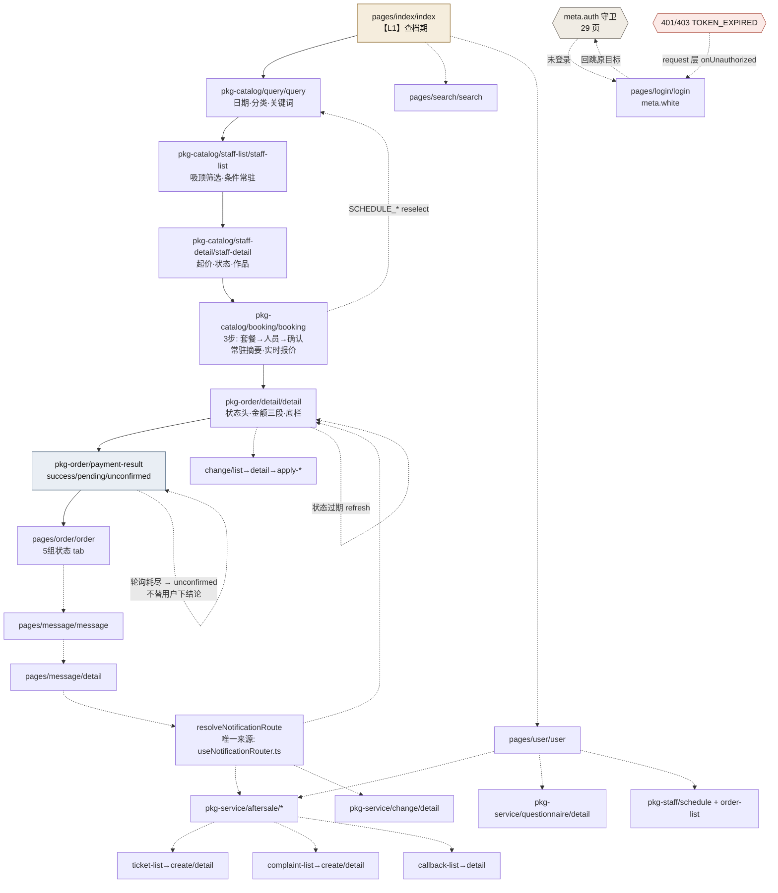

# 02 · 体验规范与逐页改造说明

> Phase 2 交付｜编制：体验设计负责人（ux-ui-designer）｜日期：2026-11-05
> 落地对象：`newuniapp/`（42 页 / 5 分包 / 10 个基础组件）。`uniapp/` 为线上存量端，仅作迁移对照，不在本次范围。
> 上游依据（已裁决，本文件不改写其任何取值）：`docs/redesign/01-视觉方向.md`（Phase 1，12 章 + 附录 A/B，下称「视觉规范」）、`docs/redesign/00-现状基线.md`。
> 代码复核：`newuniapp/src/pages.json`、`composables/useNotificationRouter.ts`、`request/error.ts`、`request/index.ts`、`request/http.ts`、`shared/contracts/error-codes.ts`、`components/base-empty/base-empty.vue`、`components/status-tag/status-tag.vue`、`components/base-input/base-input.vue`，以及 index / user / order / message(+detail) / search / query / staff-list / staff-detail / booking / pkg-order/detail / payment-result / aftersale/index / questionnaire/detail / schedule 等重点页 template。
> 硬约束（不可谈判）：保留现有功能逻辑、主要操作路径、核心内容；**不新增 / 不删除 / 不重排任何业务步骤**；`meta.auth` 登录守卫、状态机、接口契约、文案语义、`useNotificationRouter.ts` 消息路由唯一来源均不动。本文件只产出**体验层规范与逐页改造说明**，不修改 `src/` 下任何源码、不改其他已有文档、不改动任务列表、不改 Phase 1 的任何视觉取值。
> 全程引用 Phase 1 §7 的 15 类组件可视规格（§7.1–§7.15）与附录 A 的 token 增量，**本文件不另定尺寸、不另起视觉方向**；凡涉及尺寸/色值/字重/间距，一律写「见视觉规范 §x.x」。

---

## 0. 本文件的定位、咬合关系与复核事实

### 0.1 与 Phase 1 的咬合（冲突时的裁决顺序）

| 层级 | 文件 | 管什么 | 本文件的关系 |
|---|---|---|---|
| ① 取值 SSOT | `newuniapp/src/styles/tokens.css` | 色 / 字号 / 间距 / 圆角 / 阴影 / 时长 / 缓动的**数值** | 只读引用，不改写 |
| ② 视觉语义 SSOT | `01-视觉方向.md` | 变量语义角色、组件**可视规格**、对比度、状态契约视觉侧 | 只读引用，逐条对齐 |
| ③ **体验语义 SSOT** | **本文件 `02-体验规范与逐页改造.md`** | 信息架构 / 交互流程 / 状态**行为**矩阵 / 文案 SSOT / 组件**交互契约** / 逐页改造 / 适配与无障碍 | 本轮产出 |
| ④ 事实基线 | `00-现状基线.md` | 页面地图、问题清单、口径裁决 | 逐页覆盖表的页面清单依据其 §2 |
| ⑤ 代码 | `newuniapp/src/**` | 现状事实 | 复核依据，凡与文档冲突以代码为准并登记为开放项 |

**分工一句话**：视觉规范回答「长什么样、用哪个变量」；本文件回答「什么时候出现、出现后能做什么、谁负责、怎么读屏、窄屏怎么退让、逐页改哪里」。二者相加才是 Phase 3 可编码的完整规格。

### 0.2 输出规范对应导航（便于评审按图索骥）

| 交付要求 | 所在章节 |
|---|---|
| 任务流程图 | §5.3（交易 / 订单 / 个人中心 / 售后三子链路 / 消息路由 / 登录守卫，含状态分支） |
| 关键界面线框要点 | §1.6（7 类模板首屏与区块线框要点） |
| 响应式策略 | §2（断点换算表 + 逐条退让规则 + 不提供夜间/大字模式口径） |
| 无障碍清单 | §3.7（可逐条勾选） |
| 高风险交互与降级方案 | §7.9（登记表）+ §4.4 / §4.7（资金与提交类降级） |
| 信息架构 / IA | §1 |
| 状态反馈体系 | §4（重点） |
| 逐页改造 | §5（42 页全覆盖 + 15 个重点页展开） |
| 组件交互契约 | §6（10 现有 + 6 缺件） |
| 异常边界 | §7 |
| Phase 3 交接 | §8 |

### 0.3 本轮代码复核发现的 6 项事实（供主理人中转裁决，非改 Phase 1 取值）

> 与 Phase 1 §0.2 同性质：均为**代码现状的落地范围问题**，不触碰任何已裁决视觉取值。凡「需裁决」项已汇总至 §8.3。

| # | 任务书 / 上游表述 | 代码实测 | 体验侧处理 |
|---|---|---|---|
| E1 | 「针对 `booking` 的 `:disabled="!canSubmit"` 静默禁用给修复建议」 | `booking.vue` **不存在** `canSubmit`，也不禁用提交按钮；实际用 `submitHint`（`booking.vue:209` 渲染、`:356-363` 计算）把「还需填写联系人姓名 / 手机号 / 服务地址 / 报价未生成」**说在按钮上方**，按钮常可点、点击后由 `handleSubmit` 校验 | 判定 `booking` 是「禁用态必须可解释」的**正面参考实现**，应作为全站范式推广，而非修复对象。真正的静默禁用在 `staff-detail.vue:139 :disabled="!available"`（`立即预约` 灰着不给原因）、`pkg-order/detail.vue:118-124`（`payReason` 作为按钮文字解释原因，但仍 `:disabled="true"`）、`questionnaire/detail.vue:35/45 :disabled="!editable"`（配合 `:15`「已提交，不可修改」算有解释）。修复建议按真实位置给出，见 §3.5。**需主理人确认口径**。 |
| E2 | 状态反馈「文案分散在页面，无 SSOT」 | 更严重：**26+ 页的 `base-empty` 把 `error-kind` 写死为 `"network"`**（`index:20`、`order:25`、`message:25`、`staff-list:40`、`staff-detail:7`、`booking:31`、`pkg-order/detail:7`、`schedule:38`、`search:75`、`questionnaire:7`、`favorite:7`、`agreement:7`…），与 `request/error.ts` 的 `retryStrategy` 四态**完全脱节**：401、业务态不允许、参数缺失一律显示「网络开小差了」+「重新加载」 | 定为状态体系**头号 P0 缺陷**。给 `resolveErrorView` 统一映射（§4.6）+ 全站替换清单（§8.1）。这是「不可重试错误给重新加载」「把故障/权限伪装成网络问题」的系统性根因。 |
| E3 | 「`payment-result` 三按钮用历史别名 `variant="brand"`」（Phase 1 §9.2 A14） | `variant="brand"` **遍布 20+ 页**：`payment-result:20`、`settings:44`、`profile:65`、`query:64`、`order:65`、`message/detail:27`、`staff-detail:136`、`booking:213/220`、`login:13/53`、`pkg-order/detail:111/128`、`questionnaire:95`、`review/publish:103`、`review/list:42`、`change/apply-date:56` / `apply-pause:71` / `apply-addon:65`、`callback-list:33`、`callback-detail:89`、`customer-service:32` 等 | Phase 1 §9.3 已裁决废弃 `brand`/`primary` 别名（等价 `ink`/`gold`），但 §9.2 A14 仅点了 `payment-result`。**需扩展为全量替换**，且替换后须满足「一屏仅 1 个 `ink` 主 CTA」——多按钮页需按 §4.4 重排主次，不能只做字符串替换。 |
| E4 | 结果页三态 `success / fail / pending`（Phase 1 §7.11） | `payment-result.vue` 的 `state='fail'` **并非「支付失败」而是「未查到结果 / 待确认」**：标题「支付结果待确认」(`:73`)、文案「暂未查到支付结果，请勿重复支付」(`:79`) 是**正确的不替用户下结论**，但图标 `close-circle-fill` + `--c-danger`(`:60/66`) 传达「失败」，与文案语义冲突；`pending` 用 `--c-warning`(`:67`) 而 Phase 1 §7.11 规定 pending 用 `--c-info` | 体验侧建议把第三态展示语义定为 **`unconfirmed`（待确认）**：图标 `clock-fill` + `--c-info`、文案保持不替用户下结论、主操作「查看订单」、次操作「重新支付」需先经 `queryPayState` 回查（代码 `:121-131/139-148` 已实现，保留）。**图标/语义是否调整需产品 + 主理人确认**（不改业务状态变量名亦可仅在展示层处理）。另 `pending` 的 `--c-warning → --c-info` 属 Phase 1 规格对齐，需主理人确认是否纳入本轮。 |
| E5 | tabBar 6 张 PNG 零引用（Phase 1 §0.2-3 / §6.3） | `app-tabbar.vue` 确走 `u-icon` iconfont；但 `pages.json:297-328` 的 `tabBar.list` **仍保留 4 组 `iconPath` / `selectedIconPath` 指向 6 张 PNG**（`home.png`/`home_s.png`/`news*.png`/`user*.png`），且 `"custom": true` | 自定义 tabBar 下该配置通常不渲染，属**配置残留**；建议 Phase 3 与 6 张 PNG 清理一并处理，或在配置层书面确认「不生效、不回归」。属前端实施项，非视觉项。 |
| E6 | 空/错态文案层级（Phase 1 §9.2 A13）、图标色（§6.6） | `base-empty.vue:5` loading 图标 `color="var(--c-brand)"` 违反「禁 `--c-brand` 作图标主色」；`:119-123` `empty__text` 为 `--fs-xs` / `--c-ink-3` / `line-height:1.6`（不在收敛后 4 档行高内）；`:76-101` `KIND_MAP` 文案与 §4.5 SSOT 待统一 | 组件层 P0：图标改语义变量、文案层级按 A13、行高按 `--lh-body`、四分类文案改读 SSOT 常量。属 Phase 1 已裁决范围内的落地补齐，无需新裁决。 |

### 0.4 全局硬约束（每张表、每个改造点都适用）

1. **业务不动**：页面路由、`meta.auth`、状态机、接口契约、文案语义、主要操作路径、步骤数恒定（booking 3 步）一律不改；本文件所有「改造」都是**表现层重排与状态反馈补齐**。
2. **视觉取值不动**：色值、字号、间距、圆角、字重、行高、动效时长、图标尺寸只引用 `tokens.css` 与视觉规范 §7，**不新增第 7 档字号 / 第 6 档圆角 / 第 8 档间距 / 第 4 档字重**。
3. **状态不得单一编码**：状态 = 语义色 + 形状 + 中文状态词（视觉规范 §1.6 原则二）；层级 = 字重 / 字号 / 上留白至少两项；控件 = ≥3:1 边界 + 88rpx 热区 + 按下态。
4. **失败文案纪律**：不替用户下结论（轮询超时 ≠ 支付失败）、不把故障 / 权限 / 参数缺失伪装成空态或网络问题、不可重试错误不给「重新加载」。
5. **一屏一个主目标、一屏一个 `ink` 主 CTA**；金色单屏 ≤2% 且不承载文字。
6. **375px 基准屏截图判字号/间距误差；320px 只判溢出 / 遮挡 / 可读性**（视觉规范 §3.5 配套纪律 2）。

---

## 1. 信息架构与层级规则

### 1.1 全站 4 级信息层级定义

> 层级不是「字号大小」，而是**用户扫读时的决策顺序**。每一级都要能被「字重 + 字号 + 上留白」中至少两项区分（视觉规范 §1.6），且不得靠色块或 900 字重分区。

| 级别 | 名称 | 定义 | 唯一职责 | 排版承载（引用视觉规范） | 单屏数量 |
|---|---|---|---|---|---|
| **L1** | 页面主目标（Page Goal） | 用户进这一页要完成的**那一件事** | 决定主 CTA 与首屏焦点 | H1 `--fs-2xl`/`--fw-medium`，或 Display `--fs-2xl`/`--fw-semibold`（§3.1）；配唯一 `ink` 主 CTA（§7.3） | **恰好 1 个** |
| **L2** | 区块（Section） | 支撑主目标的成组信息 | 分组与命名，让用户不迷路 | `section-header`（§7.8）：H3 `--fs-lg`/600，上 `--sp-5` 48rpx / 下 `--sp-3` 24rpx；金色竖条每屏 ≤2 条 | **≤2 条带竖条**，其余用纯文字 + 上留白 |
| **L3** | 条目（Item） | 可扫读 / 可点的具体对象（一张订单、一位人员、一条消息） | 承载主信息与可执行动作 | `base-card`（§7.4）+ `status-tag`（§7.5）+ `price`（§7.9）；标题 H3、次信息 L2 色、辅助 L3 色 | 不限，但**禁止卡片套卡片** |
| **L4** | 辅助信息（Meta） | 时间戳、订单号、说明、单位、角标 | 可查证，不抢焦点 | Caption `--fs-md`/400/`--c-ink-3`（中文）；Meta `--fs-xs`/500（仅数字 / 拉丁 / 角标）；--lh-body | 不限 |

**关键判定**：L1→L2→L3→L4 的视觉权重必须**单调递减**；任何一级若比上一级更「重」（更大、更黑、更满、带色块），即为层级反模式（§1.7）。

### 1.2 4 级层级在 7 类页面模板中的映射

> 模板分类 T1–T7 是 §5.1「42 页全覆盖表」的归类依据；同一模板共用同一套层级映射与状态契约。

| 模板 | 归类 | L1 页面主目标 | L2 区块 | L3 条目 | L4 辅助信息 | 代表页 |
|---|---|---|---|---|---|---|
| **T1 门户 / 枢纽** | Portal / Hub | 首页＝「查档期」；我的＝「进入我的订单/服务」；售后＝「选一条售后链路」 | 服务分类 / 快捷入口 / 三条售后入口 / 推荐区 | 卡片式入口、分类格、菜单行 | 品牌 stats、副标题、角标数字 | `index`、`user`、`aftersale/index` |
| **T2 列表** | List（分页 / 筛选 / 状态） | 「找到并进入某一条」 | 状态 tab 组、筛选条、结果分组 | 订单卡 / 人员卡 / 消息卡 / 工单卡 | 订单号、时间、地区、创建时间 | `order`、`message`、`staff-list`、`search`、`favorite`、`review/list`、`waitlist`、`*-list`、`order-list` |
| **T3 详情** | Detail（只读 + 状态头 + 金额/底栏） | 「看懂当前状态并做下一步」 | 状态头、服务项、金额三段、订单信息、正文 | 服务项行、kv 行、正文卡 | 订单号、下单时间、联系人、地址、类型 | `pkg-order/detail`、`staff-detail`、`message/detail`、`article-detail`、`*-detail`、`questionnaire/detail` |
| **T4 表单 / 编辑** | Form（录入 + 校验 + 提交） | 「填完并提交」 | 表单分组、常驻摘要（booking）、题目卡（问卷） | 字段行（FormField）、选项、上传位 | label、hint、错误文案、必填星号 | `query`、`booking`、`login`、`profile`、`settings`、`review/publish`、`*-create`、`apply-*` |
| **T5 结果 / 反馈** | Result | 「确认结果并决定去向」 | 状态图 + 标题 + 金额 + 轮询进度 + 操作组 | 金额卡 | 说明文案、轮询计数 | `payment-result` |
| **T6 内容 / 静态** | Content / Static | 「读完 / 联系到」 | 段落标题 | 正文段落、协议条款、客服入口 | 版本、版权、更新时间 | `agreement`、`about`、`customer-service`、`webview` |
| **T7 日历 / 特殊可视化** | Calendar | 「看清哪天可约」 | 月份切换、汇总、图例、选中日详情 | 日期格、当日订单卡 | 星期表头、汇总数字、图例文字 | `schedule` |

### 1.3 「首屏只保留一个主目标」判定规则（可逐条勾选）

一个页面通过**全部** 6 条，才算「首屏单主目标」：

1. **主 CTA 唯一**：首屏（不滚动）内 `ink` 实心主按钮恰好 1 个（视觉规范 §7.3）；其余动作降级为 `ghost` / `text` / 卡片点击。T1 首页的「查档期」是 L1 主目标对应的唯一主入口，搜索胶囊/Tab 不是 CTA。
2. **H1 唯一**：首屏 `--fs-2xl` 级标题 ≤1 个；`section-header` 是 H3，不与 H1 抢层级。
3. **主目标在折线之上**：320px 窄屏首屏内，L1 主目标 + 其主 CTA 必须可见（首页硬要求：「查档期」+ ≥2 个分类入口，视觉规范 §4.5）；不允许靠滚动才能开始主任务。
4. **hero 不挤占**：hero 视觉区 320–400rpx，废弃 560rpx（`index.vue:383` 现状）；hero 内文案 ≤2 行、不堆 3 行以上。
5. **区块数受控**：首屏内 `section-header` 带金色竖条 ≤2 条；首屏区块（L2）≤2 个，其余下沉。
6. **焦点不被打断**：首屏不出现全局遮罩、启动页、全屏渐变；骨架屏尺寸接近最终内容、不带边框/阴影（§7.10）。

> 反例登记：`index.vue` 现状 560rpx hero + 搜索胶囊浮层 + 轮播 + 主 CTA + 服务分类 + 品牌 stats + 引导图 swiper + 推荐人员，首屏塞了 5 个 L2 区块且主目标被稀释；`user.vue` hero 渐变 + 倒计时 + 4 张卡（我的订单/待处理/角色中心/菜单）同屏，需按 §5.4 重排。

### 1.4 视觉焦点分配

**（1）单屏主 CTA 唯一（视觉规范 §7.3 / §1.6）**

| 规则 | 落地 |
|---|---|
| 一屏 1 个 `ink` | 多动作页（订单详情底栏「去支付 / 更多 / 联系顾问」、支付结果三按钮、booking 底栏）按 §4.4 定主次，只保留 1 个 `ink` |
| 主 CTA 位置 | 跟随主任务：表单/详情在**吸底操作栏**（`action-bar`），列表/门户在**内容区首屏**，结果页在**操作组首个** |
| 次动作 | `ghost`（次）→ `text`（第三）；`danger` 仅用于危险动作且必须配确认框 |
| 禁止 | 一屏 2 个 `ink`；把 `gold` 当默认主 CTA（§7.3）；`variant="brand"` / `"primary"` 历史别名（现状 20+ 处，见 E3） |

**（2）金额与状态的扫读路径**

婚庆场景是「先确认状态、再核对金额、再决定动作」，扫读路径固定为**左→右、上→下**：

```
[L3 条目卡]
  行1：订单号(L4 左) ────────────────── 状态标签(左对齐语义色+形状+中文词, 右端)
  行2：标题/姓名(L3 主信息, ≤2 行) ──── 金额(右对齐, 不换行, tabular-nums)
  行3：时间/地区(L4) ────────────────── 次动作(ghost sm / text sm)
```

| 约束 | 依据 |
|---|---|
| 状态标签**左**、金额**右**，同一行时中间最小 `--sp-3` 24rpx | 视觉规范 §3.6-8 / §4.4 |
| 金额一律右对齐、基线对齐、`white-space: nowrap`、不换行 | §3.6-8 / §7.9 |
| 金额与状态标签垂直 `align-items: center`；长标题最多 2 行 `ellipsis-2`，禁「切一半」 | §4.4 |
| 状态标签 = 语义色 + 10rpx 状态点/24rpx 图标 + 中文状态词 + 600 字重 + 1rpx 同色调描边 | §2.4 / §7.5 |
| 一个条目内金额只出现 1 个主数字（合计/应付优先），「需付」等派生金额降为 L4 文字 | §7.9 状态变体 |

> 现状核对：`order.vue:41-56` 已是「行1 订单号+状态标签 / 行2 标题+金额 / 行3 时间+动作」的正确骨架，改造只做标签三重编码、金额千分位与右对齐收敛、`variant="brand"→ink`，**不重排 DOM 顺序**（保留项）。

### 1.5 标题层级与 400 / 500 / 600 组合规则

严格复用视觉规范 §3.1 语义角色表与 §3.2 三档字重，**不新增组合**：

| 层级 | 语义角色 | 字号变量 | 字重 | 行高 | 允许出现位置 |
|---|---|---|---|---|---|
| L1 | H1 / Display | `--fs-2xl` | H1 `500` / Display `600` | `--lh-tight` | 页面主标题、结果页标题（≤1 个/屏） |
| L2 | H2（区块/金额摘要） | `--fs-xl` | `600` | `--lh-tight` | 订单「合计」、结果页副标题 |
| L2 | H3（`section-header` / 卡片标题 / 导航标题） | `--fs-lg` | `600` | `--lh-tight` | 区块标题、卡片标题 |
| L3 | Body | `--fs-md` | `400` | `--lh-body` | 正文、输入、列表主信息、按钮 md |
| L4 | Caption（中文辅助） | `--fs-md` | `400` | `--lh-body` | 时间戳、错误文案、空态副文案（**中文最低此档**） |
| L4 | Meta（数字/拉丁/角标） | `--fs-xs` | `500` | `--lh-none` | 状态标签、tabBar 文字、¥ 前缀、单位 |
| — | Number（金额） | `--fs-number` | `600` | `--lh-none` | 仅 `price` `xl` 档 |

**组合铁律**：
- `600` **只用于单行标题与数字**（视觉规范 §3.2-3 小程序字体渲染限制），长段落一律 `400`；
- H1→H2→H3 必须同时变化「字号 + 字重」中的两项或「字号 + 上留白」，**禁止只放大字号 / 只换颜色就叫标题**；
- Body→Caption 靠字色（L1→L2→L3）与行高区分，**不再降字号**；
- 禁用 `700/800/900/bold`；真机若 600 合成粗体发虚，降级 `500` + 字号上调一档 + 上留白 `--sp-2`（§3.2 兜底 4），**不得改用 700**。

### 1.6 关键界面线框要点（7 类模板首屏结构）

> 以下是**结构顺序与层级要点**，不含尺寸数值（数值见视觉规范 §4.6「可直接抄用的组合表」）。箭头表示从上到下的阅读/操作顺序。

```
T1 门户（index）
  nav-bar.transparent（避让胶囊 --nav-capsule-reserve，见 §2.7）
  → 搜索胶囊（浮层，非 CTA；不阻断 hero 内容）
  → hero（≤400rpx，1 行标语 + ≤1 行副文案；320px 下不占近半屏）
  → 【L1】主入口「查档期」(唯一 ink 主目标；--sp-5 与 hero 相隔)
  → 【L2】服务分类 2×2 网格（320px 不折行；--sp-7 与主入口分区）
  → 【L2】推荐人员 / 案例（section-header ≤1 条竖条；横滑卡）
  → tabBar（--safe-bottom）

T1 枢纽（user / aftersale/index）
  → 身份/统计头（L1 一句话：我是谁 / 售后总览）
  → 【L2】核心入口组（user：我的订单四态快捷；aftersale：工单/投诉/回访三条）
  → 【L2】待办 / 菜单列表（L3 行，分隔线缩进 §5.4）
  → 退出登录（ghost，最低权重）

T2 列表（order / message / staff-list / search / *-list）
  → 状态 tab 组 或 吸顶筛选条（sticky，z-index 低于自定义导航，§7.7）
  → 条件数量 / 总数（L4，让用户知道「筛过了」）
  → 【L3】卡片列表（卡片间距 --sp-3 白名单；状态标签左、金额右）
  → LoadMore 四态（§7.13）
  → tabBar 或 吸底动作栏（--safe-bottom）

T3 详情（pkg-order/detail / staff-detail / message/detail）
  → 状态头（L1：中文状态词 + 形状 + 语义色；倒计时/提示 L4）
  → 【L2】服务项 / 正文（section-header 或纯文字）
  → 【L2】金额三段（订单金额 / 已支付 / 待支付，右对齐，合计 600）
  → 【L2】订单信息 kv（编号/时间/联系人，L4）
  → 吸底操作栏（1 个 ink 主 + ghost 次 + text 第三；--safe-bottom）

T4 表单（query / booking / *-create / apply-*）
  → 常驻摘要（booking：日期/套餐/人员，任何一步都可见）
  → Steps（booking 3 步，不可点；§7.15）
  → 【L2】表单分组（FormField 行，label 常驻，错误贴字段）
  → 报价 / 校验提示区（就地反馈，不弹窗打断）
  → 吸底提交栏（1 个 ink；submitHint 把禁用原因说在按钮上方）
  → 键盘弹起时底栏退让（§2.8）

T5 结果（payment-result）
  → 状态图（144rpx 语义形状；§7.11）
  → 【L1】状态标题（不替用户下结论）
  → 说明文案（L4 Caption 档，不伪装空态）
  → 金额（price xl，保留 2 位小数）
  → 轮询进度（pending 专属，可感知，§4.7）
  → 操作组（ink lg 主 + ghost md 次 + text sm 第三）

T7 日历（schedule）
  → 月份切换（纯图标控件须 aria-label）
  → 汇总（4 个数字 + 中文标签）
  → 星期表头 → 日期格（色 + 形状双编码，§7.15）→ 图例（形状与格内一致）
  → 选中日详情（section-header + 订单卡）
```

### 1.7 明确禁止的层级反模式（评审按条判定）

| # | 反模式 | 为什么错 | 替代做法 |
|---|---|---|---|
| 1 | 靠**色块 / 加深底色**分区（给区块标题加 `--c-brand-bg` 底、给卡片叠浅底块） | 本系统容器只靠 1rpx 描边分层，`--c-surface`/`-bg` 明度差仅 1.03–1.09:1（视觉规范 §2.1.1）；色块会与状态标签浅底混淆 | `section-header` 上留白 `--sp-5` + 600 字重 |
| 2 | 靠 **900 / 700 / bold** 字重造层级 | Android 合成粗体发虚、字宽跳变、320px 折行变位；存量端 900 泛滥即返工点 | 400/500/600 三档 + 字号 + 上留白 |
| 3 | **卡片套卡片**（`base-card` 内再放 `base-card`） | 1rpx 描边叠加成「硬框套硬框」，层级反而糊 | 同容器内用分隔线（缩进见 §5.4）+ 留白分组 |
| 4 | 区块标题（`section-header`）**每屏 >2 条带竖条** | 金色面积超单屏 2% 预算，且竖条泛滥等于没有强调 | 每屏 ≤2 条竖条，其余纯文字 + 上留白 |
| 5 | 一屏 2 个 `ink` / 2 个 H1 | 主目标不唯一，用户不知道先做什么（Nielsen：系统状态可见性 + 用户控制） | 1 个 `ink`、1 个 H1，其余降级 |
| 6 | 同字号只换颜色就叫标题 / 只放大字号 | 违反「层级至少两项同时变化」 | 字号 + 字重 或 字号 + 上留白 |
| 7 | 把辅助信息（时间/编号）做黑、做大、加框 | L4 抢 L3 焦点，扫读路径被打断 | L3 色 + Caption 档 + `--lh-body` |
| 8 | 首屏塞 ≥3 个 L2 区块 / hero 3 行以上文案 | 主目标被稀释，320px 主入口掉到折线下 | 首屏 L2 ≤2，hero 文案 ≤2 行 |
| 9 | 列表用阴影 / 渐变「浮起来」 | `--shadow-card: none`，描边是唯一容器语言 | 1rpx `--c-line` + `--r-md` |
| 10 | 状态只靠红绿浅底、只靠色点、只写「成功/失败」 | 色弱 / 截图 / 读屏不可辨 | 语义色 + 形状 + 中文状态词三重编码 |
| 11 | 错误态伪装成空态、故障伪装成「暂无数据」 | 用户会以为「本来就没有」，放弃可恢复操作 | 走 §4 状态矩阵，区分可重试 / 不可重试 |
| 12 | 用装饰元素（花体、金色渐变、插画）承载层级 | 与内容争抢、强光下不可读 | 可读性优先于装饰，冲突删装饰 |

---

## 2. 多屏适配与可读性

### 2.1 断点策略与 rpx 换算

uni-app / 微信小程序 `750rpx = 屏宽`，`1rpx = 屏宽 / 750`，**rpx 随屏宽等比缩放**——这是最易被忽略的可读性风险。以 375px 为设计基准，逐档实测（中文物理字号硬下限 **≥12px**）：

| 变量 | rpx | 320px (0.4267) | 375px (0.5) 基准 | 390px (0.52) | 414px (0.552) | 430px (0.5733) | 平板 768px (1.024) |
|---|---|---|---|---|---|---|---|
| `--fs-xs` | 24 | **10.24px** ❌ | 12.00px | 12.48px | 13.25px | 13.76px | 24.58px |
| `--fs-md` | 28 | **11.95px** ❌ | 14.00px | 14.56px | 15.46px | 16.05px | 28.67px |
| `--fs-lg` | 32 | 13.65px | 16.00px | 16.64px | 17.66px | 18.35px | 32.77px |
| `--fs-xl` | 38 | 16.21px | 19.00px | 19.76px | 20.98px | 21.79px | 38.91px |
| `--fs-2xl` | 48 | 20.48px | 24.00px | 24.96px | 26.50px | 27.52px | 49.15px |
| `--fs-number` | 64 | 27.31px | 32.00px | 33.28px | 35.33px | 36.69px | 65.54px |
| 页面左右边距 `--sp-4` | 32 | 13.65px | 16px | 16.64px | 17.66px | 18.35px | 32.77px |
| 图标 24 / 32 / 40 / 48 / 96 / 144rpx | — | 10.24 / 13.65 / 17.07 / 20.48 / 40.96 / 61.44px | 12 / 16 / 20 / 24 / 48 / 72px | 12.48 / 16.64 / 20.8 / 24.96 / 49.92 / 74.88px | 13.25 / 17.66 / 22.08 / 26.5 / 52.99 / 79.49px | 13.76 / 18.35 / 22.93 / 27.52 / 55.04 / 82.55px | — |

**结论（继承视觉规范 §3.5）**：320px 下 6 档里 **2 档跌破 12px**。落地采用视觉规范 §2.5 / 附录 A 已裁决的 **方案 A**：
```
--fs-xs: max(24rpx, 12px);
--fs-md: max(28rpx, 14px);
```
375px 及以上取值**完全不变**（截图误差 0）；320px 取 12px / 14px。前端须真机验证 `max()` 内 rpx/px 混合求值，不支持则走方案 B `@media (max-width: 340px)` 降级（视觉规范 §3.5）。

**断点行为表**：

| 断点 | 判定 | 触发的退让（逐条见 §2.2–§2.9） |
|---|---|---|
| ≤340px（窄屏） | 320 / 小屏 Android | px 字号下限；hero ≤400rpx；分类 2×2 网格；金额 `xl→lg`；主目标 + ≥2 分类首屏可见；横滑卡首项回 32rpx 安全线 |
| 341–414px（主流） | 375 / 390 / 414 | 标准布局；仅做溢出与两行截断检查 |
| 415–500px（大屏手机 / 折叠屏内屏） | 430+ | 不额外加媒体查询；内容仍按 rpx 等比放大，靠 `max-width` 容器约束长行（§2.9） |
| ≥600px（平板 / 大屏 / H5 宽视口） | 768 / 1024+ | **rpx 会把 24rpx 放到 24.58px、64rpx 放到 65px**，字/图过大且行长失控：走 §2.9 容器约束与 H5 定制，不改 token 取值 |

### 2.2 文字可读下限（逐条，可检查）

| # | 规则 | 落地 / 依据 |
|---|---|---|
| 1 | 中文物理字号 ≥12px | `max()` 下限保护（§2.1）；320px 用开发者工具量测，不靠目测 |
| 2 | `--fs-xs` **永不承载中文句子**、错误文案、关键状态词 | 中文辅助说明最低 `--fs-md`（Caption 档）；错误文案同样 `--fs-md`（视觉规范 §3.5 配套纪律 1） |
| 3 | 数字 / 拉丁 / 角标可放宽到 10px，但**不得承载语义** | 角标 20rpx 白名单（§7.2），`>99` 显示 `99+` |
| 4 | 常规文字对比度 ≥4.5:1；大字与非文字控件边界 ≥3:1 | 视觉规范 §2.2；`--c-ink-3 → #6b655c`（六类浅底全域 ≥4.89:1）、`--c-neutral → #605a51`（5.79:1） |
| 5 | 状态标签小字 24rpx 用 600 字重 + 1rpx 同色调描边 | 视觉规范 §2.4（`--c-{tone}-border` 6 个新增） |
| 6 | 行高只 4 档：`--lh-none 1` / `--lh-tight 1.25` / `--lh-body 1.55` / `--lh-loose 1.7` | `page` 基础 `--lh-body`；`agreement`/`about`/`article-detail` 长文 `--lh-loose`；**禁止 `line-height:1.4/1.5/1.6`**（现状 `payment-result:221/231/259`、`base-empty:123` 需归位） |
| 7 | 中文正文不加字距；H3/Meta `0.01em`；大字/金额 `-0.01em` | 视觉规范 §3.4 |

### 2.3 两行截断与省略规则

| 场景 | 规则 | 依据 |
|---|---|---|
| 列表长标题（订单套餐名 / 人员姓名 / 消息标题 / 案例标题） | 最多 **2 行**，`ellipsis-2` + `--lh-body`；**禁止出现「切一半」的行**（容器高度按整行取整） | §4.4 |
| 单行省略（订单号 / 面包屑 / 常驻摘要「套餐」「人员」） | `ellipsis` 单行 + `white-space: nowrap`； booking 摘要 `brief__value.ellipsis`（`booking.vue:42/46`）保持 | §4.4 |
| 状态标签文案 | >8 字中文改用 `--fs-md` Caption 档并允许换行；**不缩字号硬塞** | §7.5 |
| 副说明 / 空态副文案 | 最多 2 行；超过用「展开」而非无限撑高 | §7.11 |
| 禁止 | 用 `opacity` 压淡文字表达截断；截断后不留「…」以外的提示；用固定 `height` 裁掉第二行 | — |
| 读屏 | 被截断的内容仍须完整可访问：完整文本放 `aria-label` 或详情可展开，不能只把可见文字读给读屏用户 | §3.4 |

### 2.4 长文本 / 长字段 / 大金额处理

| 对象 | 现状风险 | 处理规则 |
|---|---|---|
| **长姓名**（人员/联系人，含少数民族/复姓/英文） | 与「推荐」徽标、评分行抢位 | 姓名 `ellipsis` 单行；徽标为**独立 flex 项**且姓名区 `min-width:0` 才能生效；`aria-label` 给全名 |
| **长套餐名 / 长服务项名** | 列表 2 行后撑高卡片，金额基线不齐 | 2 行截断；卡片用 `align-items: center` 而非 `stretch`；金额列 `flex-shrink:0` 固定不换行（§1.4） |
| **长订单号**（`order_sn`，`order.vue:42`、`pkg-order/detail:75`） | 纯数字/字母串在 320px 溢出 | `font-variant-numeric: tabular-nums` + 允许**中间省略**（保留头尾各 6 位）或整行 `ellipsis`；点击复制（`copySn`，保留项）时复制**完整值**并 Toast 反馈；`aria-label` 读完整单号 |
| **大金额** | 现状无千分位（`formatMoney` 默认 `thousand:false`），5–6 位整数难扫读；`xl` 64rpx 在 320px 溢出 | ① `price` 显式 `thousand: true`（视觉规范 §3.6-1）；② 合计/应付/实收/支付结果**保留 2 位小数**（`trimZeros:false`）；③ `xl` 档仅 ≤6 位整数（`999,999.99` 内），超出自动降 `lg`；④ 金额行右侧预留 `--sp-4`，不与状态标签抢位；⑤ 整组 `nowrap` + 右对齐 |
| **长地址 / 长服务地址**（`pkg-order/detail:90 kv__v--wrap`） | 多行撑高 kv 行 | 允许 2 行 + `--lh-body`；超出折叠；不裁字、不降字号 |
| **超长问卷题目 / 选项**（`questionnaire/detail`） | 题目卡高度不定 | 题目 ≥2 行用 `--lh-body`；选项文字换行而非截断；单个选项热区仍 ≥88rpx |
| **纯数字汇总**（`schedule` 汇总、`aftersale/index` stats） | 大数字在平板过大 | 走 §2.9 容器约束；数字用 `tabular-nums` |

### 2.5 横滑卡与吸顶筛选的断点行为

**横滑卡**（`index` 推荐人员 `staff-scroll`、`query` 分类 `chips`、`search` 历史/热词 `chips`、`order`/`message` 状态 tab `scroll-x`）：

| 规则 | 落地 |
|---|---|
| 首项对齐 | 横滑容器**首项左缘始终回到 `--sp-4` 32rpx 安全线**，滚动回弹后不得留半项贴边（视觉规范 §7.7 禁止项） |
| 露出「还有更多」 | 末项刻意露出 1/3～1/2 宽度作为可滑提示；不放箭头按钮抢 CTA |
| 320px | 分类横排改 **2×2 网格**（不横滑），「查档期」+ ≥2 个分类首屏可见（§4.5）；人员横滑卡宽收敛但**热区不缩水** |
| 滚动冲突 | `scroll-x` 与页面纵向滚动共存；横向手势阈值内不触发页面 `@tap`（用 `hover-class` + 点击目标判定，避免误触进入详情） |
| 惯性回弹 | 关闭 `:show-scrollbar`；不自定义滚动条（现状已如此，保留） |
| 读屏 | 横滑容器给 `aria-label`（如「推荐服务人员，可横向滚动」）；每个卡可独立聚焦 |

**吸顶筛选**（`staff-list` `.filters`（`staff-list.vue:4-34`）、`order`/`message`/`search` 状态 tab）：

| 规则 | 落地 |
|---|---|
| sticky 层级 | 背景 `--c-surface` + `border-bottom: 1rpx solid var(--c-line)`；`z-index` **低于自定义导航**（视觉规范 §7.7），不得与 `navigationStyle: custom` 导航重叠 |
| 条件常驻 | 筛选条「改条件不必退回上一页」（`staff-list.vue:3` 注释，保留）；须展示「当前条件数量 / 总数」（`filters__count`，`staff-list.vue:30-32`） |
| 加载失败 | **保留已选条件**并显示重试入口，不清空（§7.7 状态变体）；联动空态时同样保留条件 |
| 键盘 / 弹层 | 打开 `picker` / 排序 ActionSheet 时吸顶条不被键盘顶飞；弹层关闭后条件与滚动位置恢复 |
| 320px | 3 组 chip + 总数在窄屏不折行：chip `min-width:120rpx`（§7.7）+ 总数降为 L4 独立行或省略，不允许 chip 文字截断成「日…」 |
| 禁止 | 用 `--c-line` 作 chip 边界（须 `--c-control-border`，≥3:1）；只改文字颜色表示已选；横向滚动首项不回安全线 |

### 2.6 fixed 底栏与 `env(safe-area-inset-bottom)`

| 项 | 规则 | 依据 / 现状 |
|---|---|---|
| 安全区变量 | 全站统一 `--safe-bottom: env(safe-area-inset-bottom)`（`tokens.css:87` 已定义），**业务代码不得直接写 `constant()/env()` 字面量**，只消费 `var(--safe-bottom)` | §9.1 保留项 |
| 吸底操作栏 | `padding-bottom: calc(var(--sp-2) + var(--safe-bottom))`；上边界 `1rpx --c-line` + `--shadow-float`（L2 层，同屏 ≤1，§5.5） | §4.6 组合表；`booking .action-bar`（:204）、`pkg-order/detail .action-bar`（:99）、`staff-detail .action-bar`（:129）均需复核 |
| 自定义 tabBar | 高 `100rpx` + `padding-bottom: var(--safe-bottom)`；页面底部须留 `tabbar__space` 占位（现状 `user.vue:103` 有，保留） | §7.2 |
| 抽屉 / 半屏弹层 | 底部操作栏 `calc(var(--sp-3) + var(--safe-bottom))`；Dialog ≤320px 宽 `calc(100vw - 96rpx)` | §7.14 |
| 结果页 | `payment-result.vue:190` 已用 `calc(var(--sp-5) + var(--safe-bottom))`，**保留** | — |
| 禁止 | 底栏固定却不加 `--safe-bottom`；遮罩上再叠第二层遮罩；L2/L3/L4 三层同时出现 | §5.5 |
| 页面占位 | 有 fixed 底栏的页面，内容区末尾必须有等高占位块，保证最后一条可滚到可视区 | §7.11 / §4.6 |

### 2.7 状态栏与胶囊避让

| 项 | 规则 | 依据 |
|---|---|---|
| 状态栏 | `nav-bar` 状态栏占位 = `getDeviceInfo().statusBarHeight` px **动态取值** + `--bar` 44px；`totalHeight = statusBarHeight + 44` | §7.1 |
| 胶囊预留 | `--nav-capsule-reserve: 200rpx`（100px @375，新增）：有胶囊的页面，`nav-bar __right` slot 加 `margin-right: var(--nav-capsule-reserve)`，或**直接不下发右侧 slot**、把动作下沉内容区 | §7.1 胶囊契约 |
| 禁止 | 右侧动作被胶囊遮挡；导航内堆 ≥2 个动作；固定导航不渲染等高占位块 | §7.1 |
| 透明 / 实底 | `transparent` 态不占位、内容从顶部起（`index.vue:3`、`user.vue:5`）；`fixed + 实底` 渲染等高占位块；滚动切实底用 `--dur-base 240ms` | §7.1 状态变体 ③ |
| H5 差异 | `globalStyle.h5.navigationStyle: custom`（`pages.json:293-295`）与 `index` 页 `navigationStyle:custom` 叠加可能冲突——**阶段四遗留真机项**，Phase 3 须书面结论，不得「应该没问题」结案 | 视觉规范 §9.5 / 附录 B |

### 2.8 键盘弹起、`cursor-spacing` 与滚动冲突

| 项 | 规则 | 现状 / 依据 |
|---|---|---|
| `cursor-spacing` | `base-input` 保持 `cursor-spacing: 120`（`base-input.vue:19`）；页面自写 `<input>`（`query.vue:48`、`search.vue:7`、`questionnaire/detail.vue:29/39`）须显式补齐，避免输入框被键盘盖住 | §7.6 |
| `adjust-position` | `search.vue:14 :adjust-position="false"` 为自定义避让，**保留**；但须验证键盘弹起时结果列表仍可滚动、取消按钮可见 | 阶段四真机项 |
| fixed 底栏 vs 键盘 | 键盘弹起时吸底提交栏须退让（上移或临时隐藏），不得盖住当前输入字段；`booking` 第 3 步表单 + 吸底提交栏是**高风险点** | §7.6「fixed 底栏须避让键盘」 |
| 焦点滚动 | 聚焦字段自动滚入可视区（`bindfocus` / `scroll-into-view`），提交失败后**滚动到首个错误字段**（§7.6 禁止项） | §3.5 |
| 按下态 vs 滚动 | `hover-class="is-pressed"` 只在真正 `@tap` 时生效；`scroll-view` 内滑动不触发按下态（用 `hover-stay-time` 与手势阈值）；禁止 `transform: scale()` 制造按压（文字模糊，Dialog 0.04 缩放是唯一例外） | §8.2 |
| 滚动冲突 | `sticky` 筛选条 × 自定义导航、`scroll-x` × 页面纵向、`picker` 弹层 × 页面滚动——三项为阶段四遗留真机验证项，Phase 3 须给书面结论 | 视觉规范 §9.5 |

### 2.9 平板 / 大屏与 H5 宽视口

**问题**：rpx 线性放大，768px 下 `--fs-xs` ≈24.6px、`--fs-number` ≈65.5px，字与图过大、行长失控；本系统**不提供专门的平板版式**（不新增断点档 / 不新增字号档）。

**容器级约束（不改任何 token 取值）**：

| 规则 | 落地 |
|---|---|
| 内容最大宽 | 页面内容容器 `max-width`（建议 750rpx 等价上限）+ 水平居中；超宽视口两侧留 `--c-bg` 底，不拉伸文字与卡片 |
| 通栏元素 | hero / 吸顶筛选 / 吸底栏可满幅，但**内部文字仍回到 32rpx 安全线内**（§4.2） |
| 金额 / 大数字 | 走 §2.4 降档规则，不因屏宽放大到溢出 |
| H5 | 复用小程序断点规则；`navigationStyle:custom` 冲突（§2.7）单独验证 |
| 禁止 | 为平板新增第 7 档字号 / 媒体查询改 token 取值 / 单独切一套组件；不改 `--font-sans` |

### 2.10 「不提供夜间模式 / 大字模式」的口径与补偿措施

**口径（与视觉规范 §2.7 一致，本文件不改写）**：本系统只提供一套浅色品牌主题，**不做可切换暗黑模式**（五态 `-bg` 需整套重配、深墨主 CTA 需重定义、空态图标与 hero 需重画；运行时主题死链路刚清理，不得复活）；**不做独立「大字模式」开关**。

| 用户需要 | 不做什么 | 补偿措施（本轮必须做到） |
|---|---|---|
| 暗光 / 强光可读 | 不做暗色皮肤 | ① 对比度留余量：正文最低 4.89:1（`--c-ink-3` 加固）、neutral 5.79:1、主 CTA 18.05:1；② 控件边界 `--c-control-border` 3.83/3.55:1；③ 不靠明度差分层，靠 1rpx 描边（强光下仍可辨） |
| 老花 / 弱视放大 | 不做 App 内字号开关 | ① 中文物理字号 ≥12px 且 320px 有 `max()` 下限；② 状态三重编码（色 + 形 + 中文词），放大后不依赖颜色；③ 88rpx 热区，放大后仍可点；④ 容器用 `min-height` 而非固定 `height`，允许换行、不裁剪、不遮挡（微信「字体放大」下不承诺固定版式，但**不得出现关键内容遮挡**，视觉规范 §3.5 配套纪律 3） |
| 系统字体缩放 | 不覆盖 / 不锁定 | 不写死行高 px（用 `--lh-*` 无单位档）、不写死容器高、不 `overflow:hidden` 裁文字；`letter-spacing` 用 `em` 相对单位 |
| 色弱 / 读屏 | 不做「高对比模式」皮肤 | 形状编码 + 中文状态词 + `aria-label` + 焦点顺序 + 错误三重表达（§3） |
| 减少动效 | 不做动效开关 | 尊重 `prefers-reduced-motion`：动效降 0ms、骨架改静态色块，但**静态状态完整保留**（§8.3 原则 4） |

---

## 3. 触控与无障碍

### 3.1 所有可点元素 ≥88rpx 热区（实现约定）

| 元素 | 视觉尺寸 | 热区实现 | 依据 |
|---|---|---|---|
| `base-button` md / lg | 88 / 104rpx | 自身即 ≥88rpx | §7.3 |
| `base-button` **sm** | 60rpx | **`::before` 上下各扩 14rpx → 88rpx**（现状 `base-button.vue` 已正确实现，`min-width:88rpx`，**保持不改**） | §7.3 / 基线 §4.7 |
| `section-header`「更多」 | 文字 + 24rpx 箭头 | `min-width/min-height: 88rpx` + `margin: -24rpx 0`（现状保持，但不遮挡相邻内容） | §7.8 |
| `base-input` / picker 行 | 行高 88rpx | 整行热区 + `hover-class="is-pressed"` | §7.6 |
| 筛选 chip | 60rpx | 透明上下 padding 或伪元素扩到 ≥88rpx；`min-width:120rpx` | §7.7 |
| 纯图标控件（返回 / 关闭 / 收藏 / 分享 / 日历翻月 / 清空） | 24–40rpx 图标 | 外层 `≥88×88rpx` 容器，图标居中 | §6.5 |
| 卡片 / 列表行 clickable | 整卡 | 整卡热区 + 右侧 32rpx `arrow-right` | §7.4 |
| `LoadMore` error 态 | 88rpx 行 | 整行 88rpx 可点 | §7.13 |
| tabBar 4 项 | 100rpx 高 | 等分 flex:1，整项热区 | §7.2 |
| 状态标签 | 默认**不可点** | 若业务要求可点：边界改 `--c-control-border` + 热区 ≥88rpx + 按下态 | §7.5 |

**禁止**：视觉尺寸 <88rpx 又不用伪元素扩热区；用 `padding` 扩热区却改变布局尺寸；相邻热区互相重叠导致误触。

### 3.2 相邻可点元素最小间距

| 场景 | 最小间距 | 理由 |
|---|---|---|
| 并排按钮（吸底栏「更多 / 去支付」） | `--sp-2` 16rpx | §4.6 组合表 |
| 卡片内多个动作（收藏星标 / 去支付 / 查看详情） | `--sp-2` 16rpx，且各自独立 88rpx 热区不重叠 | 防误触；`order.vue:61-77` 的 `@click.stop` 保持（防冒泡触发整卡跳转） |
| 同一行多个图标 | `--sp-2` 16rpx，尺寸必须相同 | §6.5 |
| chip 组 | `--sp-2` 16rpx | §7.7 |
| tabBar 项 | 等分，无额外间距但热区不重叠 | §7.2 |
| 「更多」与相邻内容 | 负 margin 可回收视觉空隙，但**热区不得覆盖相邻可点元素** | §7.8 |

> 误触高风险（`danger` 动作：删除、取消订单、退款、退出登录）必须**额外**配确认框（Dialog / Sheet，§7.14），且危险确认**不允许点遮罩关闭**。

### 3.3 纯图标控件 `aria-label` 覆盖清单

现状部分已做（`booking.vue:233` 关闭、`staff-list.vue:85` 收藏、`staff-detail` 等），须覆盖到全站：

| 控件 | 必须 `aria-label` | `aria-role` | 现状核对 |
|---|---|---|---|
| 导航返回 `action.back` | 「返回」 | button | 无返回栈时回首页，label 不变 |
| 弹层 / 抽屉关闭 `action.close` | 「关闭」 | button | `booking.vue:233` 已有 ✅ |
| 分享 `action.share` | 「分享」 | button | 待补 |
| 收藏星标 `action.favorite` | 「收藏」/「取消收藏」**随状态切换** | button | `staff-list.vue:85` 已有 ✅ |
| 搜索清空 | 「清空搜索内容」 | button | `search.vue:17` 待补 |
| 日历上/下月 | 「上一个月」/「下一个月」 | button | `schedule.vue:5/9` 待补 |
| tabBar 4 项 | 「首页 / 订单 / 消息 / 我的」+ 角标数（如「消息，3 条未读」） | tab | §7.2 要求必带 |
| 筛选 chip 下拉箭头 | 随 chip 文案（如「选择日期」） | button | `staff-list` / `query` 待补 |
| 复制订单号 | 「复制订单号」 | button | `pkg-order/detail:75` 待补 |
| 评分星标（问卷） | 「第 n 星，共 5 星」 | button/radio | `questionnaire/detail:77-89` 待补 |
| 图片放大 / 凭证预览 | 「查看大图」 | button | 待补 |

**规则**：
- `aria-label` 描述**动作与对象**，不描述外观（「关闭」而非「叉号图标」）；
- 状态型图标（收藏、已读、选中）的 label **随状态更新**；
- 纯图标承载关键动作（支付、删除、退款、提交、返回）**必须同时有中文文字或 `aria-label`**（§6.6）；
- 装饰性图标（区块竖条、状态点、分隔线）`aria-hidden="true"`，不进读屏顺序。

### 3.4 状态三重编码、焦点与读屏顺序

**（1）状态三重编码**（视觉规范 §1.6 原则二 / §2.4）：

| 位置 | 色 | 形 | 中文词 |
|---|---|---|---|
| `status-tag` | `--c-{tone}` / `-bg` / 1rpx `-border` | 10rpx 实心状态点或 24rpx 语义图标 | 必须含「待付款 / 已锁档 / 支付失败 / 处理中」等**状态词**，禁止只写「成功/失败」或只写符号 |
| 日历格（schedule） | 可约 `--c-success` / 占用 `--c-neutral` / 不可约 `--c-line-strong` / 冲突 `--c-danger` | 实心点 / 空心圈 / 斜线 / 叉，**每格有形状差异** | 图例 + 选中日详情用中文说明 |
| Steps | 当前 `--c-ink` / 未达 `--c-line-strong` / 失败 `--c-danger` | 实心 + 外圈 / 空心 / 反白勾 / 错误标 | 三段步骤名（文案裁决见 §8.3） |
| 表单错误 | `--c-danger` 底线 | 错误图标（可选） | **错误文案 + 字段定位**，禁止只用红色 |
| 空/错态 | 语义色 | `empty-*` 96rpx 字形 | 主文案 + 副说明（§7.11） |

**现状缺陷**：`status-tag.vue:2` 目前只渲染 `<text class="tag">{{ label }}</text>`，**无形状编码、无 1rpx 描边、字重非 600** → 属组件层 P0（视觉规范 §7.5 已给规格）。

**（2）焦点 / 读屏顺序**：

| 规则 | 落地 |
|---|---|
| DOM 顺序 = 视觉顺序 = 读屏顺序 | 不用 `order` / 绝对定位把视觉提前而 DOM 靠后；吸底栏在 DOM 末尾但读屏时须可读到（不能 `aria-hidden`） |
| 页面主目标优先 | 首屏读屏先读 L1 标题与主 CTA，再 L2 区块，再 L3 条目；`section-header` 用 `aria-role="heading"` 语义（若平台支持） |
| 弹层焦点 | 打开 Dialog / Sheet 焦点移入面板；**关闭后焦点回归触发按钮**（§7.14 禁止项）；危险确认不可点遮罩关闭 |
| 遮罩 | 遮罩层不进读屏顺序；弹层打开时背景内容不可聚焦（避免读屏穿透） |
| 横滑容器 | 给整体 `aria-label`；卡内元素独立聚焦；不用「循环焦点」 |
| tabBar | `aria-role="tab"` + 选中态 `aria-selected`（§7.2） |
| 加载 / 状态变化 | 骨架屏 `aria-hidden="true"`；状态切换用 `aria-live` 轻量播报（见 §3.5） |

### 3.5 表单错误播报与「禁用态必须可解释」

**（1）表单错误**：

| 规则 | 落地（引用 §7.6） |
|---|---|
| 常驻 label | 禁止用 placeholder 代替 label；label `--fs-md`/500/`--c-ink` |
| 错误贴字段 | 错误文字在**字段正下方**、左缘与输入框左缘对齐（`calc(140rpx + var(--sp-3))`），`--fs-md`（中文最低档）/`--c-danger`，上间距 `--sp-1` |
| 三重表达 | 1rpx `--c-danger` 底线 + 中文错误文案 + 字段定位；不用纯红色 |
| 提交后 | **滚动到首个错误字段**并聚焦；同时用 `aria-live="polite"` 播报「有 N 项需要修改，第一项是联系人姓名」；禁止把错误集中到页尾 Toast 了事 |
| 播报克制 | 输入过程中不逐字播报校验；只在「失焦」与「提交」两个时机播报，避免读屏噪音 |
| 错误与骨架 | 错误→正常**不做动画**（直接替换，避免抖动，§8.3-2） |

**（2）禁用态必须可解释（含任务书点名项的体验侧结论）**

> 事实更正见 §0.3 E1：`booking` **没有** `:disabled="!canSubmit"`；它用 `submitHint`（`booking.vue:209/356-363`）把不能提交的原因**说在按钮上方**，且按钮常可点、点击后校验。这恰是 Nielsen「系统状态可见性 + 帮助用户识别错误」的正确做法，**应作为全站禁用态的参考实现推广**，不是修复对象。

| 位置 | 现状 | 体验侧修复建议（不改业务校验逻辑） |
|---|---|---|
| `booking.vue:209/356` `submitHint` | ✅ 正面参考：按钮常可点 + 上方说明「还需填写联系人姓名 / 报价未生成，暂不能提交」 | **保留并推广**：文案改读 §4.5 SSOT 常量；说明文字用 `--fs-md`（中文最低档）而非过小字；与按钮同属吸底栏， keyboard 弹起时不遮挡 |
| `staff-detail.vue:134-141` `立即预约 :disabled="!available"` | ❌ **静默禁用**：按钮灰着不说「为什么不可约」，用户反复点无反馈 | 禁用同时**必须给出中文原因**（如「该日期已约满 / 当日不可预约」）置于按钮上方或按钮文字内；主操作改为「查看可约日期」跳回 `query` 或 `schedule`（对应 `retryStrategy:'reselect'`，§4.6）；禁用态视觉按 §7.3 显式禁用色，不用 `opacity:.45` |
| `pkg-order/detail.vue:118-124` `payReason` + `:disabled="true"` | ⚠️ 半可解释：把 `action_reasons.pay`（如「待商家确认」）当按钮文字，但按钮仍禁用、无下一步 | 保留「原因即按钮文字」的思路，补一条**可执行的下一步**（`ghost sm`「刷新状态」触发 `load`，对应 `ORDER_NOT_PAYABLE` 的 `refresh` 策略；或「联系顾问」）；不允许只灰着 |
| `questionnaire/detail.vue:35/45 :disabled="!editable"` | ✅ 有解释：`:15`「已提交，不可修改」+ `status-tag` | 保留；补 `aria-disabled` 与读屏说明「问卷已提交，内容不可编辑」 |
| 全站通用 | — | **契约**：任何 `disabled` 必须满足 ① 中文原因可见 ② 有恢复路径（去登录 / 重选 / 刷新 / 返回）或明确「此状态无可用操作」 ③ 读屏可解释 ④ 显式禁用色（非 opacity） ⑤ 不与 loading 态混淆（§7.3） |

### 3.6 防重复提交与 loading 锁的用户可感知反馈

| 层 | 机制（代码已实现，保留） | 用户可感知反馈（体验契约） |
|---|---|---|
| 组件 | `base-button` `lockMs:500` 防重复点击（`:65` 中 `locked` 判定）、`loading` 时隐藏文字显示 `u-loading` | 按钮**立即**进入 loading：文字换为 32rpx 反白 spinner（现状 `:size="16"` 违规，改 32rpx，§7.3）；按钮尺寸不变、不位移；`aria-busy="true"` + 播报「正在提交」 |
| 请求 | `request/index.ts` `inflight` 并发去重（「后来者复用先来者」）、`idempotent` 幂等键、GET 默认重试 2 次（`:88-98`） | 用户**不应看到**重复请求产生的两次 Toast；同事件只弹 1 个 Toast（§7.12 禁止项）；重试期间保持 loading，不闪回可点态 |
| 错误码 | `IDEMPOTENT_REPLAY`「请勿重复提交」、`QUOTA_EXCEEDED`「操作过于频繁」 | 属**不可重试**业务提示：Toast 说明 + 保持当前数据，不清空表单、不回退页面 |
| 全局遮罩 | `request/index.ts:34-48` `loadingCount` 引用计数（`uni.showLoading({mask:true})`） | 仅用于**提交 / 支付等瞬时阻塞**（见 §4.3）；**首屏加载禁用全局遮罩**，用骨架屏；遮罩期间 `aria-busy`、不可点背景 |
| 提交结果 | — | 成功/失败必须给**明确终态**：成功 `toast` / 结果页 / 就地反馈三选一（§4.2）；失败保留已填内容、滚动到错误字段、按钮恢复可点并说明原因 |
| 支付 | `payment-result` `queryPayState` 回查（`:121-131`）、`retrying` 锁（`:134`） | `unknown` 时**不允许重付**并说明「暂时无法确认支付状态」；回查到 `paid` 直接转 success + Toast，不重复发起 prepay（保留） |

### 3.7 无障碍清单（可逐条勾选，交 Phase 3 验收）

- [ ] 所有可点元素实测热区 ≥88×88rpx；`sm` 按钮靠 `::before` 扩张且未改变布局
- [ ] 相邻可点元素间距 ≥`--sp-2` 16rpx，热区无重叠；`danger` 动作 100% 配确认框
- [ ] §3.3 清单内纯图标控件 `aria-label` / `aria-role` 全覆盖，状态型 label 随状态更新
- [ ] 装饰图标 `aria-hidden="true"`；状态点/竖条不进读屏顺序
- [ ] 五态标签全部「语义色 + 形状 + 中文状态词 + 600 字重 + 1rpx 同色调描边」；`status-tag` 已补形状编码
- [ ] 日历 5 类状态每格有形状差异，图例形状与格内一致
- [ ] DOM 顺序 = 视觉顺序 = 读屏顺序；横滑容器有整体 `aria-label`
- [ ] 弹层打开焦点移入、关闭焦点回归触发按钮；危险确认不可点遮罩关闭
- [ ] 表单 label 常驻、必填星号、聚焦态、错误贴字段且左缘对齐、提交后滚动到首个错误
- [ ] 错误播报只在失焦 / 提交两时机，`aria-live="polite"`，不逐字播报
- [ ] 所有 `disabled` 满足「中文原因 + 恢复路径 + 读屏可解释 + 显式禁用色」四项；无静默禁用
- [ ] loading 锁：按钮立即 `aria-busy`、同事件 Toast 不重复、失败保留已填内容并恢复可点
- [ ] 常规文字 ≥4.5:1、控件边界 ≥3:1、中文物理字号 ≥12px（320px 量测）
- [ ] `prefers-reduced-motion` 下动效降 0ms 且静态状态完整保留
- [ ] 微信「字体放大」下无关键内容遮挡 / 裁切
- [ ] 88rpx 热区、`cursor-spacing`、fixed 底栏安全区在 iOS / Android 低端 + 旗舰各验 1 台

---

## 4. 状态反馈体系（重点）

> 本章是 Phase 2 的核心交付。目标：把「加载 / 成功 / 失败 / 空 / 无更多」从**分散在 42 页的私有写法**收敛为**一张状态机 + 一张文案常量表 + 一个错误映射函数**，让「同一错误在任何页面表现一致、同一操作在任何页面有同一恢复路径」。
> 视觉表现一律引用视觉规范 §7（骨架屏 §7.10、空/错/结果页 §7.11、Toast §7.12、LoadMore §7.13、Steps §7.15），本章只定义**行为与文案**。
> 现状根因见 §0.3 E2：26+ 页把 `error-kind` 写死 `"network"`，使 401 / 业务态 / 参数缺失统统变成「网络开小差了 + 重新加载」。

### 4.1 页面状态机总览（谁持有什么状态）

每个数据页（T2/T3/T7 及部分 T4）持有**一个页面级状态** + **若干局部状态**，二者不得互相覆盖：

| 类别 | 状态 | 取值 | 归属 | 渲染责任 |
|---|---|---|---|---|
| **页面级（互斥）** | `pageStatus` | `loading` \| `normal` \| `empty` \| `error` | 页面 | 四者互斥，仅 1 个渲染；`loading` 用骨架、`empty`/`error` 用 `base-empty`、`normal` 渲染内容 |
| **局部（可并行）** | `refreshing` | bool | 页面 | 下拉刷新，不改变 `pageStatus`（内容仍在，只在顶部显示刷新指示） |
| 局部 | `loadMore` | `idle` \| `loading` \| `nomore` \| `error` | 页面（`LoadMore` 受控） | 只在 `pageStatus === 'normal'` 且列表非空时渲染 |
| 局部 | `submitting` | bool | 页面 | 表单/详情提交中；只作用于提交按钮 + 全局遮罩，不改 `pageStatus` |
| 局部 | `poll` | `idle` \| `polling` \| `unconfirmed` | 结果页 | 支付结果轮询进度（§4.7） |
| 局部 | `fieldErrors` | `Record<key, string>` | 页面（FormField 受控） | 字段级错误，不改 `pageStatus` |

**状态切换铁律**：
1. 首次进入 → `loading`（骨架）→ 成功 `normal` / 空 `empty` / 失败 `error`；
2. 下拉刷新 / 切 tab / 改筛选条件 → **保持 `normal` 不动**（不清空已有内容、不回骨架，避免整体抖动，§8.3-2），仅局部 `refreshing`；
3. 请求失败 → `pageStatus='error'`，**必须经 §4.6 映射**得到 `errorKind` 与操作，禁止硬编码；
4. 触底加载失败 → `loadMore='error'`，`pageStatus` 仍 `normal`（已加载内容保留，只在列表尾给重试）；
5. 提交失败 → `pageStatus` 不变，走字段错误 + Toast（§3.5），**不清空表单**；
6. 错误→正常**不做动画**，直接替换（§8.3-2）。

### 4.2 完整「状态 × 场景 × 视觉 × 文案 × 操作」矩阵

> 列说明：**可重试** = 用户点主操作后重发同一请求能否成功；**主操作** 用主按钮层级（`ink`），**次操作** 用 `ghost`/`text`。文案列全部指向 §4.5 SSOT 常量（`FB.*`），禁止页面写字面量。

| # | 状态 | 场景 | 触发条件 | 视觉（引用视觉规范） | 文案（SSOT key） | 主操作 | 次操作 | 可重试 |
|---|---|---|---|---|---|---|---|---|
| 1 | 初始加载 | 首屏 / 列表 / 详情首次请求 | `pageStatus='loading'` | **骨架屏** `base-skeleton` §7.10：与最终内容同尺寸、`rows ≤5`、无边框无阴影、1.2s shimmer | `FB.LOADING`（可选，骨架不强制配文） | — | — | — |
| 2 | 初始加载 | 提交 / 支付 / 上传等**瞬时阻塞**动作 | `config.loading` 触发 `request/index.ts:34-48` `loadingCount` 遮罩 | **全局遮罩** `uni.showLoading({mask:true})` + 按钮 loading 态 §7.3 | `FB.LOADING` | — | — | — |
| 3 | 加载 | 骨架 vs 遮罩选用规则 | 见 §4.3 决策表 | — | — | — | — | — |
| 4 | 下拉刷新 | 用户下拉 / 切状态 tab | `refreshing=true`，`pageStatus` 不变 | 顶部系统刷新指示；**不清空列表、不回骨架、不整体抖动** | 无文案（系统指示） | — | — | — |
| 5 | 触底·有更多 | 静默加载下一页 | `loadMore='idle'→'loading'` | `LoadMore` §7.13 ①：`u-loading` 32rpx + 文案；有更多时**不渲染文字**，静默加载 | `FB.LOADING_MORE` | — | — | — |
| 6 | 触底·加载中 | 正在请求下一页 | `loadMore='loading'` | §7.13 ① | `FB.LOADING_MORE` | — | — | — |
| 7 | 触底·无更多 | `hasMore=false` | `loadMore='nomore'` | §7.13 ②：两侧 48rpx 短线 + 文案，**不再显示 spinner** | `FB.NO_MORE` | — | — | — |
| 8 | 触底·失败 | 下一页请求失败 | `loadMore='error'` | §7.13 ③：`--c-danger` 文字 + 整行 88rpx 可点 + `is-pressed` | `FB.LOAD_MORE_ERROR` | 「点击重试」（`text`/整行） | — | ✅ |
| 9 | 提交中 | 表单提交 / 下单 / 支付发起 / 问卷提交 | `submitting=true` | 按钮 loading（32rpx spinner，§7.3）+ 全局遮罩（仅阻塞类）；按钮尺寸不变、不重复点击 | `FB.SUBMITTING` | — | — | — |
| 10 | 成功·就地 | 收藏 / 已读 / 切换开关 / 复制等**不改变页面结构**的动作 | 动作成功且无页面跳转 | 控件状态就地反转（`-fill` 字形 / 已选 chip / 已读态）+ 轻 Toast | `FB.TOAST_SUCCESS` 或动作完成词 | — | — | — |
| 11 | 成功·Toast | 保存成功 / 提交成功但**留在原页** | 成功且无需结果页 | 统一 Toast §7.12（success 2000ms，深墨底 + 白字 + 32rpx 面性图标） | `FB.SAVE_SUCCESS` / 语义化 | 可选「查看」 | — | — |
| 12 | 成功·结果页 | 支付 / 下单等**高 stakes 且需确认凭证**的动作 | 动作成功且业务要求结果页 | `ResultPage` §7.11：144rpx 语义图标 + 标题 + 金额 + 三按钮（§4.7） | `FB.PAY_SUCCESS` 等 | 见 §4.7 | 见 §4.7 | — |
| 13 | 失败·network | 断网 / 超时 / 5xx / `NETWORK_ERROR` | `retryStrategy='refresh'` 且属网络层 | `base-empty status="error" error-kind="network"` §7.11：`empty-wifi` 96rpx、主文案 `--fs-lg`/500、副说明 `--fs-md` | `FB.ERR_NETWORK` + `FB.ERR_NETWORK_HINT` | `ink`（或 `ghost sm`）「重新加载」→ 重发原请求 | `text sm`「联系客服」 | ✅ |
| 14 | 失败·401 登录失效 | `TOKEN_EXPIRED` / HTTP 401 | `retryStrategy='relogin'` | `request/index.ts:253-255` + `:222-225` `onUnauthorized()` **统一跳登录**；页面**不渲染错误态** | Toast `FB.ERR_RELOGIN` | 系统跳登录页（保留原目标，登录后回跳） | — | ❌（但**可恢复**：去登录） |
| 15 | 失败·403 无权限 | HTTP 403 / `RISK_BLOCKED` / `REVIEW_MODE_ON` | `retryStrategy='relogin'`（403）或 `'none'` | `base-empty error-kind="permission"` §7.11：`empty-permission` 96rpx | `FB.ERR_PERMISSION` + `FB.ERR_PERMISSION_HINT` | 无「重新加载」；给 `ghost sm`「联系客服」或「返回」 | `text sm`「返回上一页」 | ❌ |
| 16 | 失败·5xx 服务异常 | `statusCode>=500` | `retryStrategy='refresh'`（GET 已自动重试 2 次后仍失败） | 同 #13 network | `FB.ERR_SERVER` | 「重新加载」 | 「联系客服」 | ✅ |
| 17 | 失败·业务状态不允许 | `ORDER_STATUS_INVALID` / `ORDER_NOT_PAYABLE` / `TICKET_STATUS_INVALID` / `QUOTE_EXPIRED`（价格已更新） | `retryStrategy='refresh'` 且属**状态过期类** | `base-empty error-kind="business"` §7.11：`empty-data` 96rpx + `--c-warning` | **后端 `msg` 优先**（如「价格已更新，请重新确认」），缺省 `FB.ERR_BUSINESS` | `ink`「刷新」→ **重新拉当前页数据**（不是重发失败请求） | `text sm`「返回」 | ⚠️ 条件性（刷新可恢复，重试无用） |
| 18 | 失败·需重选 | `SCHEDULE_LOCKED` / `SCHEDULE_UNAVAILABLE` / `SCHEDULE_LEAD_TIME`（档期被占 / 不可约 / 提前期） | `retryStrategy='reselect'` | `business` 态 + 页内就地提示（报价/日期区 `--c-warning` 提示条，Phase 1 §7.9 状态变体） | 后端 `msg`（「该档期已被占用，请选择其他日期」） | `ink`「重新选择日期 / 更换人员」→ 跳回 `query` / `staff-list`（**保留已填表单**） | `text sm`「返回」 | ❌ 原地重试（需回上游重选） |
| 19 | 失败·参数缺失 | booking 缺 `staff_id`（`booking.vue:23-29` 手写 `.fallback`） | 前端校验 / `VALIDATE_FAILED` | **统一为 `base-empty error-kind="business"`**，废弃手写 `.fallback`（消除同页两套失败 UI，§9.3） | `FB.ERR_PARAM_MISSING` + 具体缺什么 | `ghost sm`「返回上一页」/「重新选择」 | — | ❌ |
| 20 | 失败·确定性业务拒绝 | `ORDER_NOT_FOUND` / `PAY_TIMEOUT` / `PAY_AMOUNT_MISMATCH` / `VOUCHER_PENDING` / `QUESTIONNAIRE_*` / `IDEMPOTENT_REPLAY` / `QUOTA_EXCEEDED` / `FEATURE_OFF` / `VALIDATE_FAILED` / `UNKNOWN` | `retryStrategy='none'` | `business` 态 | 后端 `msg` 优先；缺省 `FB.ERR_BUSINESS` | **无「重新加载」**；给 `ghost sm`「返回」/「联系客服」/「查看订单」 | `text sm` 第三动作 | ❌ |
| 21 | 失败·重复提交 / 限流 | `IDEMPOTENT_REPLAY` / `QUOTA_EXCEEDED` | `retryStrategy='none'` | Toast（**不用整页错误态**，内容仍在） | `FB.ERR_DUPLICATE` / `FB.ERR_RATE_LIMIT` | 无（等待后可再操作），**不清空表单** | — | ❌（等待后自动解除） |
| 22 | 支付结果·pending | `state='pending'` 轮询中 | `poll='polling'` | `ResultPage` pending 态：144rpx `clock-fill` + `--c-info`（见 E4 待裁决）+ **轮询进度可感知**（§4.7） | `FB.PAY_PENDING_TITLE` / `FB.PAY_PENDING_DESC` / `FB.PAY_POLLING` | 轮询期间**不显示支付成功**；只给 `ghost`「查看订单」 | `text sm`「返回首页」 | — |
| 23 | 支付结果·待确认 | 轮询耗尽 / 参数缺失（`state='fail'` 实为 unconfirmed） | `poll='unconfirmed'` | 同 pending 语义（**不替用户下结论**）：`clock-fill` + 中文「支付结果待确认」，**不用红叉 / danger** | `FB.PAY_UNCONFIRMED_TITLE` / `FB.PAY_UNCONFIRMED_DESC` | `ink lg`「查看订单」 | `ghost md`「重新支付」（**须先 `queryPayState` 回查**，`unknown` 不允许重付）+ `text sm`「返回首页」 | ⚠️ 见 §4.7 |
| 24 | 支付结果·成功 | `pay_status=1` | `state='success'` | ResultPage success：`checkmark-circle-fill` + `--c-success` | `FB.PAY_SUCCESS` / `FB.PAY_SUCCESS_DESC` | `ink lg`「查看订单」 | `text sm`「返回首页」 | — |
| 25 | 空·无数据 | 列表首次请求成功但 `length=0` | `pageStatus='empty'` | `base-empty status="empty"` §7.11：语境 `empty-*` 字形 96rpx + 主文案 `--fs-lg`/500 + 副说明 `--fs-md` | `FB.EMPTY_*`（按语境，见 §4.5） | `ghost sm` 引导动作（如「去看看服务」「换个日期试试」） | — | — |
| 26 | 空·筛选无结果 | 有筛选条件但结果 0 | `pageStatus='empty'`，**筛选条件保留** | 同 #25，主文案带条件回显（如「没有找到与「XX」相关的内容」，`search.vue:80`） | `FB.EMPTY_FILTERED` | `ghost sm`「清空筛选」/「换个条件」 | — | — |
| 27 | 空·未登录 | 未登录访问需登录内容（守卫未拦截时的展示态） | `pageStatus='empty'`，`errorKind` 不适用 | `empty-permission` 字形 | `FB.EMPTY_LOGIN` | `ghost sm`「去登录」→ 登录后回跳原页 | — | — |
| 28 | 空·无权限 | 无角色权限查看 | 同 #15 的展示态 | `empty-permission` | `FB.EMPTY_PERMISSION` | `ghost sm`「联系客服」 | — | ❌ |
| 29 | 空·内容下架 | `QUESTIONNAIRE_NOT_FOUND` / `ORDER_NOT_FOUND` / `article` 已删除 | 后端 `msg` 优先 | `empty-data` 字形 | 后端 `msg` 或 `FB.EMPTY_REMOVED` | `ghost sm`「返回上一页」 | — | ❌ |
| 30 | 无更多数据 | 列表到底 | `loadMore='nomore'` | §7.13 ② 两侧短线 + 文案，**不转圈** | `FB.NO_MORE` | — | — | — |

**矩阵使用规则**：
- 一页内**不得同时出现两套失败 UI**（`booking.vue` 手写 `.fallback` + `base-empty` 必须合一，视觉规范 §9.3）；
- **错误态不得伪装成空态**：`pageStatus='error'` 只走 `base-empty status="error"`，不得因为「列表为空」就渲染 `empty-*`；
- 空态文案**不得写「0.00」/ 零值 / 「加载失败」**（§7.11 禁止项）；
- 状态切换只解释三种变化（展开/收起、选中/未选、加载/完成），不虚构进度（§8.3-3）。

### 4.3 骨架屏 vs 全局遮罩 选用决策表

| 判定问题 | 是 → | 否 → |
|---|---|---|
| 是否为**首次进入 / 首屏内容**请求？ | **骨架屏**（§7.10）：同尺寸、`rows ≤5`、可预期布局、不阻断交互 | 下一步 |
| 是否为**用户主动触发且必须等待**的阻塞动作（提交订单 / 发起支付 / 上传凭证）？ | **全局遮罩** `mask:true` + 按钮 loading：`request/index.ts` `loadingCount` 引用计数（防止并发漏 `hideLoading` 卡死） | 下一步 |
| 是否为**局部 / 就地**动作（收藏、已读、改 chip、复制）？ | 就地状态反转 + Toast，**不用遮罩、不用骨架** | 下一步 |
| 是否为**下拉刷新 / 触底加载 / 切 tab**？ | 局部指示（系统刷新 / `LoadMore`），**不回骨架、不清空内容、不整体抖动** | — |

| 禁止 | 理由 |
|---|---|
| 用骨架屏掩盖接口错误 | 错误必须走 `base-empty status="error"`（§7.10 禁止项） |
| 首屏用全局 `showLoading` 遮罩 | 阻断交互、无法预期布局，且 `loadingCount` 一旦漏释放会卡死 |
| 骨架块带边框 / 阴影 / 渐变 | §7.10 |
| 列表请求时整体抖动 / 骨架行数远超首屏可见数 | §8.3-2 / §7.10 |
| Toast 内放操作按钮 / 遮罩阻断交互 / 同一事件连弹多个 | §7.12 |

### 4.4 「可重试 / 不可重试」判定 + 主次操作 + 主次按钮层级

**（1）三态判定（不是二值）**

| 类别 | 含义 | 判定依据 | 主操作动词 | 给不给「重新加载」 |
|---|---|---|---|---|
| ✅ **可重试** | 重发同一请求可能成功 | 网络层失败 / 超时 / 5xx；`retryStrategy='refresh'` 且非状态过期类 | 「重新加载」「点击重试」 | ✅ 给 |
| ⚠️ **可恢复（非重试）** | 原地重试无效，但换一条路径能恢复 | `relogin`（去登录）、`reselect`（回上游重选）、「状态过期类 refresh」（刷新页面数据） | 「去登录」「重新选择日期」「刷新」 | ❌ 不给（动词必须换） |
| ❌ **不可重试** | 确定性拒绝，任何操作都改变不了结果 | `retryStrategy='none'`；参数缺失；权限不足；内容下架 | 「返回」「联系客服」「查看订单」 | ❌ 不给 |

> **纪律**：`base-empty` 的 `KIND_MAP.retry` 布尔只区分「给不给重新加载按钮」，但**不等于**「用户有没有恢复路径」。`permission` / `business` 目前 `retry:false` 且注释写「不给按钮，避免反复撞墙」——这会导致**可恢复的 relogin / reselect 也没有入口**。修复见 §4.6：`business` / `permission` 分支必须支持由页面透传 `actionText` + `action` 事件，动词按上表选取。

**（2）主 / 次操作分配**

| 优先级 | 选谁 | 按钮层级（§7.3 / §7.11） |
|---|---|---|
| 主操作 | 用户**最想做的下一步**（恢复损失 / 完成主任务 / 查看结果）；一屏仅 1 个 | `ink`（结果页 `ink lg`；空/错态 `ghost sm` 因视觉规范 §7.11 规定空错态用 ghost sm，此处遵守视觉规范、不另定） |
| 次操作 | 备选退出路径（返回、换个条件、联系客服） | `ghost md`（结果页）/ `text sm` |
| 第三操作 | 最低权重兜底 | `text sm` |
| 危险动作 | 删除 / 取消 / 退款 | `danger` + **确认框**（§7.14） |

**（3）结果页三按钮主次（视觉规范 §7.11 / §9.2 A14）**：见 §4.7 专表。

**（4）禁止**：不可重试错误给「重新加载」；三个同权重按钮；`variant="brand"` 历史别名；一屏 2 个 `ink`；把「去登录」写成「重新加载」。

### 4.5 统一状态文案 SSOT 清单（常量表）

**问题**：现状同一语义散落多处且不一致——`'加载中…'`（`base-empty:64`、11 个页面 `.loadmore__text`）、`'加载中'`（`request/index.ts:38`）、`'没有更多了'`（11 页 `.loadmore__text` + uView `u-loadmore:82`）、`'网络异常，请稍后重试'`（`error.ts:81`）、`'网络开小差了，请检查网络后重试'`（`base-empty:79`）、`'加载失败，请稍后重试'`（`base-empty:97`）、`'支付结果待确认'`（`payment-result:73`）、`'暂无数据'`（`base-empty:65`）、`'操作失败'`（`error.ts:65`）、各页 `uni.showToast` 硬编码。

**方案**：新增 `src/constants/feedback.ts`（或 `shared/contracts/feedback-text.ts`，由 Phase 3 定路径）导出 `FB` 常量对象；**页面 / 组件 / 请求层一律读 `FB.*`，不得写中文状态字面量**。后端 `error_code` 对应的 `ERROR_CODES[code].msg`（`shared/contracts/error-codes.ts`）是**业务错误文案的唯一事实源**，`FB` 只负责**客户端通用状态文案**，两者不重复、不冲突。

| 常量 key | 文案 | 适用位置 | 替换的现状字面量 | 禁止 |
|---|---|---|---|---|
| `FB.LOADING` | 加载中 | 骨架 / 全局遮罩 / 按钮 loading | `request/index.ts:38`「加载中」、`base-empty:64`「加载中…」 | 不得写成「加载中…」带省略号（统一无省略） |
| `FB.LOADING_MORE` | 加载中 | `LoadMore` ① | 11 页 `.loadmore__text`「加载中…」 | nomore 态不得出现 spinner |
| `FB.NO_MORE` | 没有更多了 | `LoadMore` ② | 11 页 + `u-loadmore:82` | 不得显示成「暂无数据」 |
| `FB.LOAD_MORE_ERROR` | 加载失败，点击重试 | `LoadMore` ③ | 现状无（缺态） | 不得只写「加载失败」不给动作 |
| `FB.SUBMITTING` | 正在提交 | 提交中按钮 / 遮罩 | 各页 `:loading` 无文案 | 不得虚构「正在完成 X%」 |
| `FB.TOAST_SUCCESS` | 已完成 | 就地成功 Toast | 各页分散 | 不得连弹多个 |
| `FB.SAVE_SUCCESS` | 已保存 | 保存类 Toast | `settings` / `profile` 等 | — |
| `FB.ERR_NETWORK` | 网络异常，请稍后重试 | `network` 错误主文案 | `error.ts:81` / `base-empty:79` | 与 `error.ts` **`networkError()` 的 message 必须同源** |
| `FB.ERR_NETWORK_HINT` | 请检查网络连接后重试 | network 副说明 | `base-empty:79` 合并 | — |
| `FB.ERR_SERVER` | 服务暂时不可用，请稍后重试 | 5xx 主文案 | `error.ts:101/200`「服务异常(500)」 | **不向用户暴露 HTTP 状态码**；状态码仅上报 |
| `FB.ERR_RELOGIN` | 登录已失效，请重新登录 | 401 Toast | `error.ts:93`「登录已失效，请重新登录」/ `ERROR_CODES.TOKEN_EXPIRED.msg`「登录已过期，请重新登录」 | 两处统一为一个常量 |
| `FB.ERR_PERMISSION` | 没有查看权限 | `permission` 主文案 | `base-empty:91`「没有查看权限，请联系客服」 | 不给「重新加载」 |
| `FB.ERR_PERMISSION_HINT` | 如需帮助请联系客服 | permission 副说明 | — | — |
| `FB.ERR_BUSINESS` | 当前状态不支持此操作 | `business` 缺省主文案 | `base-empty:85` | **后端 `msg` 优先**，此常量仅兜底 |
| `FB.ERR_PARAM_MISSING` | 预约信息不完整 | booking 参数缺失（原 `.fallback` 主文案语义保留） | `booking.vue:25`「预约信息不完整」/`:26`「缺少服务人员参数，请返回重新选择」 | 文案语义保留，只做 SSOT 收敛 |
| `FB.ERR_DUPLICATE` | 请勿重复提交 | `IDEMPOTENT_REPLAY` | `error-codes.ts:48` | 与 `ERROR_CODES` 保持一致 |
| `FB.ERR_RATE_LIMIT` | 操作过于频繁，请稍后再试 | `QUOTA_EXCEEDED` | `error-codes.ts:49` | 同上 |
| `FB.EMPTY_DEFAULT` | 暂无数据 | `base-empty` 缺省空态 | `base-empty:65` | 优先用语境化 `FB.EMPTY_*` |
| `FB.EMPTY_ORDER` | 还没有相关订单 | 订单列表空 | `order.vue:31` | — |
| `FB.EMPTY_MESSAGE` | 暂无消息 | 消息列表空 | `message.vue:30` | — |
| `FB.EMPTY_STAFF` | 没有符合条件的人员 | 人员列表筛选空 | `staff-list.vue:45` | — |
| `FB.EMPTY_FILTERED` | 没有找到相关内容 | 搜索 / 筛选无结果 | `search.vue:80` 带关键词回显 | 条件须回显，不得只说「暂无数据」 |
| `FB.EMPTY_FAVORITE` | 还没有收藏 | 收藏空 | `favorite` | — |
| `FB.EMPTY_LOGIN` | 登录后即可查看 | 未登录空态 | `user.vue:10` 引导语义 | — |
| `FB.EMPTY_PERMISSION` | 暂无查看权限 | 无权限空态 | — | — |
| `FB.EMPTY_REMOVED` | 内容已下架或不存在 | 内容下架 | 后端 `msg` 优先 | 不得伪装成「暂无数据」 |
| `FB.PAY_SUCCESS` | 支付成功 | 结果页 success 标题 | `payment-result:71` | — |
| `FB.PAY_SUCCESS_DESC` | 订单已进入服务流程，可在订单详情查看进度 | 结果页 success 副说明 | `payment-result:78` | — |
| `FB.PAY_PENDING_TITLE` | 确认中 | 结果页 pending 标题 | `payment-result:74` | 不得暗示「已成功」 |
| `FB.PAY_PENDING_DESC` | 微信支付结果可能有延迟，请稍候 | pending 副说明 | `payment-result:80` | — |
| `FB.PAY_POLLING` | 正在确认支付结果（{n}/{max}） | pending 轮询进度 | `payment-result:16`「正在确认支付结果…（n/max）」 | 见 §4.7 进度纪律 |
| `FB.PAY_UNCONFIRMED_TITLE` | 支付结果待确认 | 轮询超时 / 未查到 | `payment-result:73` | **不得改成「支付失败」**（不替用户下结论） |
| `FB.PAY_UNCONFIRMED_DESC` | 暂未查到支付结果，请勿重复支付；如已扣款请联系客服 | 待确认副说明 | `payment-result:79` | 保留「请勿重复支付」 |
| `FB.PAY_RECHECK_UNKNOWN` | 暂时无法确认支付状态，请稍后再试 | 回查 unknown | `payment-result:146` | 此时**不允许重付** |
| `FB.PAY_ALREADY_PAID` | 该订单已支付成功 | 回查 paid | `payment-result:142` | — |
| `FB.ACTION_RETRY` | 重新加载 | `network` / `unknown` 主操作 | `base-empty:23` | 仅可重试错误使用 |
| `FB.ACTION_REFRESH` | 刷新 | 状态过期类主操作 | 现状无 | 动词区别于「重新加载」 |
| `FB.ACTION_RESELECT` | 重新选择日期 | `reselect` 主操作 | 现状无 | — |
| `FB.ACTION_LOGIN` | 去登录 | `relogin` / 未登录主操作 | `user.vue:9`「点击登录」语义 | — |
| `FB.ACTION_BACK` | 返回上一页 | 参数缺失 / 不可重试 | `booking.vue:27` | — |
| `FB.ACTION_HOME` | 返回首页 | 结果页第三操作 | `payment-result:29` | — |
| `FB.ACTION_CONTACT` | 联系客服 | 次操作 | `customer-service:124` | — |
| `FB.NOTICE_NO_TARGET` | 该消息暂无可跳转页面 | 未知消息类型兜底 | `useNotificationRouter.ts:67` | 路由表唯一来源不放进 `FB`（见 §5.3） |

**文案纪律（4 条硬规则）**：
1. **不替用户下结论**：轮询超时 ≠ 支付失败；「未查到」≠「没有」；`unknown` 不写成「失败」。`payment-result` 现有文案已做对，**保留其语义**（E4）。
2. **不把故障伪装成空态**：`pageStatus='error'` 必须走 `error` 分支；「服务异常」不得显示成「暂无数据」；不可因 `length=0` 就把错误当成空。
3. **不把故障伪装成网络问题**：401 / 权限 / 业务态 / 参数缺失不得统统显示 `FB.ERR_NETWORK`（E2 根因）。
4. **不暴露内部信息给用户**：HTTP 状态码、接口路径、`request_id` 只进上报，不进文案；`V2_UNAVAILABLE` 属**部署态静默降级**（`error-codes.ts:53-55`、`request/index.ts:105-118` 熔断），**不向用户展示任何错误**，页面照常走 v1 数据。

### 4.6 `base-empty.errorKind` 四分类 ↔ `request/error.ts.retryStrategy` 映射（SSOT）

**（1）两侧现状**

| `base-empty` `errorKind`（`base-empty.vue:45,76-101`） | `retry` | 现有默认文案 | 现有图标 |
|---|---|---|---|
| `network` | `true` | 网络开小差了，请检查网络后重试 | `empty-wifi` |
| `business` | `false` | 当前状态不支持此操作 | `empty-data` / `--c-warning` |
| `permission` | `false` | 没有查看权限，请联系客服 | `empty-permission` |
| `unknown` | `true` | 加载失败，请稍后重试 | `empty-list` |

| `RetryStrategy`（`shared/contracts/error-codes.ts:9`） | 语义 | `ApiError` getter（`request/error.ts:36-49`） |
|---|---|---|
| `relogin` | 需重新登录 | `needRelogin` |
| `reselect` | 需重选日期 / 人员 | `needReselect` |
| `refresh` | 需刷新当前页数据 | `needRefresh` |
| `none` | 无恢复动作 | — |

**关键落差**：`errorKind` 4 类 ≠ `retryStrategy` 4 值，**不是 1:1**。尤其 `refresh` 横跨两类（网络层可重试 / 业务状态过期需刷新），`relogin` 在 `base-empty` 无对应「可恢复」入口，`reselect` 根本没有对应分类。因此**禁止页面自行 `error-kind="network"` 硬编码**（E2），必须走统一映射函数。

**（2）统一映射表（完整覆盖 `error-codes.ts` 全部 26 个 code + HTTP 层）**

| `errorCode` / HTTP | `retryStrategy` | → `errorKind` | 可重试类别（§4.4） | 主操作 | 文案来源 |
|---|---|---|---|---|---|
| `NETWORK_ERROR`、请求超时、无响应 | `refresh` | `network` | ✅ 可重试 | `FB.ACTION_RETRY` 重发原请求 | `FB.ERR_NETWORK`（与 `networkError()` 同源） |
| HTTP 5xx / `服务异常(n)` | `refresh` | `network` | ✅ 可重试 | `FB.ACTION_RETRY` | `FB.ERR_SERVER` |
| `QUOTE_EXPIRED`（价格已更新） | `refresh` | `business` | ⚠️ 可恢复（刷新） | `FB.ACTION_REFRESH` 重拉详情/报价 | 后端 `msg` 优先 |
| `ORDER_STATUS_INVALID` | `refresh` | `business` | ⚠️ 可恢复（刷新） | `FB.ACTION_REFRESH` | 后端 `msg` 优先 |
| `ORDER_NOT_PAYABLE`（订单不可支付） | `refresh` | `business` | ⚠️ 可恢复（刷新） | `FB.ACTION_REFRESH` + 「联系顾问」 | `action_reasons.pay`（`pkg-order/detail:270`） |
| `TICKET_STATUS_INVALID` | `refresh` | `business` | ⚠️ 可恢复（刷新） | `FB.ACTION_REFRESH` | 后端 `msg` 优先 |
| `TOKEN_EXPIRED`、HTTP 401 | `relogin` | `permission`（但**不渲染整页错误态**） | ⚠️ 可恢复（去登录） | 请求层 `onUnauthorized()` 统一跳登录 | Toast `FB.ERR_RELOGIN` |
| HTTP 403 | `relogin` | `permission` | ⚠️ 可恢复（去登录/客服） | `FB.ACTION_LOGIN` 或「联系客服」 | `FB.ERR_PERMISSION` |
| `SCHEDULE_LOCKED` / `SCHEDULE_UNAVAILABLE` / `SCHEDULE_LEAD_TIME` | `reselect` | `business` | ⚠️ 可恢复（回上游重选） | `FB.ACTION_RESELECT` → `query` / `staff-list`，**保留已填表单** | 后端 `msg` 优先 |
| `RISK_BLOCKED` | `none` | `permission` | ❌ 不可重试 | 「联系客服」 | 后端 `msg` |
| `REVIEW_MODE_ON` / `FEATURE_OFF` | `none` | `business` | ❌ 不可重试 | 「返回」 | 后端 `msg` |
| `ORDER_NOT_FOUND` / `QUESTIONNAIRE_NOT_FOUND` | `none` | `business` | ❌ 不可重试 | 「返回上一页」 | 后端 `msg` / `FB.EMPTY_REMOVED` |
| `PAY_TIMEOUT` / `PAY_AMOUNT_MISMATCH` / `VOUCHER_PENDING` | `none` | `business` | ❌ 不可重试 | 「查看订单」/「联系客服」 | 后端 `msg` |
| `QUESTIONNAIRE_ALREADY_SUBMITTED` / `CANCELLED` / `EXPIRED` / `REQUIRED_MISSING` | `none` | `business` | ❌ 不可重试（或就地字段错误） | 「返回」 | 后端 `msg` |
| `IDEMPOTENT_REPLAY` / `QUOTA_EXCEEDED` | `none` | **Toast，不渲染整页错误** | ❌ 不可重试（等待自动解除） | 无 | `FB.ERR_DUPLICATE` / `FB.ERR_RATE_LIMIT` |
| `VALIDATE_FAILED` / `UNKNOWN` | `none` | `business` / `unknown` | ❌ 不可重试（unknown 按可重试兜底） | 「返回」/「重新加载」 | 后端 `msg` / `FB.ERR_BUSINESS` |
| `V2_UNAVAILABLE` | `none` | **不展示任何错误** | 部署态静默降级 | 无 | 无（照常渲染 v1 数据） |
| 参数缺失（前端校验，如 booking 缺 `staff_id`） | 无 `ApiError` | `business` | ❌ 不可重试 | `FB.ACTION_BACK` | `FB.ERR_PARAM_MISSING` |
| HTTP 4xx（非 401/403） | `none` | `network`? ❌ → `business` | ❌ 不可重试 | 「返回」 | `FB.ERR_BUSINESS` |

**（3）统一映射函数（交 Phase 3 落地的伪代码，不改业务逻辑）**

```
// resolveErrorView(err: ApiError | Error, ctx): ErrorView
// 输出：{ pageStatus:'error', errorKind, title, desc, primaryAction?, secondaryAction? }
// 页面只消费 ErrorView，不再写 error-kind 字面量

if (err.errorCode === 'V2_UNAVAILABLE')        → 返回 null（静默降级，不渲染错误）
if (err.retryStrategy === 'relogin')           → 请求层已跳登录；页面返回 null（不渲染整页错误）
if (err.retryStrategy === 'reselect')          → { errorKind:'business', title: err.msg,
                                                   primary:{ label:FB.ACTION_RESELECT, to:'query|staff-list', keepForm:true } }
if (err.retryStrategy === 'refresh') {
    if (isNetworkLayer(err) || err.statusCode>=500)
                                               → { errorKind:'network',   title:FB.ERR_NETWORK, primary:{ label:FB.ACTION_RETRY, retry:true } }
    else /* 状态过期类 */                      → { errorKind:'business',  title: err.msg||FB.ERR_BUSINESS,
                                                   primary:{ label:FB.ACTION_REFRESH, reload:true } }
}
if (err.retryStrategy === 'none') {
    if (err.errorCode in ['IDEMPOTENT_REPLAY','QUOTA_EXCEEDED']) → Toast，返回 null
    if (isPermission(err))                     → { errorKind:'permission', title:FB.ERR_PERMISSION, primary:{ label:FB.ACTION_CONTACT } }
    else                                       → { errorKind:'business',   title: err.msg||FB.ERR_BUSINESS, primary:{ label:FB.ACTION_BACK } }
}
兜底                                            → { errorKind:'unknown', title:FB.ERR_BUSINESS, primary:{ label:FB.ACTION_RETRY, retry:true } }
```

**（4）`base-empty` 组件需补的交互能力（组件层，非视觉规格变更）**

| 缺口 | 现状 | 需补 |
|---|---|---|
| `business` / `permission` 无恢复入口 | `KIND_MAP.retry:false` 时仅当 `actionText` 存在才给按钮（`:25-27` 已有分支，但全站几乎不传） | 支持 `primaryAction: { label, type }` + `primary` 事件；动词按 §4.4 三态选取，**不叫「重新加载」** |
| 文案写死在 `KIND_MAP` | `:76-101` 硬编码中文 | 改为读 `FB.*`；`errorText` 仍可覆盖（保留 API） |
| 文案层级 / 图标色 / 行高 | `--fs-xs` / `--c-ink-3` / `1.6`；loading 图标 `--c-brand` | 按视觉规范 §9.2 A13 + §6.6 + §3.3 归位（E6） |
| `loading` 态混入 `empty` 容器 | 与页面级 `pageStatus='loading'` 骨架重复 | 明确：整页首次加载用 `base-skeleton`，`base-empty status="loading"` 仅用于**局部小区域**占位 |

**（5）全站替换清单（P0）**：把 26+ 页的 `error-kind="network"` 改为 `:error-kind="view.errorKind"` + `:primary-action="view.primaryAction"` + `@primary="..."`，统一由 `resolveErrorView` 驱动。逐页映射到 §5.1 覆盖表「依赖组件/token」列标注 `resolveErrorView`。

### 4.7 结果页三按钮主次层级与 pending 轮询的可感知进度

**（1）三按钮主次（`payment-result` 现状 `:19-30` 三个 `md`、无主次、`brand` 别名）**

> 严格按视觉规范 §7.11：**1 个 `ink lg` 主 + 1 个 `ghost md` 次 + 1 个 `text sm` 第三**；`brand` → `ink`（§9.2 A14）。

| 状态 | 主操作（`ink lg`） | 次操作（`ghost md`） | 第三（`text sm`） | 说明 |
|---|---|---|---|---|
| `success` | 「查看订单」→ `goOrder`（`payment-result:103-114` 保留回退逻辑） | —（无次操作） | 「返回首页」 | 成功态只有 1 个主动作，避免三按钮并列 |
| `pending`（轮询中） | **不显示主操作**（轮询未出结果，任何主动作都会误导） | 「查看订单」`ghost md` | 「返回首页」`text sm` | 主区让位给轮询进度（见下） |
| `unconfirmed`（待确认，现状 `fail`） | 「查看订单」`ink lg` | 「重新支付」`ghost md`（`:loading="retrying"`） | 「返回首页」`text sm` | 「重新支付」**必须先 `queryPayState` 回查**（`:139-148` 保留）：`paid`→转 success + Toast；`unknown`→Toast `FB.PAY_RECHECK_UNKNOWN` 且**不允许重付**；`unpaid`→才发起 prepay |

**保留项**：`goOrder` 的「从详情页进入则 `navigateBack`、否则 `redirectTo` 避免压出第二个详情页」逻辑（`:108-113`）、`queryPayState` / `retryPay` 幂等回查（`:121-164`）、`onUnload` 取消轮询（`:177-179`）、`POLL_INTERVALS=[1,2,3,5,8,13]`（`:46`）**一律不动**——本章只重排按钮层级与状态表达。

**（2）pending 轮询的用户可感知进度**

现状 `payment-result:15-17` 已有「正在确认支付结果…（{{pollCount}}/{{maxPoll}}）」+ `--c-warning-bg` pill，方向正确，按以下纪律收敛：

| 规则 | 落地 |
|---|---|
| 有**明确阶段与分母** | 显示「正在确认支付结果（n/6）」，n 随每次 `getPayStatus` 递增（`:88`）；`maxPoll = POLL_INTERVALS.length`，不虚构百分比 |
| 阶段可感知 | 每完成一次回查，进度文字 / 计数更新；`u-loading` spinner 属「循环动效白名单」（视觉规范 §8.1），但**不得用不确定转圈假装在工作** |
| 不暗示成功 | 轮询期间**禁止**任何「支付成功」字样、勾选图标、成功色动效（§8.3-3：动效不承载信息，结果以服务端为准） |
| 单次失败不打断 | 单次 `getPayStatus` 失败 `catch` 后继续下一次（`:96-98` 保留），不弹错误 Toast、不把整体转成错误态 |
| 超时定性准确 | 轮询耗尽 → `unconfirmed`（`FB.PAY_UNCONFIRMED_TITLE`），**不是「支付失败」**；图标/色按 E4 建议改为 `clock-fill` + `--c-info`（需裁决） |
| 可退出 | 用户随时可点「查看订单」/「返回首页」离开；`onUnload` 置 `cancelled=true` 停止后续轮询；返回后订单列表/详情以服务端状态为准 |
| 进度区视觉 | 沿用 `--c-warning-bg` pill 或改 `--c-info-bg`（随 E4 裁决）；文字 `--fs-md`（中文最低档）而非 `--fs-xs`（现状 `:257` 为 `--fs-xs`） |
| 读屏 | 进度区 `aria-live="polite"`，**节流**：每 2～3 次轮询播报一次，不逐次刷屏 |

**（3）降级方案（资金安全，最高风险）**

| 风险 | 降级 |
|---|---|
| 回查 `unknown` | 禁止重付 + `FB.PAY_RECHECK_UNKNOWN` + 引导「查看订单 / 联系客服」；**不得**因用户连点「重新支付」就发起 prepay |
| 回查 `paid` | 直接转 `success` + Toast `FB.PAY_ALREADY_PAID`，不重复下单 |
| 轮询接口持续 5xx | 走完_intervals 后转 `unconfirmed`，不转 `network` 整页错误（避免把「没查到」变成「网络故障」） |
| 页面参数缺失（无 `order_id`） | `:170-173` 直接 `state='fail'` → 按 `unconfirmed` 表达 + 「查看订单」兜底 `switchTab` |
| 重复点击 | `retrying` 锁（`:134`）+ `base-button lockMs:500`；按钮 loading 态用户可感知 |

---

## 5. 逐页改造说明（全站覆盖）

### 5.0 覆盖口径、模板分类与优先级判定

**覆盖口径**：以 `newuniapp/src/pages.json`（338 行）实际注册的 **42 页**为准，逐页列出、一页不漏；页面清单与 `00-现状基线.md` §2 完全一致。下表按 `pages.json` 注册顺序排列（主包 11 → `pkg-catalog` 6 → `pkg-user` 3 → `pkg-order` 5 → `pkg-service` 15 → `pkg-staff` 2）。

**模板分类**（定义见 §1.2）：`T1` 门户/枢纽 · `T2` 列表 · `T3` 详情 · `T4` 表单/编辑 · `T5` 结果 · `T6` 内容/静态 · `T7` 日历。

**优先级判定规则**：

| 级别 | 判定（满足任一即入） | 数量 |
|---|---|---|
| **P0** | ① 交易主链路任一步；② 4 个 tab 落地页；③ 涉及资金/支付/提交/登录态；④ 状态反馈高风险（错误态、结果页、轮询）；⑤ 任务书点名的重点页 | **16** |
| **P1** | 中频业务：评价、收藏、资料、设置、售后三子链路的列表/详情/创建、变更子链路、案例、资讯、候补、服务人员订单列表 | **22** |
| **P2** | 低频 / 静态内容页，主要靠 token 自动受益，零或极少页面改动 | **4** |

> 「依赖的组件/token」列中，`§x.x` 指视觉规范 `01-视觉方向.md`；`resolveErrorView` 为 §4.6 新增映射函数；`FB.*` 为 §4.5 文案常量。所有页共同依赖 `--fs-*`、`--fw-*`、`--lh-*`、`--sp-*`、`--c-{tone}-border`、`--c-toast-bg`、`--nav-capsule-reserve` 等附录 A 增量，表中只列**该页特有**依赖。

### 5.1 42 页全覆盖表（一页不漏）

| # | 页面路由 | 模板 | 改造要点（1–2 句） | 优先级 | 依赖的组件 / token |
|---|---|---|---|---|---|
| 1 | `pages/index/index` | T1 | hero 560rpx → 320–400rpx，320px 下「查档期」+ ≥2 分类首屏可见、分类改 2×2 网格；搜索胶囊与自定义导航解耦、避让胶囊；首屏 L2 区块收敛到 ≤2、唯一 `ink` 主目标。错误态接 `resolveErrorView`。 | **P0** | `nav-bar` §7.1、`section-header` §7.8、`base-skeleton` §7.10、`base-empty` §7.11、`--nav-capsule-reserve`、`--c-hero-bg`、`--sp-5/7`、`resolveErrorView` |
| 2 | `pages/order/order` | T2 | 订单卡「状态标签左 / 金额右」扫读路径落位：标签补三重编码、`price` 千分位与右对齐、长标题 2 行截断；错误态接映射、`LoadMore` 四态收编、`variant="brand"→ink` 且一屏仅 1 个主 CTA。 | **P0** | `status-tag` §7.5、`price` §7.9、`LoadMore` §7.13、`base-empty` §7.11、`--c-{tone}-border`、`--c-control-border`、`resolveErrorView`、`FB.*` |
| 3 | `pages/message/message` | T2 | 未读态改为「形状（圆点）+ 中文 + 色」三重编码，不只靠加粗；「全部已读」为就地成功反馈；`LoadMore` 四态 + 错误态映射 + 列表分隔线缩进。 | **P0** | `base-card` §7.4、`LoadMore` §7.13、`base-empty` §7.11、`app-tabbar` §7.2（角标 `unread.total`）、`FB.EMPTY_MESSAGE` |
| 4 | `pages/message/detail` | T3 | 正文 `u-parse` 长文用 `--lh-loose`；「查看详情」按钮 `brand→ghost/ink` 并按 `hasTarget` 决定是否出现（无可跳转目标不显示按钮）；错误态映射。 | **P0** | `base-card` §7.4、`base-empty` §7.11、`--lh-loose`、`useNotificationRouter`（**唯一来源，保留**）、`resolveErrorView` |
| 5 | `pages/search/search` | T2 | 区分「未搜索（历史/热词）」「搜索中（骨架）」「无结果（保留关键词回显）」「失败」四态，禁止把失败伪装成无结果；`:adjust-position="false"` 与键盘 / 吸顶 tab 避让；`LoadMore` 收编。 | **P0** | `base-skeleton` §7.10、`base-empty` §7.11、`LoadMore` §7.13、筛选 chip §7.7、`--c-control-border`、`FB.EMPTY_FILTERED`、`resolveErrorView` |
| 6 | `pages/user/user` | T1 | hero 渐变 + 倒计时卡收敛（去掉大面积渐变、倒计时降为 L4）；「我的订单 / 待处理 / 服务人员中心 / 菜单」4 卡重排为首屏 1 主目标 + ≤2 区块；快捷入口图标禁用 `--c-brand` 作主色（现状 `:41` 违规）。 | **P0** | `nav-bar` §7.1、`base-card` §7.4、`section-header` §7.8、`app-tabbar` §7.2、`--c-brand-text`、`--c-ink-3`、`--safe-bottom` |
| 7 | `pages/login/login` | T4 | 登录是 `meta.auth` 守卫与 401 `relogin` 的**统一落点**：按钮 `brand→ink`、loading 锁、失败 Toast 读 `FB.*`；登录后**回跳原目标页**不改变路由链路；协议入口为 `text` 级。 | **P0** | `base-button` §7.3、`base-input` §7.6、Toast §7.12、`FB.ERR_RELOGIN`、`FB.ACTION_LOGIN`、`--fs-xs/md` px 下限 |
| 8 | `pages/agreement/agreement` | T6 | 长文 `--lh-loose`、正文 ≥`--fs-md`、段落标题 H3/600；错误态接映射（现状 `error-kind="network"`）。零业务改动，靠 token 自动受益。 | P2 | `base-empty` §7.11、`--lh-loose`、`--fs-md`、`resolveErrorView` |
| 9 | `pages/customer-service/customer-service` | T6 | 客服入口按钮 `brand→ink`、不可用提示读 `FB.*`；纯图标 / 电话控件补 `aria-label`。 | P2 | `base-button` §7.3、`--c-control-border`、`FB.*` |
| 10 | `pages/about/about` | T6 | Logo 图失败占位（现状 `:64` 有兜底，保留）、长文 `--lh-loose`、版本号降为 L4；`--c-hero-bg` 上不叠 `--c-ink-3` 小字。 | P2 | `--lh-loose`、`--c-ink-3`、`--c-hero-bg` |
| 11 | `pages/webview/webview` | T6 | 外链容器只做加载态与失败态兜底（不伪装空态）、返回链路不变。 | P2 | `base-empty` §7.11、`FB.ERR_NETWORK` |
| 12 | `pkg-catalog/query/query` | T4 | 三条件表单（日期 / 分类 / 关键词）改 `FormField` 契约：常驻 label、picker 行 88rpx 热区、`cursor-spacing`、聚焦态；hero 渐变收敛；主 CTA `brand→ink` 且一屏唯一；分类 chip 320px 不折行。 | **P0** | `FormField`（§7.6）、筛选 chip §7.7、`base-button` §7.3、`--c-control-border`、`--sp-4/5`、`FB.*` |
| 13 | `pkg-catalog/staff-list/staff-list` | T2 | 吸顶筛选（日期/分类/排序）常驻且保留条件、展示条件数量；人员卡 1rpx 描边 + `r-md`、价格档位与星标 `aria-label`；「可预约/当日不可约」改状态三重编码；错误态映射 + `LoadMore` 收编。 | **P0** | 筛选 chip §7.7、`base-card` §7.4、`status-tag` §7.5、`price` §7.9、`LoadMore` §7.13、`--c-control-border`、`resolveErrorView` |
| 14 | `pkg-catalog/staff-detail/staff-detail` | T3 | 信息层级最复杂：状态头 / 作品 / 参数 / 评价按 4 级重排，禁止卡片套卡片；底部「立即预约」`:disabled="!available"` 补**中文原因 + 恢复路径**（E1）；起价 `price` 右对齐、主 CTA 唯一。 | **P0** | `base-card` §7.4、`price` §7.9、`section-header` §7.8、`--fs-2xl`、`FB.ERR_*`、`--safe-bottom` |
| 15 | `pkg-catalog/booking/booking` | T4 | **同页两套失败 UI 合一**：手写 `.fallback`（`:23-29`）+ `base-empty`（`:31`）统一为 `business` 态；Steps 换 §7.15 规格；常驻摘要（日期/套餐/人员）保留；`submitHint` 作为**全站禁用态参考实现**推广（E1）；底栏 `brand→ink`、报价失败就地提示、键盘避让。 | **P0** | `Steps` §7.15、`FormField` §7.6、`base-card` §7.4、`price` §7.9、`base-empty` §7.11、`resolveErrorView`、`FB.ERR_PARAM_MISSING`、`--safe-bottom` |
| 16 | `pkg-catalog/article-detail/article-detail` | T3 | `u-parse` 长文 `--lh-loose` + `--fs-md`；错误态映射；标题 H1 唯一。 | P1 | `base-empty` §7.11、`--lh-loose`、`resolveErrorView` |
| 17 | `pkg-catalog/case-list/case-list` | T2 | 案例卡整图 `card--flush` `r-md`、长标题 2 行截断；`LoadMore` 四态、错误态映射；空态用 `empty-*` 语境字形。 | P1 | `base-card` §7.4（flush）、`LoadMore` §7.13、`base-empty` §7.11、`--r-md` |
| 18 | `pkg-user/profile/profile` | T4 | 保存按钮 `brand→ink` + loading 锁；头像上传失败占位；表单 label 常驻、失焦校验播报；成功后 Toast。 | P1 | `FormField` §7.6、`base-button` §7.3、Toast §7.12、`FB.SAVE_SUCCESS` |
| 19 | `pkg-user/settings/settings` | T4 | 「确认修改」`brand→ink`；密码字段错误贴字段；退出登录为 `danger` + 确认框；菜单行分隔线缩进、`aria-label`。 | P1 | `FormField` §7.6、`base-button` §7.3（danger）、Sheet/Dialog §7.14、`FB.*` |
| 20 | `pkg-user/favorite/favorite` | T2 | 空态语境化（`empty-favor`）；错误态映射（现状 `error-kind="network"`，`:7`）；取消收藏就地反馈 + 跨页同步（§7.13）。 | P1 | `base-empty` §7.11、`base-card` §7.4、`FB.EMPTY_FAVORITE`、`resolveErrorView` |
| 21 | `pkg-order/detail/detail` | T3 | 状态头三重编码 + 倒计时 L4；「订单金额 / 已支付 / 待支付」三段右对齐、合计 600、保留 2 位小数；底栏「更多 / 去支付 / 联系顾问」定主次（1 个 ink）；`payReason` 禁用按钮补**可执行下一步**（E1）；`brand→ink`。 | **P0** | `status-tag` §7.5、`price` §7.9、`base-card` §7.4、`base-button` §7.3、Sheet §7.14、`--safe-bottom`、`resolveErrorView` |
| 22 | `pkg-order/review/list` | T2 | 「去评价」`brand→ghost`（一屏仅 1 个主 CTA）；`LoadMore` 收编、错误态映射、空态语境化。 | P1 | `base-button` §7.3、`LoadMore` §7.13、`base-empty` §7.11 |
| 23 | `pkg-order/review/publish` | T4 | 「提交评价」`brand→ink` + loading 锁；评分星标 5 档各 88rpx 热区 + `aria-label`；必填校验贴字段；重复提交走 `FB.ERR_DUPLICATE`。 | P1 | `FormField` §7.6、`base-button` §7.3、`--c-control-border`、`FB.ERR_DUPLICATE` |
| 24 | `pkg-order/waitlist/waitlist` | T2 | 候补 ≠ 锁档（业务语义保留），状态标签用 `info`/`neutral` + 中文词；空态说明「候补规则」；错误态映射。 | P1 | `status-tag` §7.5、`base-empty` §7.11、`resolveErrorView` |
| 25 | `pkg-order/payment-result/payment-result` | T5 | 三按钮定主次（`ink lg` + `ghost md` + `text sm`）、`brand→ink`；第三态展示语义按 `unconfirmed` 表达（E4 待裁决）；pending 轮询进度可感知 + 节流播报；金额 `xl` 保留 2 位小数、≤6 位整数。 | **P0** | `ResultPage` §7.11、`price` §7.9、Toast §7.12、`FB.PAY_*`、`--c-info`（待裁决）、`--safe-bottom` |
| 26 | `pkg-service/aftersale/index` | T1 | 售后枢纽：统计头 L1 + 三条子链路入口（工单/投诉/回访）为 L2，禁止三张同权重卡并列抢焦点；入口图标禁用 `--c-brand` 作主色（现状 `:31` 违规）；`danger`/`info` 色只用于图标语义。 | **P0** | `base-card` §7.4、`section-header` §7.8、`--c-brand-text`、`--c-danger`、`--c-info` |
| 27 | `pkg-service/aftersale/ticket-list` | T2 | 状态标签三重编码、`LoadMore` 四态收编、错误态映射；空态引导「提交工单」。 | P1 | `status-tag` §7.5、`LoadMore` §7.13、`base-empty` §7.11、`resolveErrorView` |
| 28 | `pkg-service/aftersale/ticket-detail` | T3 | 工单状态头 + 时间线（连接线 `--c-line`）、凭证图可放大 + 失败占位；错误态映射。 | P1 | `base-card` §7.4、`status-tag` §7.5、`--c-line`、`resolveErrorView` |
| 29 | `pkg-service/aftersale/ticket-create` | T4 | 表单 `FormField` 契约、上传位用 1rpx 虚线（仅「待补充」语义，§5.2）、提交 `ink` + 锁；失败保留已填内容。 | P1 | `FormField` §7.6、`base-button` §7.3、`--c-control-border`、`1rpx dashed` |
| 30 | `pkg-service/aftersale/complaint-list` | T2 | 同 #27；投诉状态用 `danger`/`warning` + 形状 + 中文词。 | P1 | `status-tag` §7.5、`LoadMore` §7.13、`resolveErrorView` |
| 31 | `pkg-service/aftersale/complaint-create` | T4 | 同 #29；危险语义（投诉）用文字 + 形状，不靠大红块。 | P1 | `FormField` §7.6、`base-button` §7.3 |
| 32 | `pkg-service/aftersale/complaint-detail` | T3 | 同 #28；处理进度用 Steps 或时间线（不可点、三重编码）。 | P1 | `Steps` §7.15、`status-tag` §7.5 |
| 33 | `pkg-service/aftersale/callback-list` | T2 | 同 #27；「去填写」按钮 `brand→ghost`；`LoadMore` 收编。 | P1 | `base-button` §7.3、`LoadMore` §7.13 |
| 34 | `pkg-service/aftersale/callback-detail` | T4 | 「提交」`brand→ink`；题目 / 选项 88rpx 热区 + `aria-label`；已提交态可读不可改 + 中文说明。 | P1 | `FormField` §7.6、`base-button` §7.3 |
| 35 | `pkg-service/questionnaire/detail` | T3/T4 | 题目卡重排（禁卡片套卡片）、必填星号 + 错误贴字段；「已提交，不可修改」禁用态可解释 + `aria-disabled`；`brand→ink`；`QUESTIONNAIRE_*` 走 §4.6 映射；评分星标热区与 label。 | **P0** | `FormField` §7.6、`status-tag` §7.5、`base-card` §7.4、`--c-danger`、`resolveErrorView`、`FB.*` |
| 36 | `pkg-service/change/list` | T2 | 变更记录状态三重编码、`LoadMore` 四态收编、错误态映射。 | P1 | `status-tag` §7.5、`LoadMore` §7.13 |
| 37 | `pkg-service/change/detail` | T3 | 申请状态头 + 变更前后对照（L3/L4 分层）；错误态映射。 | P1 | `base-card` §7.4、`status-tag` §7.5、`resolveErrorView` |
| 38 | `pkg-service/change/apply-date` | T4 | 日期 picker + `SCHEDULE_*` 的 `reselect` 恢复路径（回上游重选，保留已填）；「提交申请」`brand→ink`；「加载中…」抽屉提示读 `FB.LOADING`（`:82`）。 | P1 | `FormField` §7.6、`base-button` §7.3、`FB.ACTION_RESELECT`、`FB.LOADING` |
| 39 | `pkg-service/change/apply-pause` | T4 | 同 #38；暂停原因必填、错误贴字段。 | P1 | `FormField` §7.6、`base-button` §7.3 |
| 40 | `pkg-service/change/apply-addon` | T4 | 同 #38；加项清单 + 价格明细右对齐、合计保留 2 位小数。 | P1 | `price` §7.9、`FormField` §7.6、`--sp-3` |
| 41 | `pkg-staff/order-list/order-list` | T2 | 服务人员视角订单列表：状态三重编码、`LoadMore` 收编、错误态映射；与 `pages/order/order` 共用 T2 契约（不另造一套）。 | P1 | `status-tag` §7.5、`LoadMore` §7.13、`resolveErrorView` |
| 42 | `pkg-staff/schedule/schedule` | T7 | 月历 5 类状态**每格形状差异**（实心点/空心圈/斜线/叉）+ 图例形状一致；今天 1rpx 外框、选中 `--c-ink` 实底反白；汇总数字 L4；选中日详情 `section-header`；翻月纯图标补 `aria-label`。 | **P0** | 日历状态点 §7.15、`section-header` §7.8、`base-card` §7.4、`--c-control-border`、`--c-{tone}-border`、`resolveErrorView` |

**覆盖统计**：主包 11 + `pkg-catalog` 6 + `pkg-user` 3 + `pkg-order` 5 + `pkg-service` 15 + `pkg-staff` 2 = **42 页，无遗漏**；优先级 **P0 = 16 / P1 = 22 / P2 = 4**。

### 5.2 明确保留的主操作路径（任何改造不得新增 / 删除 / 重排业务步骤）

> 以下链路是 `00-现状基线.md` §1 硬约束与 `pages.json` 注册的现状事实。**Phase 2 的所有改造都是表现层重排与状态反馈补齐，不触碰任何一步的顺序、数量、跳转目标、参数与守卫。**

| 链路 | 步骤（原文顺序，不得改动） | 保留要点 |
|---|---|---|
| **交易主链路** | `index → query → staff-list → staff-detail → booking → 订单详情 → payment-result → order` | booking 恒定 3 步（`:288-306` 注释，合成页）；`goOrder` 的 `navigateBack` / `redirectTo` 分支（`:108-113`）；支付结果 `queryPayState` 幂等回查；不得插入「确认页」「推荐页」或跳过任一步 |
| **订单链路** | `order`（tab，5 组状态）→ `pkg-order/detail` → 分支：`去支付 → payment-result` / `更多 → change/*`（改期/暂停/加项）/`review/publish` / `waitlist` | 后端 11 状态收敛为 5 组 tab（`order.vue:3/95-97`）；`actions` / `action_reasons` 一律读服务端（`pkg-order/detail:174/269-277`），页面不判断状态组合 |
| **个人中心链路** | `user` → 订单 / 评价 / 候补 / 收藏 / 资料 / 设置 / 售后 / 问卷 / 服务人员中心 | `quickEntries` 带状态参数跳 `order`（`:39`）；`staffMenus` / `menus` 的 path 与 `handleMenu` 逻辑保留；未登录展示引导不强制跳转（`:113` 注释） |
| **售后子链路 ①（工单）** | `aftersale/index → ticket-list → ticket-create` / `ticket-detail` | 三条子链路各自「列表-创建-详情」结构不变 |
| **售后子链路 ②（投诉）** | `aftersale/index → complaint-list → complaint-create` / `complaint-detail` | 同上 |
| **售后子链路 ③（回访）** | `aftersale/index → callback-list → callback-detail` | 同上 |
| **变更子链路** | `pkg-order/detail → change/list → change/detail`；`apply-date` / `apply-pause` / `apply-addon` | 由 `actions.change_date/pause/cancel` 控制显隐（`:140-156`），不新增入口 |
| **消息路由** | `message → message/detail → resolveNotificationRoute(data)` | **`composables/useNotificationRouter.ts` 为唯一来源**（`ROUTES` 12 类 + `TYPE_FALLBACK` 3 类 + 未知类型兜底上报，`:29-68`）；列表点击**先进详情看完整正文**、详情再跳业务页（`message/detail:40-41` 注释）；不得在页面另写 `target_type` 映射；兜底文案 `FB.NOTICE_NO_TARGET` 只改 SSOT 不改行为 |
| **登录守卫** | `meta.auth`（29 页，`pages.json`）+ `meta.white`（`login`）+ 401/403 → `request` 层 `onUnauthorized()` → `login` | 守卫为路由级；401 统一在请求层处理，页面不自行跳登录（§4.2 #14）；登录后回跳原目标（不新增强制回首页） |
| **数据契约** | `formatMoney` 唯一格式化入口、`price` 4 档 `size`、`ERROR_CODES` 为业务错误文案 SSOT、`request` 并发去重 / 幂等键 / 重试 | 文案语义与接口契约保留；只把**客户端通用状态文案**收敛到 `FB.*`（§4.5） |

### 5.3 任务流程图（含状态分支，供 Phase 3 对照）

> 图中实线 = 业务步骤（**保留、不可增删改序**）；虚线 = 状态 / 守卫分支（Phase 2 只改造其**反馈表现**）。



**关键节点编号（与 §4 状态矩阵对应）**：

| 节点 | 主目标 L1 | 高风险状态分支 | 降级 |
|---|---|---|---|
| A 首页 | 查档期 | 首屏骨架 / 接口失败 → `resolveErrorView` | 骨架不掩盖错误；`FB.ERR_NETWORK` + 重新加载 |
| B 查档期 | 选三条件 | 分类加载失败 / 日期已过 | 条件保留 + 重试；日期已过回选 |
| C 人员列表 | 找到可约人员 | 筛选无结果 / 触底失败 | 条件不清空（§7.7）/ `LoadMore` error 就地重试 |
| D 人员详情 | 判断能否预约 | `available=false` 静默禁用 | 中文原因 + `reselect` 回 B |
| E 预约 | 提交订单 | 参数缺失 / 报价失败 / `SCHEDULE_LOCKED` / 重复提交 | `.fallback` 合一为 `business`；报价就地提示；重选回 B；`FB.ERR_DUPLICATE` |
| F 订单详情 | 看懂状态并做下一步 | `ORDER_STATUS_INVALID` / `ORDER_NOT_PAYABLE` | `refresh` 重拉数据（非重发失败请求）；`payReason` 补可执行下一步 |
| G 支付结果 | 确认结果 | `pending` 轮询 / `unconfirmed` / 回查 `unknown` | 轮询进度可感知；`unknown` 禁止重付（§4.7） |
| H 订单列表 | 找到并进入某条 | 错误态伪装空态（存量端风险） | 强制走 `pageStatus='error'`（§4.2） |
| N 消息详情 | 读完整正文并跳业务 | 未知 `target_type` | `useNotificationRouter` 兜底：留列表 + Toast + 上报 |
| GUARD/ERR | 登录态 | 401 / 403 | 请求层统一跳登录 + 回跳原目标 |

---

### 5.4 重点页详细改造说明（16 页，统一 6 段结构）

> 覆盖任务书点名的全部 15 页 + `login`（登录守卫与 401 反馈的统一落点）。每段均为可检查结论；「现状问题」引用具体文件 / 类名 / 行号，「保留项」逐条列明功能逻辑、操作路径、核心内容、文案语义。

---

#### 5.4.1 `pages/index/index`（首页 · T1 · P0）

**① 现状问题**
- `index.vue:381-383` `.hero { height: 560rpx }`，320px 下约 239px，占 iPhone SE 屏高约 42%，主 CTA「查档期」与分类入口被挤到折线下（视觉规范 §4.5）。
- `index.vue:5-11` `.search-entry` 以 `:style="{ paddingTop: searchTop }"` 浮在轮播之上，与自定义 `nav-bar`（`:3 transparent`）**耦合**，胶囊避让未走 `--nav-capsule-reserve`。
- 首屏同时存在轮播 hero、主 CTA、服务分类、品牌 stats、引导图 swiper、推荐人员（`:24/:53/:67/:91/:106/:115`）共 5+ 个 L2 区块，`section-header` 竖条可能超 2 条，主目标被稀释。
- `:20` `base-empty error-kind="network"` 写死；`:14-17` 首屏骨架 `.skeleton-hero` + `base-skeleton` 为私有骨架，需对齐 §7.10 同尺寸规格。
- `:8` 搜索图标 24rpx（Inline 档）作入口图标偏小；`:100` 品牌 CTA 与 `:54` 主 CTA 可能形成一屏 2 个 `ink`。

**② 信息层级重排（首屏主目标 / 区块顺序 / 留白）**
- L1 唯一主目标 = **「查档期」**（`.cta`），对应唯一 `ink` 级主入口；搜索胶囊降级为 L2 辅助入口（`--r-pill` + `--c-control-border`），不占 CTA 位。
- 区块顺序固定：`nav-bar.transparent` → 搜索胶囊 → hero(≤400rpx) → `--sp-5` → 主 CTA → `--sp-7` → 服务分类（2×2）→ 推荐人员 / 案例。品牌 stats、引导图 swiper 下沉到第二屏，且合并为 1 个 L2 区块。
- 留白：hero→主入口 `--sp-5` 48rpx；主入口→第一区块 `--sp-7` 96rpx；区块之间 `--sp-7`；区块标题上 `--sp-5` / 下 `--sp-3`（§4.3/§4.5）。
- `section-header` 每屏金色竖条 ≤2 条，其余纯文字 + 上留白（§7.8）。

**③ 视觉重点与状态表达**
- hero 内文字回到 32rpx 安全线、≤2 行文案；透明导航避让胶囊（右侧 slot 加 `--nav-capsule-reserve` 或下沉，§7.1）。
- 状态：`pageStatus=loading` → 骨架（`.skeleton-hero` 尺寸与最终 hero 一致、无边框阴影、`rows≤5`）；`error` → `resolveErrorView` 驱动的 `base-empty`，**不再硬编码 network**；`normal` 才渲染轮播。
- 首屏无全局遮罩、无启动页、无全屏渐变盖内容；作品图首屏之外延迟加载（§8.3-5）。
- 品牌 stats 数字用 `tabular-nums` + L4 色，不与主 CTA 抢焦点。

**④ 多屏 / 触控适配**
- 320px：hero ≤400rpx（含导航合计 ≤屏高 45%）；**「查档期」+ ≥2 个分类入口首屏可见**；分类横排改 2×2 网格、禁止折行错位（§4.5）。
- 推荐人员 `staff-scroll` 横滑：首项回 32rpx 安全线、末项露 1/3 提示、滚动回弹不贴半项；`scroll-x` 与纵向滚动手势阈值分离，防误触进详情。
- 搜索胶囊、分类格、卡片热区 ≥88rpx；`--fs-xs/md` 走 `max()` 下限；固定 tabBar 处理 `--safe-bottom` + `tabbar__space` 占位。
- H5 `navigationStyle:custom` 与 `globalStyle.h5` 叠加冲突按 §2.7 真机验证。

**⑤ 明确保留项**
- 功能逻辑：`load()` 数据聚合、`banners/brand/categories/features/staff` 各区块的显隐判断（`:24/:46/:67/:91/:106/:115`）、`navigate(item.link)` 跳转。
- 操作路径：`goQuery`（主链路第 1 步）、`goSearch`、`goStaffList` / `goStaffDetail`、`goHome`、tabBar 4 项。
- 核心内容：轮播图与文案、品牌 `greeting/team_name/subtitle/stats/cta_text`、服务分类标题与副标题、推荐人员真实作品图（不虚构、不生成图片）。
- 文案语义：`:56`「查档期」、`:57`「选日期 · 看谁有空 · 立即预约」、`:9`「搜人员、资讯」等全部保留。

**⑥ 可检查的改造验收点**
- [ ] `.hero` 高度在 320–400rpx，废弃 560rpx；320px 首屏「查档期」+ ≥2 分类可见
- [ ] 首屏 `ink` 主 CTA 恰好 1 个、H1 恰好 1 个、带竖条 `section-header` ≤2 条
- [ ] 搜索胶囊右侧动作不被微信胶囊遮挡（`--nav-capsule-reserve`）
- [ ] `error-kind` 已改 `:error-kind="view.errorKind"`，401/业务态不再显示「网络开小差了」
- [ ] 骨架与最终内容同尺寸、无边框阴影、行数 ≤5；首屏无全局遮罩
- [ ] 横滑首项回 32rpx 安全线；所有入口热区 ≥88rpx
- [ ] 375px 基准屏字号/间距误差 0；320px 无溢出、遮挡、字号 <12px

---

#### 5.4.2 `pages/user/user`（我的 · T1 · P0）

**① 现状问题**
- `user.vue:298-308` `.hero` + `.hero__bg` 用 `linear-gradient(180deg, var(--c-hero-bg) 0%, rgba(248,246,240,0) 100%)` 大面积渐变，与「不靠渐变/色块分区」（§1.7-1）冲突；`:17-26` 倒计时卡叠在 hero 内。
- `:41` 快捷入口图标 `color="var(--c-brand)"` **违反视觉规范 §6.6 / §1.6 原则一**（`--c-brand` 2.25:1 不可作图标主色）。
- 首屏 4 张 `base-card`（我的订单 `:30`、待处理 `:49`、服务人员中心 `:67`、菜单 `:84`）同屏并列，L1 主目标不唯一；`:58` `.todo__item.is-disabled` 以 `t.count === 0` 静默禁用。
- `:3` hero 用 `:style="{ paddingTop: navHeight + 'px' }"` + `:5` 透明 `nav-bar` 双层叠放，胶囊避让未走契约。

**② 信息层级重排**
- L1 唯一主目标 = **「查看 / 处理我的订单」**：`.quick` 四态快捷入口（待付款/待服务/待评价/售后）为 L2 核心入口组，首屏即达。
- 区块顺序：身份头（头像 + 昵称/手机号，`--c-surface` 实底 + 1rpx 描边，不用渐变）→ 我的订单快捷入口 → 待处理（有 `todoCount>0` 才出现，降为 L2）→ 服务人员中心 / 通用菜单（合并为 1 个 L2 列表，分隔线缩进 §5.4）→ 退出登录（`text` 级）。
- 倒计时卡由「hero 内主视觉」降为 L4 辅助信息（数字 + 中文「距婚礼 N 天」），不占 hero 高度预算。

**③ 视觉重点与状态表达**
- 去掉大面积渐变；hero 背景收敛为 `--c-surface`（或 ≤1 处 `--c-hero-bg` 小色块），层级靠 1rpx `--c-line` + 圆角 + 留白。
- 图标主色改 `--c-brand-text`（5.34:1）或语义色；`quick__badge` 用 `--c-danger` 底 + 反白字，`>99` 显示 `99+`。
- 未登录态（`:9-11`）：展示登录引导而非空态/弹窗，主操作 `ghost sm`「去登录」（`FB.ACTION_LOGIN`），登录后回跳本页。
- `.todo__item` `count=0` 的禁用改为「中文说明 + 不响应」而非灰着无解释（§3.5），或直接隐藏（不改业务数据）。

**④ 多屏 / 触控适配**
- 320px：四态快捷入口 2×2 排列、不横滑、不折行错位；昵称长文本单行省略；手机号 `maskedMobile` 保留脱敏语义。
- 菜单行 ≥88rpx 热区；`card-head__more`「全部」`min-width/min-height:88rpx` 且不遮挡相邻内容；纯图标（设置 `:13`、箭头）补 `aria-label`。
- 固定 tabBar（`:104`）+ `:103 .user-page__tab-space` 占位 + `--safe-bottom` 保留。

**⑤ 明确保留项**
- 功能逻辑：`isLogin` 分支、`weddingDate` / `daysRemaining` 倒计时计算、`quickEntries` 带 `q.status` 跳订单（`:39`）、`todos` / `staffMenus` / `menus` 的 path 与 `handleMenu`、`handleLogout`。
- 操作路径：个人中心 → 订单 / 评价 / 候补 / 收藏 / 资料 / 设置 / 售后 / 问卷 / 服务人员中心（基线 §2）。
- 核心内容：头像、昵称、脱敏手机号、四态角标数、待处理数、菜单文案。
- 文案语义：「点击登录」「登录后查看订单与档期」「距婚礼」「全部」「退出登录」保留。

**⑥ 可检查的改造验收点**
- [ ] 无大面积 `linear-gradient` 分区；`--c-brand` 零处作图标主色
- [ ] 首屏 1 个 L1 主目标、L2 区块 ≤2、无 4 张同权重卡并列
- [ ] 倒计时降为 L4，不挤占首屏主入口
- [ ] 未登录引导不弹窗、不强制跳走；`aria-label` 覆盖设置/箭头等纯图标
- [ ] 320px 四态入口 2×2 可见、昵称不溢出；tabBar 安全区与占位块齐备
- [ ] `quickEntries` / `menus` 的跳转 path 与 `q.status` 参数逐项与改造前一致

---

#### 5.4.3 `pages/order/order`（我的订单 · T2 · P0）

**① 现状问题**
- `:25` `error-kind="network"` 写死；`:82-83` 私有 `.loadmore__text`「加载中…/没有更多了」，无 error 态、无点击重试（§4.2 #8 缺态）。
- `:65` / `:73` 卡片内「去支付」用 `variant="brand"` 历史别名，与「查看详情」`ghost` 并列，一屏多个同权重动作。
- `:42` `row__sn` 长订单号在 320px 有溢出风险；`:48` `body__title.ellipsis` 只做单行省略（长套餐名需 2 行规则，§2.3）；`:53` `price` 金额无千分位。
- `:43` `status-tag` 目前无形状编码 / 1rpx 描边 / 600 字重（`status-tag.vue:2`），状态只靠浅底色（对页面底仅 1.03–1.09:1，边界不可辨，视觉规范 §2.4）。

**② 信息层级重排**
- L1 主目标 = **「找到并进入某一条订单」**：`:4-17` 5 组状态 tab（后端 11 状态收敛，`order.vue:3/95-97`）常驻吸顶，作为 L2 分组。
- 单卡 3 行骨架**保持不动**（`:41-78`）：行1 订单号(L4) + 状态标签(右)、行2 标题(≤2 行) + 金额(右对齐不换行)、行3 时间(L4) + 次动作。仅重排权重，不重排 DOM 顺序。
- 卡片之间 `--sp-3` 24rpx（连续列表白名单，§4.3）；区块之间无额外色块。

**③ 视觉重点与状态表达**
- 状态标签补三重编码：语义色 + 10rpx 状态点/图标 + 中文状态词 + 600 字重 + 1rpx `--c-{tone}-border` 描边（§7.5）。
- 金额：`price thousand:true`、右对齐、`tabular-nums`、`nowrap`；`body__need`（待付提示）降为 L4 文字，与主金额不抢位。
- 主 CTA：卡片内动作一律 `ghost sm` / `text sm`（一屏仅 1 个 `ink` 的规则不落在列表卡内）；`variant="brand"→ghost`，`@click.stop` 防冒泡保留。
- `LoadMore` 四态收编（§7.13）：`nomore` 不转圈、`error` 可点重试；`pageStatus='error'` 经 `resolveErrorView`，**不得因 `!list.length` 把失败渲染成「还没有相关订单」空态**。

**④ 多屏 / 触控适配**
- 320px：状态 tab `scroll-x` 首项回 32rpx 安全线、不折行；长订单号中间省略（保留头尾）或单行 ellipsis，**点击复制完整值**（`copySn` 语义）；标题 `ellipsis-2` 两行、`--lh-body`。
- 卡片整卡 clickable 热区 ≥88rpx；行内按钮 `@click.stop` 与整卡 `@tap` 不冲突、热区不重叠（间距 ≥`--sp-2`）。
- 下拉刷新（`pages.json:19 enablePullDownRefresh`）/ 触底（`onReachBottomDistance:80`）保持 `normal` 不回骨架、不整体抖动。

**⑤ 明确保留项**
- 功能逻辑：后端 11 状态 → 5 组 tab 的收敛（`TABS` / `switchTab`）、`statusLabel` / `statusTone` / `itemTitle` / `needPayText` / `canPay` / `regionText` 各计算函数。
- 操作路径：`goDetail(item.id)`、`goPay(item.id)` → 交易链路、`goHome`（空态引导）、tabBar。
- 核心内容：订单号、标题、服务日期、地区、金额、待付提示、创建时间、状态词。
- 文案语义：`:31`「还没有相关订单」→ 收敛为 `FB.EMPTY_ORDER`（语义不变）、`:33`「去看看服务」保留。

**⑥ 可检查的改造验收点**
- [ ] 五态标签全部三重编码 + 1rpx 同色调描边；`status-tag` 形状编码已落地
- [ ] 金额千分位 + 右对齐 + 不换行；与状态标签同行的中间间距 ≥`--sp-3`
- [ ] `variant="brand"` 归零；卡片内动作全部 `ghost sm` / `text sm`
- [ ] `LoadMore` 四态齐备（含 error 可点重试），私有 `.loadmore__text` 已移除
- [ ] 错误态走 `resolveErrorView`；断网时**不**显示「还没有相关订单」
- [ ] 320px 长订单号不溢出、长标题两行不切半行、tab 首项回安全线
- [ ] 下拉刷新 / 切 tab 不回骨架、不抖动

---

#### 5.4.4 `pages/search/search`（搜索 · T2 · P0）

**① 现状问题**
- 四态混在一起：`:27` 未搜索（历史/热词）、`:71` 骨架、`:75` 错误 `error-kind="network"`、`:77-80` 无结果（带关键词回显）——**失败与无结果易混**，缺「搜索中」骨架与结果列表的明确边界。
- `:14 :adjust-position="false"` 自定义避让，键盘弹起时结果 tab（`:58-69`）与列表可能被遮挡；`:7` 自写 `<input>` 未带 `cursor-spacing`。
- `:127-128` 私有 `.loadmore__text`；`:34/:45` 历史/热词 chip 为私有样式，未走 §7.7 chip 规格；`:21`「取消」文字按钮热区待核。
- `:18` 清空图标纯图标无 `aria-label`。

**② 信息层级重排**
- L1 主目标 = **「找到目标内容」**：搜索框（`:4-24`）为唯一输入焦点，常驻、不下沉。
- 四态互斥且各自完整：① 未搜索 → 历史 / 热词（L2 面板）；② 搜索中 → 骨架（§7.10）；③ 有结果 → 结果 tab（含 `countOf` 数量，L4）+ 列表；④ 无结果 / 失败 → `base-empty`（**必须区分**：`empty` vs `error`）。
- 结果 tab 吸顶时 `z-index` 低于自定义导航，不与键盘 / 弹层冲突。

**③ 视觉重点与状态表达**
- 「无结果」文案保留关键词回显（`:80`「没有找到与「XX」相关的内容」→ `FB.EMPTY_FILTERED`），主操作「清空筛选」/「换个关键词」，**筛选条件不清空**。
- 「失败」走 `resolveErrorView`：`network` 可重试 / `permission` 不给重新加载 / `business` 给返回；**禁止把失败显示成「没有找到相关内容」**。
- chip 按 §7.7：未选 1rpx `--c-control-border`、已选 `--c-ink` 实底；「清空」为 `text` 级 + 确认（或直接执行 + 就地 Toast）。
- 就地成功（应用历史词 `applyKeyword`）不弹遮罩、不回骨架。

**④ 多屏 / 触控适配**
- 自写 `<input>` 补 `cursor-spacing:120`（§7.6）；`:adjust-position="false"` 保留但须验证键盘弹起时结果 tab / 取消按钮可见、列表可滚。
- 320px：历史/热词 chip 组换行而非截断成单字；搜索框 + 取消按钮不挤压；结果 tab 数量角标 `tabular-nums`。
- 清空图标 / 取消 / chip 热区 ≥88rpx；纯图标补 `aria-label`（「清空搜索内容」）；横滑首项回 32rpx 安全线。

**⑤ 明确保留项**
- 功能逻辑：`searched` / `submitted` / `autoFocus` / `history` / `hotWords` / `activeTab` / `countOf` / `clearHistory` / `clearKeyword` / `applyKeyword` / `handleSearch` / `handleCancel`。
- 操作路径：首页搜索胶囊 → 本页；结果与 `TABS` 各类型跳转（不新增直达业务页的捷径，保持既有链路）。
- 核心内容：搜索历史、热门搜索、结果计数、结果列表、关键词回显文案。
- 文案语义：「搜人员、资讯」「清空」「取消」「输入关键词开始搜索」（`:52`）保留。

**⑥ 可检查的改造验收点**
- [ ] 四态互斥，`error` 与 `empty` 视觉与文案可区分；失败不伪装成无结果
- [ ] 无结果时筛选条件 / 关键词保留且回显；主操作为「清空筛选」类
- [ ] 键盘弹起时输入框、结果 tab、取消按钮均可见；`cursor-spacing` 已补
- [ ] chip 走 §7.7 规格、`aria-label` 齐备、热区 ≥88rpx
- [ ] `LoadMore` 四态收编；`error-kind` 已接 `resolveErrorView`
- [ ] 320px chip 不折成单字、搜索框不挤压

---

#### 5.4.5 `pages/message/message`（消息列表 · T2 · P0）

**① 现状问题**
- `:40` 未读仅靠 `.msg__dot`（`:43` 小圆点）+ `:43 .is-unread` 加粗/类变化表达，**未形成「色 + 形 + 中文词」三重编码**；读屏用户无法知道「未读」。
- `:25` `error-kind="network"` 写死；`:54-55` 私有 `.loadmore__text` 缺 error 态。
- `:16-18`「全部已读」为纯文字、热区待核，且成功后无就地反馈说明。
- 列表卡片 `:35-51` 标题单行 ellipsis、正文 `ellipsis-2`，长标题按 §2.3 应允许 2 行。

**② 信息层级重排**
- L1 主目标 = **「找到并读完一条消息」**：`:4-19` 类型 tab + 「全部已读」为 L2 分组/操作，列表卡为 L3。
- 卡片顺序：未读形状标记 → 标题(L3) + 时间(L4) → 正文(2 行截断)；不重排 DOM。
- 「全部已读」为 `text` 级就地动作，位于 tab 行右端，不与主 CTA 抢位。

**③ 视觉重点与状态表达**
- 未读三重编码：语义色（`--c-info` 或 `--c-danger` 角标）+ 形状（10rpx 实心点 / 徽标）+ **中文「未读」或 `aria-label`「未读消息」**；已读态无点、L3 色。
- 「全部已读」成功后就地反转所有条目 + 轻 Toast（`FB.TOAST_SUCCESS`），并同步 tabBar `unread.total` 角标（§7.2 数据源）；**跨页同步**见 §7.13。
- 空态 `FB.EMPTY_MESSAGE` + `empty-message` 字形；错误态 `resolveErrorView`；`LoadMore` 四态收编。

**④ 多屏 / 触控适配**
- 320px：类型 tab 横滑首项回安全线；标题 `ellipsis-2`、时间不换行；正文 2 行不切半行。
- 整卡 ≥88rpx 热区；「全部已读」独立 88rpx 热区且不与 tab 项重叠。
- tabBar 角标（`unread.total`）`>99` 显示 `99+`，字号 20rpx 白名单；`--safe-bottom` + 占位。

**⑤ 明确保留项**
- 功能逻辑：`TABS` / `switchTab` / `unread.total` / `handleReadAll` / `openItem` / 列表分页。
- 操作路径：**列表点击先进 `message/detail` 看完整正文**（`message/detail.vue:40-41` 注释），详情再按 `useNotificationRouter` 跳业务页——不得改成列表直达。
- 核心内容：消息标题、正文摘要、时间、未读数、类型分组。
- 文案语义：`:30`「暂无消息」→ `FB.EMPTY_MESSAGE`、`:17`「全部已读」保留。

**⑥ 可检查的改造验收点**
- [ ] 未读三重编码（色 + 形 + 中文词/`aria-label`），读屏能识别未读
- [ ] 「全部已读」就地反馈 + tabBar 角标同步，不弹遮罩
- [ ] `LoadMore` 四态 + `resolveErrorView`；私有 `.loadmore__text` 移除
- [ ] 列表点击仍先进详情（业务路径未改）
- [ ] 320px 标题两行不切半行、tab 首项回安全线；热区 ≥88rpx

---

#### 5.4.6 `pages/message/detail`（消息详情 · T3 · P0）

**① 现状问题**
- `:27`「查看详情」`variant="brand" size="lg"`，与 `hasTarget`（`:26`）绑定；当消息无可跳转目标时按钮应不出现，但 `variant` 别名与「一屏 1 个 ink」需统一。
- `:21` `u-parse` HTML 正文与 `:22` 纯文本分支并存，长文行高现状未收敛（`--lh-loose` 缺失）。
- `:7` `error-kind="network"` 写死；`:4` 骨架 `variant="text"` 需对齐 §7.10 同尺寸。
- 标题 `:11`、类型 `:13`、时间 `:14` 为 L1/L4，但层级字重未按 400/500/600 归位。

**② 信息层级重排**
- L1 主目标 = **「读完整正文并决定是否跳业务」**：标题 H1（`--fs-2xl`/500，唯一）、类型 + 时间 L4。
- 正文卡为 L2（单卡，不套卡）；底部「查看详情」为**唯一主操作**（`ink lg` 或 `ghost`，按是否唯一动作定），无目标时不渲染（保留 `hasTarget`）。
- 区块顺序：标题头 → 正文卡 → 主操作 → 底部占位。

**③ 视觉重点与状态表达**
- 正文：HTML 用 `u-parse` + `--lh-loose` + `--fs-md`；纯文本同规格；链接 / 图片不溢出、失败有占位。
- 「查看详情」`brand→ink`（若为本页唯一主动作）或 `ghost`（若标题头已有动作）；禁用 `brand` 别名。
- 错误态 `resolveErrorView`；`loading` 用同尺寸骨架，不掩盖错误。

**④ 多屏 / 触控适配**
- 320px：长标题 2 行、`--lh-tight`；正文长行不横向溢出（图片 `max-width:100%`）；按钮 `lg` 104rpx 热区。
- 纯图标 / 长文本 `aria-label`；正文完整文本可读（不被截断只读可见部分，§2.3）。

**⑤ 明确保留项**
- 功能逻辑：`getNotificationDetail`、`isHtml` 判断、`:76 resolveNotificationRoute(data as any)` 调用、`hasTarget`。
- 操作路径：**`useNotificationRouter.ts` 为消息路由唯一来源**（12 类 `ROUTES` + 3 类 `TYPE_FALLBACK` + 未知类型兜底上报 + Toast），不得在页面另写 `target_type` 映射；「列表 → 详情 → 业务页」两步不变。
- 核心内容：完整正文（长消息不被列表截断的设计意图，`:40-41` 注释）、标题、类型、时间。
- 文案语义：`FB.NOTICE_NO_TARGET`「该消息暂无可跳转页面」保留（只做 SSOT 收敛）。

**⑥ 可检查的改造验收点**
- [ ] `resolveNotificationRoute` 仍是唯一路由来源，页面无 `target_type` 硬编码
- [ ] `hasTarget=false` 时「查看详情」不渲染
- [ ] 正文 `--lh-loose` + `--fs-md`，320px 长行不横溢
- [ ] `variant="brand"` 归零；标题 H1 唯一、类型/时间 L4
- [ ] `error-kind` 已接 `resolveErrorView`；骨架同尺寸

---

#### 5.4.7 `pkg-catalog/query/query`（查档期 · T4 · P0）

**① 现状问题**
- `:136-138` `.hero` 用 `linear-gradient(180deg, var(--c-hero-bg) 0%, rgba(248,246,240,0) 100%)` 渐变；hero 标题 + 副标题占首屏，三条件表单被下压。
- `:11-17` 私有 `.field` / `.field__label` / `.field__value`、`:21-43` 私有 `.chips` / `.chip`、`:46-56` 私有 `.field--stack` / `.field__input`——**三套私有表单样式**，正是组件缺口 `FormField` / chip 的收编对象；`:48` 自写 `<input>` 无 `cursor-spacing`。
- `:64` 主 CTA `variant="brand" size="lg"`；`:61` `info-circle` 24rpx 提示图标偏小。
- `:10` `<picker mode="date">` 的 `:start="today"` 与「日期已过」边界（§7）需明确反馈。

**② 信息层级重排**
- L1 主目标 = **「选好三条件并查看可约人员」**：三条件（服务日期 / 服务类型 / 关键词）为唯一 L2 表单组，主 CTA 唯一 `ink lg`。
- 区块顺序：hero（收敛为标题 + 1 行副文案，≤`--sp-5` 高度）→ 表单组 → 提示（L4，「档期以服务人员当天是否已被预约为准，最终以下单确认为准」）→ 吸底/表单末主 CTA。
- 提示区不抢焦点，用 `--fs-md` Caption 档（中文最低），不用 `--fs-xs`。

**③ 视觉重点与状态表达**
- 三条件统一 `FormField`（§7.6）：常驻 label `--fs-md`/500/`--c-ink`、picker 行 1rpx `--c-control-border` 底线 + 32rpx 右箭头、聚焦 2rpx inset、88rpx 热区、`cursor-spacing:120`。
- 分类 chip 按 §7.7：未选 1rpx `--c-control-border`、已选 `--c-ink` 实底 + 反白字 + 600；「全部」为默认选中项。
- 日期已过 / `SCHEDULE_LEAD_TIME` 等：按 §4.6 `reselect` 就地提示（表单内 `--c-warning` 提示条），**保留已填条件**，不弹窗打断。
- 分类加载失败（`:106` 上报）走就地重试，不整页错误；主 CTA 提交中 `loading` 锁。

**④ 多屏 / 触控适配**
- 320px：分类 chip 组不折成单字、首项回 32rpx 安全线；hero 不挤占表单；主 CTA `lg` 104rpx 热区、不贴边。
- 键盘弹起：`<input>` 补 `cursor-spacing`，当前字段滚入可视区；主 CTA 若在吸底栏须退让（§2.8）。
- `picker` 行 / chip / 主 CTA 热区 ≥88rpx 且不重叠；`info-circle` 改 32rpx Field 档。

**⑤ 明确保留项**
- 功能逻辑：只收集**三个必要条件**（日期 / 分类 / 关键词），其余筛选交列表页（`:74-76` 注释）；`onDateChange` / `categoryId` / `keyword` / `handleSearch` / `getCategoryTree`、`:start="today"`。
- 操作路径：`index → query → staff-list`（交易链路第 1→2 步），`handleSearch` 的 query 参数不变。
- 核心内容：三条件值、分类树、提示文案、主 CTA 文案。
- 文案语义：`:4`「查档期」、`:5`「选好日子，看看谁还有空」、`:14`「请选择日期」、`:51`「人员姓名 / 风格，可留空」、`:60` 提示、`:64`「查看可预约人员」全部保留。

**⑥ 可检查的改造验收点**
- [ ] 私有 `.field/.chips/.chip/.field__input` 收编为 `FormField` + chip 组件能力
- [ ] 三条件常驻 label、picker 88rpx 热区、`cursor-spacing:120`、聚焦态齐备
- [ ] `variant="brand"` 归零；一屏唯一 `ink lg`；hero 渐变收敛
- [ ] 日期已过 / 档期不可约走 `reselect` 就地提示且**保留已填条件**
- [ ] 分类加载失败给就地重试，不整页错误、不清空条件
- [ ] 320px chip 不折字、表单与 CTA 首屏可达、键盘不遮挡

---

#### 5.4.8 `pkg-catalog/staff-list/staff-list`（服务人员列表 · T2 · P0）

**① 现状问题**
- `:4-34` 私有 `.filters` / `.filters__chip` / `.filters__text` / `.filters__count` 三组筛选 + 总数，未走 §7.7 chip 规格；吸顶时与自定义导航 `z-index` 关系未书面化。
- `:40` `error-kind="network"` 写死；`:107-108` 私有 `.loadmore__text`。
- `:53` 私有 `.card` 未用 `base-card` 规格（圆角/描边/按下态可能不一致）；`:92` 收藏星标 `var(--c-brand)` 作选中色（违反 §6.6，应为 `--c-brand-text`，视觉规范 §6.4 `action.favorite`）。
- `:97-100 .card__avail`「可预约 / 当日不可约」为纯文字 + `is-on/is-off` 类，未形成状态三重编码；`:59-61`「推荐」徽标为私有 badge。

**② 信息层级重排**
- L1 主目标 = **「找到并进入可约人员」**：`:4-34` 吸顶筛选（日期 / 分类 / 排序三组条件**常驻**，`:3` 注释）为 L2，`:30-32`「N 位」为 L4 条件回显。
- 人员卡 3 段：头像 + 姓名/推荐徽标 → 评分/单数/年限(L4) + 简介(2 行) → 价格 + 收藏 + 可约状态。不重排 DOM。
- 卡片之间 `--sp-3` 白名单；筛选条与列表之间 `--sp-3`。

**③ 视觉重点与状态表达**
- 卡片统一 `base-card`（`compact` / `r-md` / 1rpx `--c-line` / 无阴影 / `is-pressed`）；头像 120rpx `--r-md`、`aspectFill`（禁 `scaleToFill`）。
- 「可预约 / 当日不可约」补形状编码（`success` 实心点 / `neutral` 空心圈）+ 中文词 + 语义色（§7.5）；「推荐」徽标用 `primary` tone（`--c-brand-text` / 1rpx `--c-primary-border`），**不承载业务状态**。
- 星标：未选 `star` / 选中 `star-fill`，选中色 `--c-brand-text`（非 `--c-brand`），`aria-label` 随状态切换（`:85` 已有 ✅）。
- 筛选失败**保留已选条件** + 重试入口（§7.7）；无结果联动空态（`:42-50`）也保留条件；`LoadMore` 四态收编；`error` 走 `resolveErrorView`。

**④ 多屏 / 触控适配**
- 吸顶条 `--c-surface` + `1rpx --c-line` 下边界，`z-index` **低于自定义导航**；打开 `picker` / 排序 ActionSheet 时不被键盘顶飞，关闭后条件与滚动位置恢复（§7.13）。
- 320px：3 组 chip + 总数不折行（chip `min-width:120rpx`，总数可为独立 L4 行），不截断成「日…」；横滑首项回 32rpx 安全线。
- 收藏星标 / chip / 卡片热区 ≥88rpx 且互不重叠（`@tap.stop` 保留，`:87`）；价格 `price` 右对齐不换行。

**⑤ 明确保留项**
- 功能逻辑：三组筛选 `onDateChange` / `onCategoryChange` / `openSort` / `sortLabel` / `total` / `reload` / `toggleFav` / `goDetail(item)` / `goQuery`；「改条件不必退回上一页」（`:3`）。
- 操作路径：`query → staff-list → staff-detail`（交易链路第 2→3 步），空态「换个日期试试」跳回 `query`（`:49`）。
- 核心内容：人员头像、姓名、推荐标记、评分、单数、年限、简介、价格（含「价格待定」`:80`）、可约状态、收藏状态、总数。
- 文案语义：`:45`「没有符合条件的人员」→ `FB.EMPTY_STAFF`、`:46`「换个日期试试」、`:80`「价格待定」、`:99`「可预约 / 当日不可约」保留。

**⑥ 可检查的改造验收点**
- [ ] 私有 `.filters__chip` 收编为 §7.7 chip；吸顶 `z-index` 低于自定义导航
- [ ] 筛选失败 / 无结果均**保留已选条件**并给重试或换条件入口
- [ ] 「可预约」三重编码；星标选中色为 `--c-brand-text` 且 `aria-label` 随状态更新
- [ ] 卡片统一 `base-card` 规格；`--c-brand` 零处作图标主色
- [ ] `LoadMore` 四态 + `resolveErrorView`；私有 `.loadmore__text` 移除
- [ ] 320px 筛选行不折字、不截断；收藏与卡片热区不重叠

---

#### 5.4.9 `pkg-catalog/staff-detail/staff-detail`（人员详情 · T3 · P0）

**① 现状问题**
- 信息层级全站最复杂：`:11-18` 头图 swiper、`:22-49` 资料卡、`:52-60` 档期状态、`:63-93` 套餐列表、`:97-109` 作品横滑、`:113-123` 评价——**6 个 L2 区块同页**，其中 `:63/:98/:113` 三条 `section-header` 可能都带金色竖条（超 §7.8 每屏 ≤2 条）。
- `:39` 收藏星标选中色 `var(--c-brand)`（违反 §6.6）；`:87` 勾形图标 `color="var(--c-on-brand)"` 与 `selected` 卡片描边现状用 `--c-brand`（2.43:1 违规，视觉规范 §9.2 A8）。
- `:134-141`「立即预约」`:disabled="!available"` **静默禁用**（E1）：按钮灰着不说「为什么不可约」，也无恢复路径。
- `:52-60` 档期状态靠 `checkmark-circle`/`close-circle` 图标 + `is-on/is-off` 类 + 文字，形状编码方向正确但色/字重/中文状态词需按 §7.5 归一；`:7` `error-kind="network"` 写死；`:94`/`:123` 两处 `base-empty status="empty"` 为**局部空态**（非整页），需与整页错误态区分。
- 底部 `:129-142` `.action-bar` 起价 + 主 CTA，`variant="brand"`（`:136`）。

**② 信息层级重排**
- L1 主目标 = **「判断此人/此日能否预约并进入预约」**：资料卡姓名(H1 唯一) + 档期状态头为 L1 焦点；底部 `.action-bar`「立即预约」为**唯一 `ink` 主 CTA**。
- 区块顺序：头图（可满幅，文字回 32rpx 安全线）→ 资料卡(L2) → 档期状态(L2) → 服务套餐(L2) → 作品案例(L2) → 用户评价(L2) → 吸底栏。作品 / 评价下沉到第二屏，减少首屏区块数。
- 三条 `section-header` 只保留 ≤2 条金色竖条（建议「服务套餐」「作品案例」用纯文字 + 上留白），竖条 4rpx×32rpx（§7.8）。
- **禁止卡片套卡片**：`:65-92` 套餐 `base-card` 内不再嵌 `base-card`；`:44-46` tags、`:82-89` 勾形区用分隔线 / 留白分组。

**③ 视觉重点与状态表达**
- 档期状态补三重编码：语义色（`--c-success` 可约 / `--c-danger` 或 `--c-neutral` 不可约）+ 形状（勾选 / 叉 / 空心圈）+ **中文状态词**（「可预约」「当日不可约」）+ 明确字重；日期 `:59` 为 L4。
- 收藏星标：`star`/`star-fill` 配对，选中色 `--c-brand-text`，补 `aria-label`「收藏 / 取消收藏」（`:35` 现无）。
- 套餐 `selected` 描边改 `--c-brand-text`（≥3:1）+ 右上角勾形形状编码，只改 `border-color` 不引起尺寸跳动（§7.4）。
- 「起价」`price` 右对齐 + 千分位；底栏 1 个 `ink`（`brand→ink`）；`payReason` 类比：若 `!available`，按 §3.5 给**中文原因 + 恢复动作**（「查看可约日期」→ 回 `query`/`schedule`，对应 `reselect`），不允许只灰着。
- 两处局部空态（`:94`「暂无可预约套餐」、`:123`「还没有评价」）保持 `status="empty"` **局部语义**，文案层级按 §7.11 升级；整页 `error` 走 `resolveErrorView`，两者不得混用。

**④ 多屏 / 触控适配**
- 320px：头图高度收敛（避免 560rpx 级）、姓名长名单行省略 + `aria-label` 全名；tags 组换行不裁字；套餐名 2 行截断、价格右对齐不换行。
- 作品 `works` 横滑：首项回 32rpx 安全线、末项露 1/3、`aspectFill` 保护面部与服装细节（禁 `scaleToFill`）、图片失败占位。
- 收藏 / 套餐卡 / 底栏按钮热区 ≥88rpx 且不重叠；吸底栏 `calc(var(--sp-2) + var(--safe-bottom))` + 内容末尾 `.body__space`（`:125`）占位。

**⑤ 明确保留项**
- 功能逻辑：`banners` / `staff` / `tags` / `available` / `availText` / `date` / `packages` / `selectedPackageId` / `works` / `reviews` / `reviewTotal` / `isFavorite` 全部数据源与计算；`handleFavorite` / `selectPackage` / `goBooking` / `load`。
- 操作路径：`staff-list → staff-detail → booking`（交易链路第 3→4 步）；`goBooking` 参数（含 `date` / `package_id` / `staff_id`）不变；不可约时不新增「替用户换人」的自动跳转。
- 核心内容：真实作品图与头像、姓名、评分 / 单数 / 年限、简介、标签、档期状态与日期、套餐名 / 时长 / 描述 / 价格、评价内容与评分、起价。
- 文案语义：「服务套餐」「作品案例」「用户评价」「暂无可预约套餐」「还没有评价」「立即预约」「起价」保留。

**⑥ 可检查的改造验收点**
- [ ] `section-header` 每屏带竖条 ≤2 条；无卡片套卡片；首屏 L2 区块 ≤2
- [ ] 档期状态三重编码；`--c-brand` 零处作图标主色 / 选中描边
- [ ] `selected` 描边为 `--c-brand-text` + 勾形形状编码，无尺寸跳动
- [ ] `!available` 时「立即预约」有中文原因 + 「查看可约日期」恢复动作，无静默禁用
- [ ] 局部空态与整页错误态分离；`error-kind` 接 `resolveErrorView`
- [ ] 320px 头图不占近半屏、长姓名不溢出；横滑首项回安全线；底栏安全区齐备

---

#### 5.4.10 `pkg-catalog/booking/booking`（预约 · T4 · P0，1150 行）

**① 现状问题**
- **同页两套失败 UI**：`:23-29` 手写 `.fallback`（`.fallback__title`「预约信息不完整」/`.fallback__desc`「缺少服务人员参数，请返回重新选择」/「返回上一页」按钮）与 `:31` `base-empty status="error" error-kind="network"` 并存，视觉规范 §9.3 明确要求合一。
- `:4-16` 私有 `.steps` / `.steps__dot` / `.steps__label`（内联 3 步），`:694` 起私有 `.steps` 样式；`:306` `STEPS = ['套餐','人员','确认']`，`:124` 注释「第三步：确认」但**实际第 3 步仍是表单填写**（联系人/地址/报价核对），步骤名与真实动作不符（Phase 1 §7.15 留的开放项）。
- `:213/:220` 底栏「下一步」「提交订单」均 `variant="brand"`；`:209` `submitHint` 已把禁用原因说在按钮上方（**正面参考实现**，E1）。
- `:229-236` 私有 `picker-mask` / `picker` 角色候选人弹层（未走 §7.14 Sheet 契约）；`:583` 报价失败 `validations` 就地提示；`:483` 配置加载失败上报。
- `:34-48` 常驻摘要 `.brief`（日期 / 套餐 / 人员）方向正确，需保留并强化层级。

**② 信息层级重排**
- L1 主目标 = **「按 3 步填完并提交订单」**：`.brief` 常驻摘要（`:34-48`）为**跨步骤的上下文锚点**，任何一步都可见（`:34` 注释）；Steps 为 L2 进度指示（不可点）。
- 区块顺序：Steps → 常驻摘要 → 当前步表单（L2 分组）→ 报价 / 校验提示（就地 L4）→ 吸底操作栏（唯一 `ink`）。
- 步骤数**恒定 3 步**（`:288-306`：把老端动态 7 步合成「套餐+附加项 / 角色选人 / 确认」），不得增删或重排。
- 失败 UI 合一：`.fallback` 与 `base-empty` 统一为 `base-empty status="error" error-kind="business"`，主文案 `FB.ERR_PARAM_MISSING`、副说明保留「缺少服务人员参数，请返回重新选择」语义，主操作 `FB.ACTION_BACK`。

**③ 视觉重点与状态表达**
- Steps 换 §7.15 规格：96rpx 高、3 等分、32rpx 圆点（已完成 `--c-ink` 实心 + 反白勾 / 当前 `--c-ink` + 外圈 / 未达 `--c-line-strong` 空心）、连接线 2rpx、**不可点**（无需 88rpx 热区）；当前步文字 600。
- `submitHint`（`:356-363`）作为**全站禁用态参考实现推广**：文案改读 `FB.*`、用 `--fs-md` Caption 档（中文最低）、与按钮同属吸底栏；按钮**常可点**、点击后校验并滚动到首个错误（§3.5）。
- 报价：未生成显示「报价计算中」占位（不显示 `0.00`，§7.9）、失效联动 `--c-warning` 提示 + 重试入口；`quoteHash` 失效机制（`:376-380`）保留。
- 角色候选人弹层改 Sheet 契约（§7.14）：遮罩单层、标题栏 96rpx、`--safe-bottom`、关闭焦点回归、危险确认不可点遮罩关闭。
- 底栏 `brand→ink`（唯一主 CTA）、`submitting` 时 32rpx spinner + `aria-busy`；参数缺失为 `business` 不可重试态。

**④ 多屏 / 触控适配**
- 320px：`.brief` 三字段不折行（各 `ellipsis`）、Steps 三段标签不折字；套餐卡 `compact` `r-md`；吸底栏 `calc(var(--sp-2) + var(--safe-bottom))` + `.panel__space`（`:200`）占位。
- **键盘弹起是本页最高风险**：第 3 步表单 + 吸底提交栏，须按 §2.8 让底栏退让 / 当前字段滚入可视区；`cursor-spacing:120`；`hover-class` 与 `picker` 滚动不冲突。
- 表单行 / 套餐卡 / 选项 / 角色候选行热区 ≥88rpx；`selected` 卡片形状编码；`aria-label` 覆盖纯图标（弹层关闭 `:233` 已有 ✅）。

**⑤ 明确保留项**
- 功能逻辑：**恒定 3 步**、`STEPS`、`step` / `nextStep` / `prevStep` / `handleSubmit`、`form`（联系人/手机号/地址）、`packages` / `packageId` / `selectPackage`、`addons`、角色 `pickerVisible` / `pickerTitle`、`quoteHash` / `quote` / `quoteState` / `invalidateQuote`、`submitHint`、`validations`、`load()`、`goBack`。
- 操作路径：`staff-detail → booking → 订单详情`（交易链路第 4→5 步）；提交成功后的跳转目标与参数不变。
- 核心内容：常驻摘要三项、套餐与附加项、角色选人、联系人信息、实时报价与校验提示、3 步进度。
- 文案语义：「套餐 / 人员 / 确认」「预约信息不完整」「缺少服务人员参数，请返回重新选择」「返回上一页」「上一步」「下一步」「提交订单」**全部保留**（Steps 第 3 步文案调整须走 §8.3「需产品确认」，本轮不改）。

**⑥ 可检查的改造验收点**
- [ ] 同页只剩 1 套失败 UI（`.fallback` 已删除，统一 `business` 态 `base-empty`）
- [ ] Steps 走 §7.15 规格、不可点、三段标签与真实动作一致（文案若改须产品确认）
- [ ] `submitHint` 保留且读 `FB.*`；禁用态可解释、按钮常可点、提交后滚动到首个错误
- [ ] 常驻摘要 3 步全程可见；报价未生成不显示 `0.00`
- [ ] 底栏 `brand→ink` 且一屏唯一；键盘弹起不遮挡当前字段；`--safe-bottom` 齐备
- [ ] 角色弹层走 Sheet 契约（单层遮罩、焦点回归、安全区）
- [ ] 3 步顺序与跳转目标逐项与改造前一致（业务步骤未增删重排）

---

#### 5.4.11 `pkg-order/detail/detail`（订单详情 · T3 · P0）

**① 现状问题**
- `:11-20 .status-head` 状态头只有 `statusText` 文字 + `hint` + 倒计时，**无形状编码 / 语义色标签**（§7.5 三重编码缺）。
- `:54-68` 金额三段：`订单金额` 用 `price`、但 `:61`「已支付」/`:65`「待支付」用 `¥{{ money(...) }}` **裸拼金额**（`money()` 调 `formatMoney` 但未走 `price` 组件），无千分位、无统一基线、`.kv__v--brand` 类名与禁用金冲突。
- `:99-133` 底栏三个动作（`更多` ghost / `去支付` brand / `联系顾问` brand，或 `payReason` 禁用按钮 `:118-124`）——**两个 `brand` 并列、主次不明**；`payReason` 按钮虽把原因当文字，但 `:disabled="true"` 无下一步（E1）。
- `:136-146` 私有 `.mask` / `.sheet`「更多操作」浮层未走 §7.14 契约；`:75` 订单号点击复制但无 `aria-label`；`:7` `error-kind="network"` 写死。
- `:174/:269-277` 注释明确「可执行动作一律读服务端 `actions` / `action_reasons`，不在页面判断状态组合」——**必须保留**。

**② 信息层级重排**
- L1 主目标 = **「看懂当前状态并做下一步动作」**：`.status-head`（`:11`）为 L1 焦点，含中文状态词 + 形状 + 语义色；`hint` 为 L4、倒计时 `countdown` 为 L4（不抢状态）。
- 区块顺序：状态头 → 服务项(L2，`:23-50`) → 金额三段(L2，`:53-68`) → 订单信息 kv(L2，`:71-94`) → 吸底操作栏。不重排 DOM。
- 金额三段：`订单金额 / 已支付 / 待支付` 全部 `price` 组件、右对齐、基线对齐；「待支付」为视觉重点（600 / `--c-danger` + 中文状态词），但**不靠色块**。

**③ 视觉重点与状态表达**
- 状态头补 `status-tag`（或等值三重编码）：语义色 + 形状 + 中文词 + 600 + 1rpx `--c-{tone}-border`；倒计时用 `--fs-md` Caption 档。
- 金额统一 `price`：`thousand:true`，合计 / 待支付**保留 2 位小数**（`trimZeros:false`），`¥` 与整数基线对齐、`nowrap`、`tabular-nums`；废弃 `:61/:65` 的裸 `¥{{ money() }}` 与 `.kv__v--brand`。
- 底栏主次（§4.4）：**1 个 `ink`**（`actions.pay` → 「去支付」`ink md`；否则 「联系顾问」降 `ghost md`）＋ `更多` 为 `ghost`/`text`；`brand→ink`。
- `payReason`（`:118-124`）保留「原因即按钮文字」思路，补**可执行下一步**：`ghost sm`「刷新状态」触发 `load()`（对应 `ORDER_NOT_PAYABLE` 的 `refresh` 策略）或「联系顾问」；禁用态按 §7.3 显式色、不用 `opacity`。
- 「更多操作」浮层改 Sheet（§7.14）：单层遮罩 `--c-mask`、仅顶部两角 `--r-lg`、标题栏 96rpx、底部 `--safe-bottom`、关闭焦点回归、危险项（取消订单 `:156`）配确认框且不可点遮罩关闭。
- 错误态 `resolveErrorView`；状态过期类给 `FB.ACTION_REFRESH`（重拉详情，**非重发失败请求**）。

**④ 多屏 / 触控适配**
- 320px：金额三段不换行、长订单号中间省略（复制完整值 + `aria-label`「复制订单号」）；`kv__v--wrap` 长地址 2 行 + `--lh-body`；服务项名 2 行截断。
- 吸底栏 `calc(var(--sp-2) + var(--safe-bottom))` + `.detail__space`（`:96`）占位；3 个按钮热区互不重叠（≥`--sp-2`）、`@click.stop` 语义保留。
- 「去支付」为资金动作：`:loading="paying"`（`:114`）+ 锁，失败 Toast `FB.*`（`:365/:378`）不改业务。

**⑤ 明确保留项**
- 功能逻辑：`actions` / `action_reasons` **一律读服务端**（`:174/:269-277`）、`deriveActionsLegacy` 降级、`statusText` / `hint` / `countdown` / `needPayAmount` / `items` / `copySn` / `handlePay` / `contactAdvisor` / `hasMoreActions` / `moreVisible` / `goChange(...)` / `handleCancelFromSheet` / `autoPay`（`:394`）。
- 操作路径：`booking → 订单详情 → payment-result`（交易链路）；`更多 → change/apply-date|apply-addon|apply-pause`、`cancel`；「去支付」→ `payment-result`；不新增 / 删除 / 重排任何动作。
- 核心内容：状态词、提示、倒计时、服务项（人员 / 附加项 / 小计）、三段金额、订单号 / 下单时间 / 服务日期 / 联系人 / 地址。
- 文案语义：所有状态词、`action_reasons.pay`（如「待商家确认」）、「更多」「去支付」「联系顾问」「申请改期 / 加项 / 暂停」「取消订单」保留。

**⑥ 可检查的改造验收点**
- [ ] 状态头三重编码；倒计时降为 L4
- [ ] 三段金额全部走 `price`、千分位、合计保留 2 位小数、右对齐不换行；裸 `¥{{ money() }}` 归零
- [ ] 底栏仅 1 个 `ink`；`variant="brand"` 归零；`payReason` 禁用态有中文原因 + 可执行下一步
- [ ] 「更多操作」浮层走 Sheet 契约；危险项配确认框
- [ ] `actions` / `action_reasons` 仍来自服务端，页面零状态组合硬编码
- [ ] 320px 长订单号 / 长地址不溢出；吸底栏安全区与占位齐备

---

#### 5.4.12 `pkg-order/payment-result/payment-result`（支付结果 · T5 · P0）

**① 现状问题**
- `:19-30` 三个按钮全部 `size="md"`、`variant="brand"` / `ghost` / `text` 并列，**无主次层级**；`:20` 用历史别名 `brand`（Phase 1 §9.2 A14 点名）。
- `:52/:58-68/:70-75` 三态 `success/fail/pending`，但 `state='fail'` 实为**「未查到结果 / 待确认」**：标题「支付结果待确认」、副文案「暂未查到支付结果，请勿重复支付」是**正确的不替用户下结论**，图标却用 `close-circle-fill` + `--c-danger`（失败语义）与之冲突（E4）；`pending` 用 `--c-warning`（`:67`）而 §7.11 规定 pending 用 `--c-info`。
- `:216-232` 标题 `--fs-2xl`/500/`line-height:1.4`、副文案 `--fs-xs`/`--c-ink-3`/`line-height:1.6`（**行高不在收敛后 4 档**、中文副文案用 `--fs-xs` 违规）；`:256-259` 轮询文字 `--fs-xs`/`1.5`。
- `:15-17` 轮询进度 pill 用 `--c-warning-bg`、文字 `--fs-xs`；`:4` 结果图标 `:size="96"`（结果页应为 144rpx，§7.11）；`:201` 圆形底用了 `box-shadow: var(--shadow-float)`（结果页圆形底应 1rpx 同色描边，§7.11）。
- `:142/:146` 两处 `uni.showToast` 原生样式（应走统一 Toast 层 §7.12）。

**② 信息层级重排**
- L1 主目标 = **「确认结果并决定去向」**：状态图(144rpx) + 标题(H1 唯一) → 副说明(L4 Caption 档) → 金额卡(L2 `price xl`) → 轮询进度(pending 专属 L4) → 操作组。
- 操作组按 §4.7 三态主次：`ink lg` 主 + `ghost md` 次 + `text sm` 第三；`margin-top:auto`（`:267`）保持按钮组贴底。
- 轮询中**不显示主操作**（主区让位给进度），避免用户在未出结果时误以为是成功。

**③ 视觉重点与状态表达**
- 三按钮主次：`success` → 「查看订单」`ink lg` + 「返回首页」`text sm`；`pending` → 「查看订单」`ghost md` + 「返回首页」`text sm`；`unconfirmed` → 「查看订单」`ink lg` + 「重新支付」`ghost md`（`:loading="retrying"`）+ 「返回首页」`text sm`。`brand→ink`。
- 第三态展示语义按 `unconfirmed` 表达（E4 待裁决）：图标 `clock-fill` + `--c-info`、**不用红叉 / danger**；标题 `FB.PAY_UNCONFIRMED_TITLE`「支付结果待确认」、副说明 `FB.PAY_UNCONFIRMED_DESC` 保留「请勿重复支付」。
- 金额 `price xl`、千分位、**保留 2 位小数**、≤6 位整数（超出降 `lg`）；`¥` 按档位定字号。
- 结果页圆形底：直径 160rpx、`--r-pill`、`--c-*-bg` 底 + `1rpx solid var(--c-{tone}-border)`，**去掉 `--shadow-float`**；标题 `--fs-xl`/600（§7.11）、副说明 `--fs-md`/`--c-ink-3`/`--lh-body`；轮询文字 `--fs-md`/`--lh-body`。
- 两处 Toast 收敛到统一层（`--c-toast-bg`、success/error 图标 32rpx、`FB.PAY_ALREADY_PAID` / `FB.PAY_RECHECK_UNKNOWN`）。

**④ 多屏 / 触控适配**
- 320px：`--fs-number` 64rpx = 27.31px，长金额 `xl→lg`；副说明 ≤2 行；三按钮竖排（现状 `:262-269` flex-column）保持、各 ≥88rpx。
- `:190 padding: 120rpx var(--sp-4) calc(var(--sp-5) + var(--safe-bottom))` **保留**；`min-height:100vh` 居中布局保留。
- 轮询进度区 `aria-live="polite"` + 节流播报（每 2–3 次轮询 1 次）；「重新支付」`aria-busy` + `retrying` 锁。

**⑤ 明确保留项**
- 功能逻辑：`POLL_INTERVALS=[1,2,3,5,8,13]`（`:46`）、`poll()` 单次失败继续（`:96-98`）、`queryPayState()` 三态 `paid/unpaid/unknown`（`:121-131`）、`retryPay()` 先回查再 prepay（`:133-164`）、`goOrder()` 的 `navigateBack` / `redirectTo` 分支（`:103-114`）、`goHome()`、`onLoad` 参数解析（`:166-175`）、`onUnload` 置 `cancelled=true`（`:177-179`）。
- 操作路径：`订单详情 → payment-result → order`（交易链路第 6→7 步）；「查看订单」「返回首页」「重新支付」三个动作与去向不变。
- 核心内容：支付金额、三态标题与说明、轮询计数、三个操作按钮。
- 文案语义：「支付成功」「支付结果待确认」「暂未查到支付结果，请勿重复支付；如已扣款请联系客服」「确认中」「微信支付结果可能有延迟，请稍候」「该订单已支付成功」「暂时无法确认支付状态，请稍后再试」**全部保留**（仅收敛到 `FB.*` 常量，语义不变）。

**⑥ 可检查的改造验收点**
- [ ] 三按钮主次为 `ink lg` / `ghost md` / `text sm`；`variant="brand"` 归零
- [ ] 第三态不写「支付失败」、不用红叉 / danger（或按主理人裁决书面结论）；`pending` 色按 §7.11 归位
- [ ] 结果图标 144rpx、圆形底 1rpx 同色描边无阴影；标题/副说明/轮询文字字号与行高按 §7.11 / §3.3 归位
- [ ] 轮询进度有明确分母 (n/6)、不暗示成功、单次失败不打断、`aria-live` 节流
- [ ] 回查 `unknown` 禁止重付；`paid` 直接转 success；`onUnload` 取消轮询
- [ ] 金额千分位 + 2 位小数、320px 不溢出；`--safe-bottom` 保留；Toast 统一层

---

#### 5.4.13 `pkg-service/aftersale/index`（售后枢纽 · T1 · P0）

**① 现状问题**
- `:4-25` 统计头（处理中 / 已完成 / 全部）+ `:28-65` 三张 `base-card compact clickable` 入口（服务工单 / 投诉建议 / 服务回访）——三张**同权重卡并列**，无 L1 主目标引导，用户需自行判断该进哪条链路。
- `:31` 工单入口图标 `color="var(--c-brand)"`（违反 §6.6）；`:30/:43/:56` `entry__icon--brand/danger/info` 用色块承载语义，需与「不靠色块分区」（§1.7-1）协调。
- `:79-86` `load()` 用 `try/catch` 静默把失败吞成 `stats.value = {}`，**统计加载失败无任何反馈**（虽不影响入口，但违反「状态可见性」）。
- `:10-24` 统计区缩进不齐（`:9-24` 实际 `:10` 与 `:9` 层级有缩进错位，纯样式）。

**② 信息层级重排**
- L1 主目标 = **「选一条售后链路」**：统计头一句话说明（`:6-7`「工单、投诉与回访进度统一在这里查看」）为 L1 语境，三条入口为 L2 并列但**按用户意图命名排序**（工单 / 投诉 / 回访，顺序保留）。
- 三张卡由「同权重并列」改为**同一 L2 列表组**（可减少为 1 个容器 + 3 行，或保留 3 卡但统一层级、只给 1 个主视觉焦点）；不做卡片套卡片。
- 统计数字（处理中 / 已完成 / 全部）为 L4 辅助（`tabular-nums`），不占 hero 高度。

**③ 视觉重点与状态表达**
- 入口图标主色改语义色但**不作 `--c-brand`**：工单 `--c-ink-2`、投诉 `--c-danger`（语义提示，非色块分区）、回访 `--c-info`；图标容器若用浅底，须 1rpx 同色调描边（§7.11 结果页同理）而非纯色块。
- 统计加载失败：改为**就地轻提示 + 重试入口**（不整页错误、不伪装成「0」），或按基线现状保留静默但需在 §8.3 标注为开放项；建议前者。
- 三条入口 `clickable` 右侧 32rpx `arrow-right`（§7.4）+ `is-pressed`；`aria-label` 补链路名称。

**④ 多屏 / 触控适配**
- 320px：统计 4 项（含分隔符）不折行；三卡标题 / 描述不截断成单字（描述允许 2 行）；图标 40rpx Action 档。
- 每张卡整卡 ≥88rpx 热区；统计数字 `tabular-nums`；页面 `.page-wrap` 自带 `--safe-bottom`（`:2`）。

**⑤ 明确保留项**
- 功能逻辑：`stats`（`unfinished` / `completed` / `total`）、`getAfterSaleStatistics()`、`go(path)`、`onShow` 刷新。
- 操作路径：**售后三条子链路**（`aftersale/index → ticket-list → ticket-create/ticket-detail`、`→ complaint-list → complaint-create/complaint-detail`、`→ callback-list → callback-detail`）顺序与目标 path（`:28/:41/:54`）逐字保留；消息路由 `target_type=ticket/complaint/callback` 也指向这些详情页（`useNotificationRouter.ts:32-35`），不得改。
- 核心内容：统计三项、三条入口的标题与描述（「素材交付、流程协调、服务建议」等）、右侧箭头。
- 文案语义：「售后服务」「工单、投诉与回访进度统一在这里查看」「服务工单 / 投诉建议 / 服务回访」及各自描述全部保留。

**⑥ 可检查的改造验收点**
- [ ] `--c-brand` 零处作图标主色；图标色块改语义色 + 1rpx 同色描边或纯线性图标
- [ ] 三入口层级统一、无 3 个同权重主 CTA；统计数字 L4
- [ ] 统计失败不再静默吞掉（就地提示 + 重试，或已在 §8.3 登记开放项）
- [ ] `go(path)` 三条子链路 path 与改造前逐字一致
- [ ] 320px 统计不折行、描述 2 行不裁字；整卡热区 ≥88rpx

---

#### 5.4.14 `pkg-service/questionnaire/detail`（新人问卷 · T3/T4 · P0）

**① 现状问题**
- `:20-92` 每道题一个 `base-card` 包裹 `.q`，题量多时形成**长卡片列表**；`:87` 未选中的评分星标 `color="var(--c-line-strong)"`（1.59:1，视觉规范 §6.6 禁止作图标主色，虽为「未选态」仍需裁决）。
- `:35/:45` `input` / `textarea` 用 `:disabled="!editable"`，配合 `:15`「已提交，不可修改」+ `:14 status-tag` 算有解释，但缺 `aria-disabled` / 读屏说明（§3.5）。
- `:25` 必填星号 `.q__required` 私有；`:29-90` 五类题型（text / textarea / single / multiple / rating）为**私有表单控件**，未走 `FormField`；`:55/:69/:82` 用 `editable && ...` 内联表达式禁用。
- `:7` `error-kind="network"` 写死；`:95`「提交问卷」`variant="brand" size="lg"`；`:132-133` `canSubmit = Number(detail.value.can_submit)` 是**脚本内计算**（非模板 `:disabled`，E1 澄清）。
- `QUESTIONNAIRE_*` 6 个 `errorCode`（`error-codes.ts:41-46`）需按 §4.6 映射（多为 `none` 不可重试）。

**② 信息层级重排**
- L1 主目标 = **「填完并提交问卷」**：问卷标题(H1 唯一) + 状态标签 + 描述为头部 L2；题目列表为 L2 分组；提交为唯一 `ink lg`。
- 题目卡：题号 + 题干(L3) + 必填星号 → 输入 / 选项(L3) → 字段级错误(L4)。**禁止卡片套卡片**；题量多时用分隔线 + 留白分组，或保留单卡但统一 `--sp-3` 间距。
- 已提交态：整页转**只读**（`editable=false`），头部状态标签 + 「已提交，不可修改」为 L4 说明；不渲染提交按钮（`:94 v-if="editable"` 保留）。

**③ 视觉重点与状态表达**
- 状态标签三重编码（`:14 status-tag`）；`QUESTIONNAIRE_EXPIRED` / `CANCELLED` / `ALREADY_SUBMITTED` 走 `business` 不可重试，用后端 `msg` 说明「为什么不能填」，不给「重新加载」。
- 必填星号 `--c-danger` + 左侧 `--sp-1`；错误贴字段（左缘与输入框对齐）+ `aria-live` 播报；提交后滚动到首个未完成必填题。
- 单选 / 多选 / 评分控件走 `FormField` 能力：选项 88rpx 热区、`--c-control-border` 边界、选中 600 + 形状编码（勾选 / 实心）；评分星标未选态色**需裁决**（`--c-line-strong` 是否允许作「未选控件态」，见 §8.3）。
- `:95` `brand→ink` + loading 锁；`QUESTIONNAIRE_REQUIRED_MISSING` 给就地字段错误而非整页错误；重复提交 `FB.ERR_DUPLICATE` Toast。

**④ 多屏 / 触控适配**
- 320px：长题干 2 行 + `--lh-body`、选项文字换行不截断；5 个评分星标各 ≥88rpx 热区（可用 `::before` 扩张）且间距 `--sp-2`；`textarea` 不被键盘遮挡（`cursor-spacing`）。
- 纯图标（评分星标）补 `aria-label`「第 n 星，共 5 星」；已提交态 `aria-disabled` + 读屏说明「问卷已提交，内容不可编辑」。
- `:97 .space` 底部占位 + `--safe-bottom` 复核。

**⑤ 明确保留项**
- 功能逻辑：`detail.title_snapshot` / `description_snapshot` / `can_submit`（`:132-133`）、`editable` / `statusLabel` / `statusTone` / `questions` / `answers` / `isMultiChecked` / `toggleMulti` / `handleSubmit` / `load`。
- 操作路径：消息路由 `target_type=questionnaire` → 本页（`useNotificationRouter.ts:36`）；个人中心 → 问卷；提交后去向不变。
- 核心内容：题干、题型（5 类）、选项、必填标记、已填答案、问卷状态、提交按钮。
- 文案语义：「新人问卷」「已提交，不可修改」「提交问卷」及题目/选项文本（后端下发）全部保留。

**⑥ 可检查的改造验收点**
- [ ] 五类题型收编为 `FormField` 能力；私有 `.q__*` 控件样式收敛
- [ ] 必填星号 + 错误贴字段 + 提交后滚动到首个未完成题 + `aria-live` 播报
- [ ] 已提交态 `aria-disabled` + 读屏说明；`--fs-xs` 零处承载中文
- [ ] `QUESTIONNAIRE_*` 走 §4.6 映射（`none` 类不给「重新加载」）；`error-kind` 接映射
- [ ] `brand→ink`；评分星标热区 ≥88rpx + `aria-label`；未选态色按裁决结论
- [ ] 320px 长题干 / 选项不裁字；键盘不遮挡 `textarea`

---

#### 5.4.15 `pkg-staff/schedule/schedule`（我的档期 · T7 · P0）

**① 现状问题**
- `:49-61` 日期格 `.cell__dot`（`:57`）为**单一色点**：`:53` 用 `is-${cell.tone}` 类给色，但「每格必须有形状差异」（§7.15：实心点 / 空心圈 / 斜线 / 叉）未实现——色弱用户无法区分「可约 / 占用 / 不可约 / 冲突」。
- `:63-69` 图例 `LEGEND` 用 `.legend__dot` + `is-${l.tone}`，与格内形状需一致（现状同为圆点，缺形状差异）。
- `:15-32` 汇总 4 项（可预约/已预约/锁定/待服务）为裸数字 + 中文标签，层级字重未按 400/500/600 归位；`:274` `.calendar`（或月历区）用 `background: var(--c-hero-bg)` 暖底，其上小字对比度需复核（§2.2）。
- `:5/:9` 上/下月为纯图标控件，无 `aria-label`；`:38` `error-kind="network"` 写死；`:34-36` 骨架 `rows=2` 需与日历最终尺寸对齐（§7.10）。

**② 信息层级重排**
- L1 主目标 = **「看清哪天可约」**：月份切换(`:4-12`) + 汇总(`:15-32`) 为 L2 概览，日历网格为 L1 焦点，图例为 L4 辅助，选中日详情(`:73-81`) 为 L2。
- 区块顺序：月份切换 → 汇总 → 星期表头 → 日历格 → 图例 → 选中日详情（`section-header` + 订单卡）。不重排 DOM。
- 汇总数字用 600 + `tabular-nums`，中文标签 L4；不占 hero 高度。

**③ 视觉重点与状态表达**
- 5 类状态**形状编码**（§7.15）：可约 `--c-success` 实心点 / 占用 `--c-neutral` 空心圈 / 不可约 `--c-line-strong` + 删除线（斜线）/ 冲突 `--c-danger` 叉 / 未知 `--c-ink-3` 问号点；**今天**用 `1rpx --c-control-border` 外框，**选中**用 `--c-ink` 实心底 + 反白字（`:53` 的 `is-today/is-selected` 类保留语义）。
- 图例形状**必须与格内逐项一致**（不能用统一圆点）；每项配中文状态词（「可预约 / 已预约 / 锁定 / 不可约 / 冲突」）。
- `--c-hero-bg` 暖底上不叠 `--c-ink-3` 小字（§2.1.1 禁止）；如保留暖底，文字须回 `--c-ink`/`--c-ink-2` 或改 `--c-surface`。
- 错误态 `resolveErrorView`；骨架同尺寸（日历格占位），不掩盖错误。

**④ 多屏 / 触控适配**
- 320px：7 列日历格宽度收敛但**每格热区 ≥88rpx**（可用格内 `::before` 扩张）；日期数字 `--fs-md`（中文数字 ≥12px）、状态点 ≥10rpx；图例 5 项换行而非截断。
- 上/下月纯图标补 `aria-label`「上一个月 / 下一个月」+ 88rpx 热区；每个日期格 `aria-label` 含「日期 + 中文状态词」（如「11 月 8 日，已预约」），**不只读颜色**；日历整体 `aria-label`。
- 选中日详情 `section-header` 标题为选中日期（`:74`），订单卡长单号不溢出（§2.4）。

**⑤ 明确保留项**
- 功能逻辑：`year` / `month` / `prevMonth` / `nextMonth` / `WEEK` / `cells`（`tone` / `isToday` / `selected`）/ `selected` / `selectedInfo` / `selectedOrders` / `pendingOrders` / `summary`（available/booked/locked）/ `LEGEND` / `load`。
- 操作路径：个人中心 / 服务人员中心 → `schedule`；选中日期联动当日订单详情（`:75-81`）；不新增「直接下单」入口。
- 核心内容：月份、4 项汇总、星期表头、日期格与状态、图例、选中日订单列表（订单号 / 套餐名）。
- 文案语义：「我的档期」「可预约 / 已预约 / 锁定 / 待服务」及图例文字保留。

**⑥ 可检查的改造验收点**
- [ ] 5 类状态每格**形状差异**可辨（点/圈/斜线/叉/问号），图例形状逐项一致
- [ ] 今天有 1rpx 外框、选中为 `--c-ink` 实底反白；日期格 `aria-label` 含中文状态词
- [ ] `--c-hero-bg` 上无 `--c-ink-3` 小字；上/下月图标 `aria-label` 齐备
- [ ] 320px 7 列不折行、每格热区 ≥88rpx、图例换行不截断
- [ ] `error-kind` 接 `resolveErrorView`；骨架与日历同尺寸

---

#### 5.4.16 `pages/login/login`（登录 · T4 · P0，`meta.white` + 401 落点）

**① 现状问题**
- `:13`「微信一键登录」与 `:53`「完成」均 `variant="brand" size="lg"`（历史别名）。
- `:17-27` 协议勾选 `.agree__box` 为私有 checkbox（`:19` 勾形用 `var(--c-on-brand)`，金底语义需按 §7.3 / §5.3 归一）；`:23/:25` 协议链接 `@tap.stop` 保留但热区与 `aria-label` 待核。
- `:42-49` 第二步自写 `<input type="nickname">` 无 `cursor-spacing`；`:113` `uni.showToast({ title: e?.message || '登录失败，请重试' })` 为分散文案（应读 `FB.*` + 统一 Toast 层）。
- `:3` 透明 `nav-bar :show-back="true"` 需按 `--nav-capsule-reserve` 复核；协议入口为 `text` 级。

**② 信息层级重排**
- L1 主目标 = **「完成登录并回到原目标」**：`:5-8` 品牌头（标题 + 1 行副文案）为 L1 语境，当前步面板（`:11` 授权 / `:31` 补资料）为唯一 L2。
- 两步顺序**保留**（`:10`「第一步：授权登录」→ `:30`「第二步：新用户补资料，可跳过」）；「跳过」（`:54`）为 `text` 级次操作，不与主 CTA 抢位。
- 协议勾选为 L4 辅助但**是登录前置条件**：未勾选时「微信一键登录」应给出中文提示（不静默拒绝，§3.5），而非按钮禁用不说话。

**③ 视觉重点与状态表达**
- 主 CTA `brand→ink`（一屏唯一 `ink lg`）；`loading` 时 32rpx 反白 spinner + `aria-busy` + `FB.SUBMITTING`。
- 协议勾选框用 `--c-control-border` 边界（≥3:1）+ 选中 `--c-ink` 实底 + 反白勾形（形状编码），**不用 `--c-brand` 作边界**；协议链接为 `text` 级、`@tap.stop` 保留、≥88rpx 热区。
- 失败 Toast 收敛：`FB.*` + 统一 Toast 层（§7.12），失败**不清空已勾协议 / 已填昵称**；401 触发的登录显示 `FB.ERR_RELOGIN`。
- 头像选择（`:35-38`）失败占位 + 「点击选择头像」中文提示；`aria-label`。

**④ 多屏 / 触控适配**
- 320px：品牌头不占近半屏；两步面板字段不折行；协议文案 2 行 + `--lh-body`，链接可点热区 ≥88rpx 且不重叠。
- `<input type="nickname">` 补 `cursor-spacing:120`；键盘弹起时主 CTA / 协议区不被遮挡（§2.8）。
- 透明 `nav-bar` 返回键 32rpx + 88rpx 热区 + `aria-label`「返回」；右侧按胶囊契约避让。

**⑤ 明确保留项**
- 功能逻辑：`:64-66` 注释的流程「勾选协议 → `wx.login` 拿 code → `/login/mnpLogin` 换 token → 新用户补头像昵称（可跳过）→ 回跳 `BACK_URL`」；`step='auth'|'profile'`、`agreed`、`handleLogin`、`handleSaveProfile`、`finish`、`chooseAvatar`、`openAgreement('service'|'privacy')`、`mnpLogin` / `updateUser`；**不强制绑手机号**（`:66` 注释，手机号在下单前再要）。
- 操作路径：`meta.auth` 守卫（29 页）→ 本页（`meta.white`）→ **回跳原目标页**；不新增「登录成功回首页」的强制跳转。
- 核心内容：品牌标题 / 副文案、协议文本与两个链接、头像、昵称、提示文案。
- 文案语义：「婚礼服务」「选日期 · 看档期 · 在线预约」「微信一键登录」「未注册的微信号将自动创建账号」「我已阅读并同意《服务协议》与《隐私政策》」「完善资料」「让顾问更容易联系到你」「点击选择头像」「完成」「跳过」全部保留。

**⑥ 可检查的改造验收点**
- [ ] `variant="brand"` 归零；一屏唯一 `ink lg`；「跳过」为 `text` 级
- [ ] 未勾选协议时给中文提示（不静默禁用）；勾选框边界 ≥3:1 + 形状编码
- [ ] 失败 Toast 读 `FB.*` + 统一层；失败不清空已填内容；401 显示 `FB.ERR_RELOGIN`
- [ ] `wx.login → mnpLogin → 补资料（可跳过）→ 回跳 BACK_URL` 四步顺序与去向未变
- [ ] `<input>` 补 `cursor-spacing`；320px 协议链接热区 ≥88rpx 且不重叠；键盘不遮挡

---

## 6. 通用组件交互契约

> **性质声明**：本章是**交互契约**（何时用 / 何时不用 / 状态与事件 / 可访问性 / 与页面状态机的边界），**不重写视觉规范 §7 的可视规格**（尺寸、色值、字重、圆角、描边一律引用 §7.x 与附录 A）。「10 个现有 + 6 类缺件」按视觉规范 §0.2-4 / §9.2 A20 / §9.5 的口径，与基线 §4.4 的组件缺口清单一致。
> **新增组件纪律**：视觉规范 §9.1「10 个基础组件不并行创建第三套相似组件」——6 类缺件只按 §7 规格**补齐**，不得另造功能重叠的第二套；`z-paging` 已在 `pages.json:334` 注册 easycom 但全站零引用，是否复用其 load-more 见 §8.3 开放项。

### 6.0 边界总则：谁负责什么

| 责任 | 归属 | 规则 |
|---|---|---|
| **数据获取 / 状态机** | **页面** | 页面持有 `pageStatus` / `refreshing` / `loadMore` / `submitting` / `poll` / `fieldErrors`（§4.1）；组件**不发起请求、不持有业务状态** |
| **loading（首次）** | 页面 → `base-skeleton` | 页面判 `pageStatus='loading'` 渲染骨架；组件只受控渲染 |
| **loading（提交 / 瞬时）** | 页面 → `base-button` loading + 请求层遮罩 | 页面置 `submitting`；`base-button` 只反映 `loading` prop，不自行加锁（锁由 `lockMs` 与页面共同保证） |
| **空态** | 页面 → `base-empty status="empty"` | 页面判「成功且 `length=0`」；组件不判断数据 |
| **错误态分类** | 页面（经 `resolveErrorView`）→ `base-empty status="error"` | **组件不猜错误类型**；`errorKind` / 主次动作全部由页面透传（§4.6） |
| **重试动作** | **页面** | `base-empty` 只 `emit('retry'/'primary')`，由页面决定「重发原请求 / 刷新 / 去登录 / 重选」；组件不自行 reload |
| **文案** | `FB.*` SSOT + 后端 `msg` | 组件默认文案读 `FB.*`；页面可用 `errorText` / `emptyText` 覆盖但须语义一致（§4.5） |
| **Toast** | 页面 / 请求层 `emit` → 统一 Toast 层 | 组件不直接调 `uni.showToast`；同事件去重由 Toast 层负责（§7.12） |
| **路由** | 页面（消息路由唯一来源 `useNotificationRouter`） | 组件不含任何业务跳转；`router-navigate` 等保持现状 |

**一句话**：**页面是状态机与决策者，组件是受控的渲染器与事件发射器。** 违反此边界的典型反模式：组件内部 `if (!list.length) showEmpty`、组件内 `uni.request`、组件内写死「重新加载」。

---

### 6.1 现有 10 个基础组件 · 交互契约

#### C1 `app-tabbar`（自定义 tabBar，视觉规格 §7.2）

| 项 | 契约 |
|---|---|
| **何时用** | 4 个 tab 落地页：`index` / `order` / `message` / `user`；每页显式传 `current` |
| **何时不用** | 任何非 tab 页（分包页、详情、表单、结果页）；不用于页面内分段 |
| **状态与事件** | 状态：未选 / 选中 / 有角标 / `99+`；`@change` → `uni.switchTab`。角标数据源固定：消息 `unread.total`、订单 `statistics.pending_pay`，其余 tab 不显示（§7.2）；**跨页同步**：`onShow` 刷新角标，收藏/已读/订单状态变更后广播更新（§7.13） |
| **可访问性** | 每项 `aria-role="tab"` + `aria-label`（含角标数，如「消息，3 条未读」）+ `aria-selected`；选中态靠 `-fill` 字形 + 色，**不只换颜色**；整项 100rpx 热区 |
| **状态机边界** | 不负责任何页面的 loading / 空态 / 重试；只消费全局角标 store；不发起请求 |
| **禁止** | 回退 PNG；第 5 个 tab；角标用品牌金；`bottom` 固定不处理 `--safe-bottom` |

#### C2 `nav-bar`（导航栏，§7.1）

| 项 | 契约 |
|---|---|
| **何时用** | 所有 `navigationStyle: custom` 页（`index` / `user` / `login`，及 H5 全局 custom）；实底态用于内页 |
| **何时不用** | 使用系统原生导航栏的页面（不重复渲染）；不在页面内当区块标题用 |
| **状态与事件** | 5 变体（§7.1）：`transparent` / `fixed+实底` / 滚动切实底 / 无返回栈 / 分享·通知直达；`@back` 由组件处理「有栈返回、无栈回首页」，**页面不重写返回链路**；`titleColor`/`iconColor` 仅透明态传入 |
| **可访问性** | 返回键 `aria-label="返回"` + 88rpx 热区；标题为页面 H1 语义；`__right` slot 按 `--nav-capsule-reserve` 避让胶囊，禁止被遮挡；装饰性透明层 `aria-hidden` |
| **状态机边界** | 不感知页面数据状态；滚动切实底是**滚动位置**驱动，不属于 `pageStatus` |
| **禁止** | 导航内堆 ≥2 个动作；标题用 `--fs-xl`；固定导航不渲染等高占位块；`--c-brand` 作标题色 |

#### C3 `base-button`（按钮，§7.3）

| 项 | 契约 |
|---|---|
| **何时用** | 所有可执行动作；主 CTA 用 `ink`（一屏 1 个）、次 `ghost`、第三 `text`、危险 `danger` |
| **何时不用** | 纯展示（金额、状态标签用 `price` / `status-tag`）；导航返回用 `nav-bar` 自带；整卡跳详情用 `base-card clickable` |
| **状态与事件** | `default` / `pressed` / `disabled` / `loading` 四态（§7.3）；`@click` 由 `lockMs:500` + `locked` 去抖；`loading` 时隐藏文字显示 32rpx spinner、**不重复发事件**；`disabled` 时 `hover-class` 为空 |
| **可访问性** | `aria-busy`（loading）/ `aria-disabled`（disabled）+ **禁用原因必须由页面在按钮上方或文字内给出**（§3.5）；纯图标按钮必须有 `aria-label`；`sm` 档 `::before` 扩 88rpx 热区 |
| **状态机边界** | 只读 `loading` / `disabled` prop，不自行置位；`submitting` 由页面持有；**不负责错误提示**（错误由 `FormField` + Toast 表达） |
| **禁止** | `variant="brand"/"primary"` 历史别名；金底白字；一屏 2 个 `ink`；字重 700；按钮高度 <88rpx；用 `transform:scale()` 做按下 |

#### C4 `base-card`（卡片，§7.4）

| 项 | 契约 |
|---|---|
| **何时用** | L3 条目的容器：订单卡、人员卡、消息卡、表单分组、kv 信息块、正文卡 |
| **何时不用** | 页面级分区（用留白 `--sp-7`）；卡片内部再分组（用分隔线 + 留白）；可点状态标签（用 `status-tag`） |
| **状态与事件** | `default` / `compact` / `flush` / `clickable`（`@tap` + `is-pressed` + 右箭头）/ `selected`（形状编码 + `--c-brand-text` 描边，只改 `border-color` 不跳尺寸）；`clickable` 与内部按钮共存时内部用 `@tap.stop` / `@click.stop` |
| **可访问性** | 整卡热区 ≥88rpx；`clickable` 给 `aria-role="button"` + `aria-label`（含条目主信息）；纯装饰右箭头 `aria-hidden`；`selected` 用 `aria-selected` 或勾形 + 中文（不只靠颜色） |
| **状态机边界** | 纯容器，**不持有任何状态**；空 / 错 / 骨架由页面在卡片外渲染；局部空态（如「暂无可预约套餐」）由页面判空后传 slot |
| **禁止** | 卡片套卡片；阴影分层；`--c-brand` 作描边；`--r-lg`/`--r-pill` 给卡片 |

#### C5 `base-input`（表单输入，§7.6）

| 项 | 契约 |
|---|---|
| **何时用** | 单行输入 / 表单行（由 `FormField` 统一编排，见 C11）；`layout="row"` 默认、`stack` 用于长 label |
| **何时不用** | 多行文本（用 `textarea` 但须由 `FormField` 包裹）；选项组（用 FormField 的 radio/checkbox 能力）；只读展示（用无底线只读态） |
| **状态与事件** | 7 态（§7.6）：默认 / 聚焦（2rpx inset）/ 错误（1rpx `--c-danger` + 文案）/ 禁用（显式色）/ 只读 / hint / picker 行；`v-model` + `@focus`/`@blur`/`@confirm`；`cursor-spacing:120` 保持 |
| **可访问性** | label **常驻且与 input 关联**（不用 placeholder 代替）；必填星号 + `aria-required`；错误文字 `aria-live="polite"` 且**左缘与输入框左缘对齐**；禁用 `aria-disabled` + 中文原因；picker 行 88rpx 热区 + `aria-label` |
| **状态机边界** | 只反映 `error` / `disabled` prop；`fieldErrors` 由页面持有；**不负责提交后滚动**（由页面滚到首个错误字段） |
| **禁止** | 错误集中到页尾；`--c-line` 作输入底线；禁用态只靠 opacity；键盘遮挡当前字段 |

#### C6 `base-empty`（空 / 错 / 结果占位，§7.11）

| 项 | 契约 |
|---|---|
| **何时用** | `status="empty"`（无数据 / 筛选无结果 / 未登录 / 无权限 / 内容下架）、`status="error"`（经 `resolveErrorView` 的 4 类 `errorKind`）、局部 `status="loading"`（小区域占位） |
| **何时不用** | **整页首次加载**（用 `base-skeleton`，§4.3）；结果页（用 `ResultPage`，C14）；触底加载更多（用 `LoadMore`，C13）；Toast 可表达的一次性失败（用 Toast 层） |
| **状态与事件** | `empty`：语境 `emptyIcon` + `emptyText` + 可选 `@action`；`error`：`errorKind` 决定图标/文案/是否给按钮，**新增 `primaryAction` + `@primary`**（§4.6-4），`@retry` 仅用于 `network`/`unknown` 可重试；`showAction` / `actionText` API 保留 |
| **可访问性** | 主文案 `--fs-lg`/500、副说明 `--fs-md`/`--lh-body`（中文最低档，§7.11）；图标 `aria-hidden`（文案已表达语义）；操作按钮 ≥88rpx 热区 + `aria-label`；错误态 `aria-live="polite"` 播报「加载失败 + 原因 + 可执行动作」 |
| **状态机边界** | **完全受控**：`errorKind` / 文案 / 动作全部由页面经 `resolveErrorView` 透传；组件**不猜错误类型、不自行 reload、不发起请求**；`fixed` 由页面按「整页列表」传 |
| **禁止** | 错误态伪装成空态；不可重试错误给「重新加载」；`KIND_MAP` 内写死中文（改读 `FB.*`）；loading 图标用 `--c-brand`（E6）；空态显示 `0.00` / 零值 |

#### C7 `base-skeleton`（骨架屏，§7.10）

| 项 | 契约 |
|---|---|
| **何时用** | **整页 / 列表首次加载**（`pageStatus='loading'`）；`variant="card"` / `"text"` 按最终内容形态选 |
| **何时不用** | 提交 / 支付等瞬时阻塞（用遮罩 + 按钮 loading）；下拉刷新 / 触底 / 切 tab（内容保留，不回骨架）；**接口失败**（必须走 `base-empty status="error"`） |
| **状态与事件** | 无交互、无事件；`rows` = 首屏可见卡片数且 **≤5**；1.2s shimmer 属循环动效白名单（§8.1） |
| **可访问性** | `aria-hidden="true"`（骨架不进读屏顺序），但页面需 `aria-busy="true"` 告知「内容加载中」；`prefers-reduced-motion` 下改静态 `--c-neutral-bg`，**静态占位仍完整** |
| **状态机边界** | 只受控渲染；**不得用来掩盖错误**；与最终内容同尺寸（避免替换跳动） |
| **禁止** | 骨架块加边框 / 阴影 / 渐变；行数远超首屏；列表请求时整体抖动 |

#### C8 `section-header`（区块标题，§7.8）

| 项 | 契约 |
|---|---|
| **何时用** | L2 区块起首：服务分类、推荐人员、服务套餐、作品案例、用户评价、选中日详情 |
| **何时不用** | 页面 H1（用 `--fs-2xl`）；卡片内小标题（用 H3 文字）；每屏 ≥3 个区块（应合并或下沉） |
| **状态与事件** | 无副标题 / 无「更多」/ 长标题（≤12 字截断）三变体；`@more` 由页面处理跳转，**组件不含业务路由** |
| **可访问性** | 标题 `aria-role="heading"`（平台支持时）；「更多」`min-width/min-height:88rpx` + `aria-label`（如「查看全部服务人员」）；金色竖条 `aria-hidden`；**每屏带竖条 ≤2 条**（§7.8） |
| **状态机边界** | 纯展示，不持有状态；区块内空 / 错由页面渲染 |
| **禁止** | 标题用 `--fs-xl` 与 H2 抢层级；区块标题叠色块背景；竖条用 `--c-brand-text` |

#### C9 `status-tag`（状态标签，§7.5）

| 项 | 契约 |
|---|---|
| **何时用** | 任何业务状态展示：订单状态、可约状态、工单/投诉/回访状态、问卷状态、变更状态 |
| **何时不用** | 品牌强调（用 `tone="primary"` 但仅「精选/推荐/官方」，不参与状态机）；可点动作（用 `base-button`）；纯装饰徽标 |
| **状态与事件** | 5 态 + `primary`；`label` 必须含**中文状态词**；未知状态由页面 `resolveStatusLabel` 得「未知状态(n)」再传 `neutral`，**组件不兜底**（§7.5）；默认不可点、无按下态 |
| **可访问性** | **三重编码**：语义色 + 10rpx 状态点/24rpx 语义图标 + 中文词 + 600 字重 + 1rpx `--c-{tone}-border`（现状 `status-tag.vue:2` 仅渲染 `<text>`，形状编码与描边**待补，组件层 P0**）；`aria-label` 读完整状态词；**禁止只用颜色** |
| **状态机边界** | 纯展示；`tone` / `label` 由页面从服务端状态映射（如 `statusTone(item)`），组件不判断业务状态 |
| **禁止** | 文案只写「成功/失败」；`--c-line` 描边；`opacity` 压浅底；`--fs-xs` 承载 >8 字中文（改 Caption 档） |

#### C10 `price`（金额，§7.9）

| 项 | 契约 |
|---|---|
| **何时用** | 任何金额展示：列表内嵌价、人员起价、卡片主价、订单三段金额、报价摘要、支付结果大金额 |
| **何时不用** | 非金额数字（订单号、评分、汇总计数用普通 `<text>` + `tabular-nums`）；页面自行 `toFixed` / 拼 `¥` |
| **状态与事件** | 正常 / 划线原价 / **未获取报价（显示「报价计算中」占位，不显示 `0.00`）** / 需重新报价（`--c-warning` 提示 + 重试，由页面触发）/ 金额变化（展示差异并重新确认）；`size="sm\|md\|lg\|xl"` 4 档由调用处选 |
| **可访问性** | 金额整组 `aria-label` 读「人民币 X 元」（避免读屏把 `¥`、整数、小数拆开）；划线原价 `aria-label` 说明「原价」；`aria-live` 仅在**报价变化**时轻量播报 |
| **状态机边界** | 纯展示；`content` 为业务数值，`formatMoney` 为**唯一格式化入口**（§3.6），页面不传裸字号 / 裸色值；报价状态由页面 `quoteState` 决定 |
| **禁止** | 调用处传裸字号 / 裸色值；合计类去尾零；`xl` 承载 ≥7 位整数；`--c-ink-3` 放浅底 |

**10 组件共同边界小结**：`app-tabbar` / `nav-bar` / `base-card` / `section-header` / `status-tag` / `price` **零业务状态**；`base-button` / `base-input` / `base-empty` / `base-skeleton` **仅受控反映状态**。全部不发起请求、不含业务路由、不自行重试。

---

### 6.2 Phase 1 建议补齐的 6 类缺件 · 交互契约

> 只按视觉规范 §7 已给的可视规格补件（§7.15 Steps、§7.6 FormField、§7.13 LoadMore、§7.11 ResultPage、§7.12 Toast、§7.1 Navbar 状态契约），**不并行造第三套**。

#### C11 `FormField`（表单字段容器，可视规格 §7.6；收编 `.field` / `.row` / `.q` / `.picker` / `.input` 私有样式）

| 项 | 契约 |
|---|---|
| **何时用** | 所有录入型字段：单行文本、多行文本、日期/选择器 picker 行、单选、多选、评分、上传位；承载常驻 label、必填星号、hint、字段级错误、聚焦/禁用/只读 7 态 |
| **何时不用** | 整页 loading/空/错（页面级）；纯展示 kv（用 `base-card` + 文本）；按钮（用 `base-button`） |
| **状态与事件** | `v-model` + `@blur`（失焦校验时机）+ `@focus`；`error: string` / `disabled` / `readonly` / `required` / `hint`；picker 行 `@tap` 打开选择器（由页面提供数据源）；**错误只在失焦 / 提交两时机出现** |
| **可访问性** | label 常驻且关联控件；`aria-required` / `aria-invalid` / `aria-describedby`（指向错误与 hint）；错误 `aria-live="polite"`、左缘与输入框左缘对齐；评分星标 / 选项各 88rpx 热区 + `aria-label`；`cursor-spacing:120`；键盘弹起时当前字段滚入可视区 |
| **状态机边界** | 只反映 `fieldErrors[key]`；**校验规则、提交后滚动到首个错误、表单整体 `submitting` 全归页面**；组件不发起请求、不决定能否提交 |
| **禁止** | 用 placeholder 代替 label；错误集中到页尾；`--c-line` 作底线；禁用态只靠 opacity；组件内写死业务校验 |

#### C12 `Steps`（步骤条，可视规格 §7.15；收编 `booking.vue` 内联 `.steps`）

| 项 | 契约 |
|---|---|
| **何时用** | 线性、步数固定的多步流程：booking 3 步；变更/工单进度类只读展示 |
| **何时不用** | 步数动态 / 可跳步 / 非线性流程；状态标签能表达的单状态；**不可当作可点导航** |
| **状态与事件** | `steps: string[]` + `current: number`；状态：已完成 / 当前 / 未达 / 失败（当前步标 `--c-danger` + 错误文案）；**不可点、无 `@change`、无需 88rpx 热区**（§7.15）；进度由页面 `step` 驱动 |
| **可访问性** | 整体 `aria-label="流程进度，第 n 步，共 m 步：XX"`；每步状态用中文 + 形状（勾/实心/空心）表达；当前步 `aria-current="step"`；**不只靠颜色** |
| **状态机边界** | 纯进度指示，`current` 由页面持有；不控制步骤切换（切换由页面 `nextStep`/`prevStep` + 底栏按钮） |
| **禁止** | 步骤名与实际动作不符（booking 第 3 步「确认」问题，交 §8.3「需产品确认」）；`--c-brand` 作当前步主色；步骤条内放大字号；组件内改业务步骤数 |

#### C13 `LoadMore`（触底加载更多，可视规格 §7.13；收编 11 页私有 `.loadmore__text`）

| 项 | 契约 |
|---|---|
| **何时用** | `pageStatus='normal'` 且列表非空时的**列表尾部**；由页面 `onReachBottom` 驱动 |
| **何时不用** | 整页首次加载（骨架）/ 整页错误（`base-empty`）/ 空列表（`base-empty`）/ 无分页的短列表 |
| **状态与事件** | **四态**（§4.2 #5–8、§7.13）：`idle`（有更多，静默不渲染文字）→ `loading`（spinner + `FB.LOADING_MORE`）→ `nomore`（两侧短线 + `FB.NO_MORE`，**不再转圈**）→ `error`（`FB.LOAD_MORE_ERROR` + 整行 88rpx 可点 `@retry`）；状态由页面 `loadMore` 传入 |
| **可访问性** | `aria-live="polite"` 仅播报 `nomore` / `error` 两个终态（不逐次播报 loading）；`error` 态整行 `aria-role="button"` + `aria-label="加载失败，点击重试"`；装饰短线 `aria-hidden` |
| **状态机边界** | `@retry` 只 emit，**由页面重发下一页请求**；不改 `pageStatus`（已加载内容保留）；不自行判断 `hasMore` |
| **禁止** | 每页私有 `.loadmore__text`；`nomore` 还转圈；加载失败不给重试；列表请求时整体抖动；组件内发请求 |

#### C14 `ResultPage`（结果页容器，可视规格 §7.11；`payment-result` 组件化）

| 项 | 契约 |
|---|---|
| **何时用** | 高 stakes、需确认凭证的终态：支付结果（success / pending / unconfirmed）；未来可扩展到「提交成功」类，但**本轮只服务 `payment-result`** |
| **何时不用** | 就地成功（Toast）/ 留原页的保存（Toast）/ 失败异常（走 `base-empty`）/ 空态 |
| **状态与事件** | 三态 `success` / `pending` / `unconfirmed`；`@primary`（主操作）/ `@secondary`（次）/ `@tertiary`（第三）；`poll?: { current, max, text }` 供 pending 进度；金额走 `price` slot；**按钮主次由组件按 §4.7 固化**（`ink lg` / `ghost md` / `text sm`） |
| **可访问性** | 状态图 144rpx + 中文标题 + 副说明，三重编码；`aria-live="polite"` 播报终态（success / unconfirmed），**不替用户下结论**；轮询进度区 `aria-live` 节流（每 2–3 次 1 次）；主按钮 `aria-busy`（重付中）；`unconfirmed` 不出现「失败」字样 |
| **状态机边界** | `state` / `poll` 由页面持有；**轮询逻辑、`queryPayState` 幂等回查、`retryPay` 决策全归页面**（`payment-result.vue:83-164` 保留）；组件不发起支付、不轮询、不判断支付状态 |
| **禁止** | 三个同权重按钮；`variant="brand"`；把轮询超时说成「支付失败」；用不确定 spinner 假装在工作；结果页三态之外私造第四态 |

#### C15 `Toast` 统一层（可视规格 §7.12；收编 387 处 `showError` + 60 处 `uni.showToast` 双轨）

| 项 | 契约 |
|---|---|
| **何时用** | 一次性、轻量、不阻断的反馈：就地成功、保存成功、字段外的业务提示、401 提示、重复提交/限流、复制成功、未知消息类型兜底 |
| **何时不用** | 整页错误 / 空态（`base-empty`）；需用户决策的确认（Dialog/Sheet）；结果凭证（ResultPage）；**同一事件连弹多个** |
| **状态与事件** | `success` / `error` / `warning` / `info` / `loading` 五态；`error` 2500ms、其余 2000ms；**同事件去重**（相同 key + 时间窗内只弹 1 个）；全局单例（挂载 `App.vue` 或 provide/inject），页面只 `toast.show(FB.XXX)` |
| **可访问性** | `aria-live="polite"`（error 用 `assertive`）；文案 ≤2 行 / 单行 ≤14 字；`--c-toast-bg` 深墨底 + 白字（对比度达标）；前置 32rpx 面性状态图标 + 中文文案（**不只靠图标**）；`isMask:false` 不阻断交互 |
| **状态机边界** | **不承载页面状态**；请求层 `toast(error.message)`（`request/index.ts:264/:318`）也改走统一层；错误分类仍由 `resolveErrorView` 决定「Toast 还是整页错误」；组件不发起请求、不含操作按钮 |
| **禁止** | 混用 `uni.showToast` 原生样式；遮罩阻断交互；Toast 内放操作按钮；金色底 / 白底 Toast；`uni.showLoading` 当作 Toast 用 |

#### C16 `Navbar` 状态契约（视觉规范 §7.1 的 5 变体 + 胶囊契约，非新组件、是 `nav-bar` 的交互约定）

| 项 | 契约 |
|---|---|
| **何时用** | 所有自定义导航页；用于统一「透明 / 实底 / 滚动切换 / 无返回栈 / 分享直达」5 种状态的**触发条件与事件** |
| **何时不用** | 系统原生导航页；页面内吸顶筛选条（当容器层级低于 nav，用 §7.7） |
| **状态与事件** | ① `transparent`：不渲染占位、内容从顶部起；② `fixed+实底`：渲染等高占位块；③ 滚动切实底：`@scroll` 阈值由**页面**提供（组件不监听全局滚动），`transparent→--c-surface` 240ms；④ 无返回栈：`showBack=false` 或 `@back` 回首页；⑤ 分享/通知直达：标题与返回链路与正常进入一致；`__right` slot 按 `--nav-capsule-reserve` 避让或下沉 |
| **可访问性** | 返回 / 右侧动作 `aria-label` + 88rpx 热区；滚动切换时 `aria-hidden` 不重复渲染两份标题；透明态在深底图上用 `--c-on-dark`（对比度达标）；胶囊避让后右侧动作仍可点 |
| **状态机边界** | 只消费页面传入的 `scrollTop` / `variant`；**不感知 `pageStatus`**；H5 `navigationStyle:custom` 冲突由 Phase 3 书面验证（§2.7） |
| **禁止** | 固定导航不渲染占位块；导航内堆 ≥2 个动作；右侧动作被胶囊遮挡；组件内写死业务标题 |

### 6.3 组件 × 状态责任矩阵（速查）

| 组件 | 首次 loading | 空态 | 错误态 | 重试动作 | 提交中 | 触底 | Toast |
|---|---|---|---|---|---|---|---|
| 页面（状态机） | ✅ 决策 | ✅ 决策 | ✅ 决策 + `resolveErrorView` | ✅ 执行 | ✅ 持有 | ✅ 驱动 | ✅ 触发 |
| `base-skeleton` C7 | ✅ 渲染 | — | ❌ 不得掩盖 | — | — | — | — |
| `base-empty` C6 | ⚠️ 仅局部 | ✅ 渲染 | ✅ 渲染 | ⚠️ 仅 emit | — | — | — |
| `LoadMore` C13 | — | — | ⚠️ 仅触底 error | ⚠️ 仅 emit | — | ✅ 渲染四态 | — |
| `base-button` C3 | — | — | — | — | ✅ 反映 loading | — | — |
| `FormField` C11 | — | — | ⚠️ 仅字段级 | — | — | — | — |
| `ResultPage` C14 | — | — | — | ⚠️ 仅 emit | — | — | — |
| `Toast` 层 C15 | — | — | ⚠️ 轻量业务提示 | — | — | — | ✅ 渲染 |
| `Steps` C12 / `status-tag` C9 / `price` C10 / `section-header` C8 / `base-card` C4 | — | — | — | — | — | — | — |
| `nav-bar` C2 / `app-tabbar` C1 | — | — | — | — | — | — | — |

> 图例：✅ 负责决策/渲染　⚠️ 受控渲染或仅发射事件　❌ 明确禁止　— 不涉及

---

## 7. 异常与边界场景清单

> 本章覆盖任务书点名的 13 类边界，并补 4 类高频边界。每条给出「触发 → 现状风险 → 交互契约 → 视觉依赖 → 降级方案」，可直接转成 Phase 3 的测试用例。
> 通用原则：**不静默失败、不替用户下结论、不伪装空态、不丢失用户已填内容、不新增业务步骤**。

### 7.1 网络与服务端类

| # | 场景 | 触发 | 现状风险 | 交互契约 | 视觉依赖 | 降级方案 |
|---|---|---|---|---|---|---|
| 7.1.1 | **弱网 / 高延迟** | RTT 长、 intermittent 断连 | GET 默认重试 2 次（`request/index.ts:88-98`）期间无阶段提示，用户以为卡死 | 首屏骨架保持到终态；重试期间**不闪回可点态**；超过阈值给 `FB.ERR_NETWORK` + 重新加载；**不清空已加载内容** | `base-skeleton` §7.10、`base-empty` §7.11 | 已加载数据保留（v1 降级数据照常渲染）；`V2_UNAVAILABLE` 熔断后静默走 v1（`request/index.ts:105-118`），不展示错误 |
| 7.1.2 | **接口 500 / 5xx** | `statusCode>=500` | `error.ts:101` 现文案「服务异常(500)」把状态码暴露给用户；页面一律 `error-kind="network"` | `retryStrategy='refresh'` → `errorKind='network'`，文案 `FB.ERR_SERVER`（**不暴露 HTTP 码**），主操作重新加载、次联系客服；状态码只进上报 | `FB.ERR_SERVER`、`--c-danger` 仅用于按钮不用于整页 | 自动重试耗尽后转终态；已加载列表保留，触底失败走 `LoadMore error` 就地重试（不整页错误） |
| 7.1.3 | **登录态过期 / 401 / 403** | `TOKEN_EXPIRED` / HTTP 401、403 | 页面 `error-kind="network"` 会把 401 显示成「网络开小差了」，用户反复点「重新加载」 | `relogin` → 请求层 `onUnauthorized()` **统一跳登录**（`request/index.ts:222-225/253-255`），页面**不渲染整页错误**；Toast `FB.ERR_RELOGIN`；登录后**回跳原目标页**，已填表单尽力保留 | Toast §7.12、`FB.ERR_RELOGIN`、403 用 `base-empty permission` §7.11 | 403 且非登录问题（风控/审核模式）→ `permission` 不可重试，给「联系客服 / 返回」，**不给重新加载**；守卫 `meta.auth` 为第一道，401 为兜底 |
| 7.1.4 | **支付轮询超时 / 未查到结果** | `POLL_INTERVALS` 6 次耗尽（`payment-result:83-101`） | 现状 `state='fail'` 用红叉 + danger，易被读成「支付失败」而重复支付 | `poll='unconfirmed'`：中文「支付结果待确认」+「请勿重复支付」；**不写「支付失败」**；主操作「查看订单」，次「重新支付」须先 `queryPayState` 回查 | `ResultPage` §7.11、`FB.PAY_UNCONFIRMED_*`、图标语义见 E4 待裁决 | 回查 `paid`→转 success + Toast；`unknown`→`FB.PAY_RECHECK_UNKNOWN` 且**禁止重付**；`unpaid`→才 prepay；`onUnload` 取消轮询 |
| 7.1.5 | **接口返回非信封 / 解析失败** | `request/index.ts:209-211` 原样返回、上传 `JSON.parse` 失败（`:309-312`） | 上层拿到非预期结构可能白屏 | 页面对关键字段做存在性判断，缺失走 `business` 态 + 后端 `msg`，不渲染 `0.00` / 「暂无数据」 | `base-empty` §7.11 | 保留已缓存的上一次有效数据 + 就地「数据可能不完整」提示；不清空 |
| 7.1.6 | **v2 聚合接口未部署** | `/api/v2` 404 → `v2Available=false` | 若当故障上报会刷屏 | **部署态静默降级**：不展示任何错误、不上报，照常渲染 v1 数据（`error-codes.ts:53-55` 注释） | 无（不应有视觉表现） | 熔断后本会话不再发 v2 请求 |

### 7.2 业务状态与时间类

| # | 场景 | 触发 | 现状风险 | 交互契约 | 视觉依赖 | 降级方案 |
|---|---|---|---|---|---|---|
| 7.2.1 | **日期已过 / 提前期不足** | `query :start="today"`、`SCHEDULE_LEAD_TIME` | 用户选到过去日期无提示，进入列表才发现无结果 | `reselect`：表单内就地 `--c-warning` 提示 + 明确「预约需提前 N 天」，**保留其他已填条件**；主操作「重新选择日期」 | `--c-warning` 提示条、FormField §7.6 | 回 `query` 重选，不清空分类/关键词；不自动替用户改日期 |
| 7.2.2 | **档期被占 / 人员当日不可约** | `SCHEDULE_LOCKED` / `SCHEDULE_UNAVAILABLE` | `staff-detail :disabled="!available"` 静默禁用（E1）；booking 提交才报错 | `reselect`：就地提示 + 中文原因 + 「查看可约日期 / 更换人员」跳回 `query` 或 `schedule`；**booking 已填套餐/联系人保留** | `FB.ERR_*`、`--c-warning`、日历状态点 §7.15 | 不自动换人、不自动改期；回上游重选后原路返回（不新增步骤） |
| 7.2.3 | **报价失败 / 报价失效 / 价格更新** | `booking:583` 报价失败、`invalidateQuote()`（`:376-380`）、`QUOTE_EXPIRED` | 页面可能沿用旧 `quoteHash` 或显示 `0.00` | 未生成显示「报价计算中」占位（**不显示 0.00**）；失效联动 `--c-warning` 提示 + 重试入口；`QUOTE_EXPIRED` 走 `refresh`（重拉报价/详情，**非重发下单**） | `price` §7.9 状态变体、`submitHint` | 报价不可用期间禁止提交（`submitHint` 说明原因，按钮常可点）；恢复后重新确认金额 |
| 7.2.4 | **订单状态不允许 / 不可支付** | `ORDER_STATUS_INVALID` / `ORDER_NOT_PAYABLE` / `TICKET_STATUS_INVALID` | `pkg-order/detail:118-124` 把 `payReason` 当禁用按钮文字但无下一步 | `refresh` 状态过期类 → `business` 态 + 后端 `msg` + 主操作 `FB.ACTION_REFRESH`（重拉当前页数据）；`payReason` 按钮补「刷新状态 / 联系顾问」 | `FB.ACTION_REFRESH`、`base-button` §7.3 | 刷新后以服务端 `actions` 为准重新渲染底栏；不改 `actions` 来源 |
| 7.2.5 | **问卷 / 内容已提交、过期、取消、下架** | `QUESTIONNAIRE_*`、`ORDER_NOT_FOUND`、`article` 删除 | 走 `network` 错误会给「重新加载」，用户反复撞墙 | `none` → `business` 不可重试，用后端 `msg` 说明「为什么不能操作」；问卷已提交转**只读态** + 中文说明 + `aria-disabled` | `base-empty business` §7.11、`status-tag` §7.5 | 给「返回 / 查看订单」；不伪装成「暂无数据」 |
| 7.2.6 | **重复提交 / 限流** | `IDEMPOTENT_REPLAY` / `QUOTA_EXCEEDED` | 可能弹多个 Toast 或清空表单 | Toast 去重（同事件 1 个）+ `FB.ERR_DUPLICATE` / `FB.ERR_RATE_LIMIT`；**不清空表单、不回退页面**；等待后自动解除 | Toast §7.12 | `base-button lockMs:500` + 请求层幂等键 + 并发去重三重保险 |

### 7.3 内容与媒体类

| # | 场景 | 触发 | 现状风险 | 交互契约 | 视觉依赖 | 降级方案 |
|---|---|---|---|---|---|---|
| 7.3.1 | **图片加载失败** | 头像 / 作品 / 轮播 / 凭证 CDN 失败 | 空白或破图，卡片高度塌陷 | `image` 失败显示**等尺寸占位**（`--c-surface-2` + 语义 `empty-*` 图标或默认头像），不塌陷、不遮挡文字；`about.vue:64` Logo 兜底保留；凭证图失败仍可「重试加载 / 联系客服」 | `--c-surface-2`、`--c-line`、`u-icon` 32/40rpx | 占位块与最终图同尺寸（避免跳动）；真实授权作品图不虚构、不用生成图替代（§6.6） |
| 7.3.2 | **空图片 / 无轮播 / 无作品** | `banners.length=0`（`index:46`）、`works=[]`（`staff-detail:97`）、`staff.avatar` 空 | 局部空白被误读为「加载失败」 | 用**品牌头 / 默认头像 / 局部空态**（`base-empty status="empty"`）表达「本来就没有」，与 `error` 严格区分；不可用 `0.00` 或零值 | `base-empty` §7.11、`user/default_avatar.png`（保留） | 组件按 `v-if` 显隐，不渲染空 `<image>`；不阻断主流程 |
| 7.3.3 | **超长文本** | 长姓名 / 长套餐名 / 长订单号 / 大金额 / 长地址 / 长题目 | 320px 溢出、金额基线不齐、卡片被撑高 | 按 §2.3 / §2.4：2 行 `ellipsis-2`、单行省略、中间省略（订单号）、金额 `xl→lg` 降档、地址 2 行、**完整值可复制/可读屏** | `--fs-*`、`--lh-body`、`tabular-nums` | 不裁字、不降字号硬塞；`aria-label` 给完整文本 |
| 7.3.4 | **HTML 正文 / 外链内容异常** | `message/detail` `u-parse`、`article-detail`、`webview` | 长行横溢、外链白屏 | `--lh-loose` + `--fs-md`、图片 `max-width:100%`、外链失败走 `base-empty error`（读 `FB.ERR_NETWORK`），**不伪装空态** | `--lh-loose`、`base-empty` §7.11 | 保留纯文本分支（`message/detail:22`）；不因 HTML 解析失败丢正文 |

### 7.4 交互与导航类

| # | 场景 | 触发 | 现状风险 | 交互契约 | 视觉依赖 | 降级方案 |
|---|---|---|---|---|---|---|
| 7.4.1 | **重复点击 / 连点** | 提交、支付、收藏、全部已读 | 重复下单 / 重复 prepay / 多个 Toast | `base-button lockMs:500` + `loading` 锁 + 请求层 `inflight` 去重 + `idempotent` 幂等键；**用户可感知**（按钮立即 loading + `aria-busy`） | `base-button` §7.3、Toast 去重 | 支付类额外 `queryPayState` 回查（§4.7）；`unknown` 禁止重付 |
| 7.4.2 | **返回时列表位置与筛选条件** | 从 `staff-list → staff-detail → 返回`、`order → detail → 返回`、切 tab 后返回 | 返回后回到列表顶部 / 筛选被清空，用户丢失上下文 | ① 筛选条件（日期/分类/排序、`activeKey`、`keyword`）保持在页面实例或会话级缓存；② 滚动位置在 `onShow` 恢复（记录 `scrollTop` + 已加载页数）；③ **不新增页面参数、不改路由**；④ 下拉刷新是用户主动行为，才清空位置 | 筛选 chip §7.7、`LoadMore` §7.13 | 缓存失效（会话结束/登录态变化）时回默认态并给轻提示；恢复失败不报错、静默回顶部 |
| 7.4.3 | **跨页状态同步：收藏** | `staff-list` / `staff-detail` / `favorite` 三处收藏 | 一处收藏、另一处仍显示未收藏 | 以服务端为准，`onShow` 刷新 + 变更后就地反转 + 广播给同会话其他页；选中 `-fill` 形状 + `--c-brand-text` + `aria-label` 随状态更新 | `u-icon star/star-fill`、`--c-brand-text` | 同步失败：就地回滚 + Toast 说明，**不静默显示错误状态** |
| 7.4.4 | **跨页状态同步：已读** | `message`「全部已读」/ 打开详情 | tabBar `unread.total` 角标不更新 | 详情 `onShow`/读完后标记已读并回写；tabBar 角标 `onShow` 刷新；`>99` 显示 `99+` | `app-tabbar` §7.2 角标 | 回写失败保留未读态 + 下次 `onShow` 重试，不假装已读 |
| 7.4.5 | **跨页状态同步：订单状态** | 支付 / 取消 / 改期后返回 `order` / `detail` | 列表仍显示旧状态，出现「已支付但仍显示待付款」 | 支付结果 `goOrder` 的 `navigateBack` 分支（`payment-result:108-113`）保留；`order` / `detail` 在 `onShow` 以服务端状态重拉；**状态词跨 42 页语义一致**（§4.5） | `status-tag` §7.5 三重编码 | 弱网下拉不到时保留上一次可信状态 + 「下拉刷新」提示，不显示「未知状态」吓用户 |
| 7.4.6 | **消息路由未知类型** | `target_type` 不在 `ROUTES` 且无 `TYPE_FALLBACK`（`useNotificationRouter:65-68`） | 用户点了没反应 | 兜底：**留在消息列表** + Toast `FB.NOTICE_NO_TARGET` + 上报 `page_error`；**不新增映射、不改路由表** | Toast §7.12 | 详情页「查看详情」按钮按 `hasTarget=false` 不渲染（§5.4.6） |
| 7.4.7 | **键盘 / 吸顶 / fixed 底栏冲突** | booking 第 3 步、`query` 关键词、`search` 输入框 | 输入被遮挡、sticky 与自定义导航重叠、横滑误触 | `cursor-spacing:120`、键盘弹起底栏退让、sticky `z-index` 低于导航、横滑首项回安全线（§2.5–§2.8） | `--safe-bottom`、`--nav-capsule-reserve` | 三项为阶段四遗留真机验证项，Phase 3 须**书面结论**，不得「应该没问题」结案 |
| 7.4.8 | **页面栈过深 / 返回链路** | 消息 → 详情 → 订单详情 → 支付结果 → 订单列表 | `payment-result:108-113` 已防「压出第二个详情页」 | 保留现有 `navigateBack` / `redirectTo` / `switchTab` 分支；**不新增页面、不改跳转目标** | — | 无返回栈时回首页（`nav-bar` C2 契约） |

### 7.5 高风险交互登记表与降级方案（按风险降序）

> 判定维度：资金影响 > 数据完整性 > 用户可恢复性 > 频次。P0 级必须在本轮闭环。

| 等级 | 交互 | 最坏后果 | 必做的防护 | 降级方案 | 责任层 |
|---|---|---|---|---|---|
| **R0 资金** | 支付 / 重新支付 | 重复扣款、对已付订单再 prepay | `queryPayState` 回查 + `unknown` 禁止重付 + `retrying` 锁 + `onUnload` 取消轮询 + 结果以服务端为准 | 转 `unconfirmed`（不说失败）+「查看订单 / 联系客服」；金额不显示 `0.00` | 页面 + `ResultPage` + 请求层 |
| **R0 资金** | 提交订单（booking） | 重复下单、用失效报价下单 | `quoteHash` 失效机制 + `submitHint` + `lockMs` + 幂等键 + `SCHEDULE_*` 回上游重选 | 报价不可用禁提交且说明原因；档期被占回 `query` 且保留已填表单 | 页面 + `FormField` + `Steps` |
| **R1 数据** | 表单提交（问卷 / 评价 / 工单 / 变更申请） | 已填内容丢失、重复提交 | 失败**不清空表单** + 字段级错误 + 滚动到首个错误 + `aria-live` | `IDEMPOTENT_REPLAY` Toast 等待解除；`QUESTIONNAIRE_*` 转只读并说明 | 页面 + `FormField` + Toast |
| **R1 数据** | 登录态失效 | 用户以为「网络问题」反复重试 | 请求层统一 `onUnauthorized` + 回跳原目标 | 403 非登录类给「联系客服」，不给「重新加载」 | 请求层 + 守卫 + Toast |
| **R1 状态** | 订单/详情状态过期 | 用户按旧状态点了不可用的动作 | `actions` / `action_reasons` 一律读服务端 + `refresh` 重拉 + 跨页 `onShow` 同步 | 刷新后重渲染底栏；弱网保留上次可信状态 + 下拉提示 | 页面 + `status-tag` |
| **R1 状态** | 错误态分类 | 不可重试错误反复撞墙 / 故障伪装空态 | `resolveErrorView` 统一映射 + 三态（可重试/可恢复/不可重试）+ 主次动词区分 | 未知兜底 `unknown` 按可重试；`V2_UNAVAILABLE` 静默降级 | 页面 + `base-empty` |
| **R2 可用性** | 键盘遮挡 / sticky 冲突 / 横滑误触 | 无法输入、误进详情 | `cursor-spacing`、底栏退让、z-index 层级、手势阈值 | 真机验证书面结论；不支持时降级为普通滚动 | 页面 + `nav-bar` |
| **R2 可用性** | 图片 / 长文本 / 大金额 | 布局塌陷、溢出 | 等尺寸占位、2 行截断、金额降档、完整值可读 | 占位块同尺寸；不裁字不缩字号 | 页面 + `price` / `base-card` |
| **R2 可用性** | 返回位置 / 筛选条件 / 跨页同步 | 丢失上下文、状态不一致 | 会话级条件缓存 + `onShow` 刷新 + 就地反转 + 广播 | 恢复失败静默回顶部；同步失败就地回滚 + Toast | 页面 + `app-tabbar` |

**降级总则**：任何降级都**不得**①替用户下结论（超时≠失败）②把故障伪装成空态 ③静默丢弃用户输入 ④新增/删除/重排业务步骤 ⑤在订单/支付/审核页引入装饰性动效（视觉规范 §1.6 原则三、§8.3）。

---

## 8. 给 Phase 3 的交接清单

> 本章把 §1–§7 的结论整理成**前端可直接执行的约束清单**，按「样式 token 层 / 组件层 / 页面模板层 / 需新增组件与文件」四层归类，并列出**与 Phase 1 规范不一致或需主理人裁决的开放项**。所有视觉取值仍以 `tokens.css` + 视觉规范附录 A 为准，本文件不重复给值。

### 8.1 分层约束清单

#### （A）样式 token 层（Phase 1 附录 A 已给增量，本层只列体验侧依赖，不新增任何变量）

| 约束 | 来源 | 体验侧依赖点 |
|---|---|---|
| `--c-ink-3 → #6b655c`、`--c-neutral → #605a51` | 视觉规范 §2.5 | 全站 L3 辅助文字、状态标签小字（§2.2） |
| 6 个 `--c-{tone}-border` + `.tone-*` 补 `border-color` | §2.5 / 附录 A | 状态标签三重编码的形状边界（§3.4、§4.2） |
| `--c-toast-bg` | §2.5 | 统一 Toast 层（C15）、401/重复提交反馈 |
| `--fw-regular/medium/semibold = 400/500/600`（禁 700/800/900） | §2.5 / §3.2 | 4 级信息层级（§1.1、§1.5）；`600` 只用于单行标题与数字 |
| `--lh-none/tight/body/loose = 1/1.25/1.55/1.7` | §2.5 / §3.3 | 行高归位：`payment-result:221/231/259`、`base-empty:123` 等 `1.4/1.5/1.6` 需改（§2.2-6） |
| `--fs-xs: max(24rpx,12px)` / `--fs-md: max(28rpx,14px)` | §2.5 / §3.5 方案 A | 320px 中文 ≥12px（§2.1）；**真机验证 `max()` 混合求值**，不支持走方案 B 媒体查询 |
| `--ease-in`、`--nav-capsule-reserve:200rpx` | §2.5 | 退出动效、自定义导航胶囊避让（§2.7） |
| **保持不变**：`--c-brand`、`--c-control-border`、`--shadow-card:none`、6 档字号 / 5 档圆角 / 7 档间距 / 3 档时长、`--font-sans` | §2.5 | 不新增第 7 档字号 / 第 6 档圆角 / 第 8 档间距 / 第 4 档字重（§0.4） |
| 卡片默认圆角 `--r-lg → --r-md`、`card--selected` 描边 `--c-brand → --c-brand-text` | §9.2 A7/A8 | 42 页卡片视觉回归（`staff-detail` / `order` / `booking`） |
| `--safe-bottom: env(safe-area-inset-bottom)` | `tokens.css:87` | 全站吸底栏 / tabBar / 抽屉**只消费变量**，业务代码不写 `env()` 字面量（§2.6） |

> ⚠️ **本文件不新增任何 token**。「平板/大屏容器 `max-width`」（§2.9）是页面容器级约定，不改变量取值；若 Phase 3 认为需要新变量，须回到 §8.3 开放项 O8 由主理人裁决。

#### （B）组件层（10 个现有组件改造 + 6 类缺件补齐）

| 类型 | 组件 | 必做交互改造 | 依据 |
|---|---|---|---|
| 改造 | `status-tag` C9 | **补形状编码（10rpx 状态点/24rpx 图标）+ 1rpx `--c-{tone}-border` 描边 + 600 字重 + 中文状态词约束**（现状 `status-tag.vue:2` 仅 `<text>`） | §3.4 / §7.5 / §2.4 |
| 改造 | `base-empty` C6 | ① `KIND_MAP` 文案改读 `FB.*`；② `business`/`permission` 分支支持 `primaryAction` + `@primary`（**可恢复但非重试**的动作）；③ 主文案 `--fs-lg`/500、副说明 `--fs-md`/`--lh-body`；④ loading 图标 `--c-brand` → 语义色；⑤ `errorText` API 保留 | §4.6-4 / E6 / §7.11 |
| 改造 | `base-button` C3 | 禁用态显式色（去 `opacity:.45`）、loading 图标 `16→32rpx`、`variant` 别名拦截、`aria-busy`/`aria-disabled` | §7.3 / §9.2 A10 |
| 改造 | `base-input` C5 | label `--fs-md`/500/`--c-ink`、聚焦 2rpx inset、禁用去 opacity、`cursor-spacing:120` 保持、`aria-*` | §7.6 / §9.2 A11 |
| 改造 | `base-card` C4 | 默认圆角 `--r-md`、`selected` 描边 `--c-brand-text` + 勾形、按下态统一 `.is-pressed` | §9.2 A7/A8 |
| 改造 | `section-header` C8 | 字重 600、竖条 4rpx×32rpx、每屏 ≤2 条、上间距 48rpx | §9.2 A12 |
| 改造 | `price` C10 | `thousand:true`、合计类保留 2 位小数（`trimZeros?:boolean`）、`¥` 按档位定字号、主数字 600、`xl` 限 6 位整数 | §9.2 A15 / §3.6 |
| 改造 | `base-skeleton` C7 | shimmer 1.4s→1.2s、圆角与卡片一致、`rows≤5`、同尺寸 | §9.2 A18 |
| 改造 | `app-tabbar` C1 | 图标↔文字 4→8rpx、角标 18→20rpx、`aria-*` + 跨页同步 | §9.2 A16 / §7.13 |
| 改造 | `nav-bar` C2 | 胶囊契约（`--nav-capsule-reserve`）、透明/实底 5 变体触发条件书面化 | §9.2 A17 / C16 |
| **新增** | `FormField` C11 | 收编 `.field/.row/.q/.picker/.input` 私有样式；7 态 + label/必填/hint/错误 + `aria-*` | §6.2 / §7.6 |
| **新增** | `Steps` C12 | 收编 `booking.vue` 内联 `.steps`；不可点、形状编码、`aria-current` | §6.2 / §7.15 |
| **新增** | `LoadMore` C13 | 收编 **11 页**私有 `.loadmore__text`；四态 + `@retry` + `aria-live` | §6.2 / §7.13 / E2 |
| **新增** | `ResultPage` C14 | `payment-result` 组件化；三态 + 三按钮主次固化 + 轮询进度 slot | §6.2 / §4.7 / §7.11 |
| **新增** | `Toast` 统一层 C15 | 收编 387 处 `showError` + 60 处 `uni.showToast`；同事件去重、全局单例、`FB.*` | §6.2 / §7.12 / §9.2 A20 |
| **新增（约定非组件）** | `Navbar` 状态契约 C16 | 5 变体触发条件、滚动阈值由页面提供、胶囊避让 | §6.2 / §7.1 |

#### （C）页面模板层（42 页，按优先级）

| 批次 | 页面 | 主要改造类型 | 依据 |
|---|---|---|---|
| **P0（16 页，首轮）** | `index` / `user` / `order` / `message` / `message/detail` / `search` / `login` / `query` / `staff-list` / `staff-detail` / `booking` / `pkg-order/detail` / `payment-result` / `aftersale/index` / `questionnaire/detail` / `schedule` | ① hero 收敛、首屏单主目标；② 错误态接 `resolveErrorView`（**去 `error-kind="network"` 硬编码**）；③ `variant="brand"→ink` + 主次重排；④ `LoadMore`/Steps/FormField 收编；⑤ 状态三重编码、金额千分位与 2 位小数；⑥ 禁用态可解释；⑦ `--safe-bottom`/胶囊/键盘/320px 退让 | §5.1 / §5.4（16 页逐一 6 段展开） |
| **P1（22 页，次轮）** | `favorite` / `profile` / `settings` / `review/list` / `review/publish` / `waitlist` / `case-list` / `article-detail` / 售后 3 条子链路的 9 页 / `change/*` 5 页 / `pkg-staff/order-list` | 同上但强度中等：字重/行高/字号下限、状态标签描边、表单 label 与聚焦、空态文案层级、列表分隔线缩进、`LoadMore` 收编 | §5.1 |
| **P2（4 页，token 自动受益）** | `agreement` / `customer-service` / `about` / `webview` | 零或极少页面改动：长文 `--lh-loose`、按钮别名、错误态映射、`aria-label` | §5.1 |

**全站通用替换动作（跨 42 页）**：
1. `error-kind="network"` 硬编码 → `:error-kind="view.errorKind"` + `:primary-action="view.primaryAction"`，由 `resolveErrorView` 驱动（§4.6-5）；
2. `variant="brand"` / `"primary"` → `ink` / `gold`，**并同步重排主次**（不能只做字符串替换，E3）；
3. 中文状态字面量（`'加载中…'` / `'没有更多了'` / `'网络异常，请稍后重试'` / `'支付结果待确认'` 等）→ `FB.*` 常量（§4.5）；
4. 私有 `.loadmore__text` / `.steps` / `.field` / `.fallback` → 对应组件能力（§9.3 废弃清单）；
5. `--fs-xs` 承载中文句子 / `line-height:1.4/1.5/1.6` / `--c-brand` 作图标主色 → 归位（§2.2、E6）；
6. 所有 `disabled` 补中文原因 + 恢复路径 + `aria-*`（§3.5）；
7. 吸底栏 / tabBar / 抽屉统一 `var(--safe-bottom)`；自定义导航统一 `--nav-capsule-reserve`。

#### （D）需新增的文件 / 能力（非组件）

| 新增 | 建议路径（由 Phase 3 定） | 内容 | 依据 |
|---|---|---|---|
| `FB.*` 状态文案常量表 | `src/constants/feedback.ts` 或 `shared/contracts/feedback-text.ts` | §4.5 全部常量 key；**页面/组件/请求层只读常量** | §4.5 |
| `resolveErrorView(err, ctx)` | `src/utils/resolveErrorView.ts` 或 `composables/useErrorView.ts` | §4.6 映射表 + 伪代码；输出 `{ errorKind, title, desc, primaryAction, secondaryAction }` | §4.6 |
| `useFormGuard` / 条件缓存（可选） | `composables/` | 返回列表位置 + 筛选条件恢复（§7.4.2） | §7.13 |
| 跨页状态同步广播（可选） | `stores/` 或事件总线 | 收藏 / 已读 / 订单状态 `onShow` 刷新 + 广播（§7.4.3–7.4.5） | §7.13 |
| `Toast` 全局挂载点 | `App.vue`（视觉规范 §9.4 已提及） | 单例 Toast 层 | C15 |

### 8.2 建议实施顺序（依赖优先，避免返工）

```
① token 层（附录 A 增量 + max() 真机验证 + 600 字重 iOS/Android 验证）
   ↓
② 新增能力（FB 常量 → resolveErrorView → Toast 统一层）
   ↓
③ 组件层（10 改造 + Steps/FormField/LoadMore/ResultPage 补齐）
   ↓
④ P0 页面（16 页，按交易链路顺序：index→query→staff-list→staff-detail
            →booking→pkg-order/detail→payment-result→order；再补 tab/枢纽/日历）
   ↓
⑤ P1 页面（22 页，按模板批量套用 T2/T3/T4 契约）
   ↓
⑥ P2 页面（4 页，token 自动受益 + 抽查）
   ↓
⑦ 真机验收（375px 截图比对 + 320px 溢出/遮挡/字号 + iOS/Android 低端+旗舰
            + H5 导航冲突 / 键盘遮挡 / sticky 冲突 三项书面结论）
```

**每批门禁**：上一层的验收点（§8.4）全绿才进下一层；尤其 `resolveErrorView` + `FB.*` 必须先于页面替换落地，否则 42 页会各写各的映射。

### 8.3 开放项：与 Phase 1 不一致 / 需主理人裁决

> 类型说明：**【需产品确认】**＝业务文案/语义，体验侧不擅改、不改业务代码；**【需主理人确认】**＝范围或与 Phase 1 规格的口径差；**【继承 Phase 1 未决】**＝Phase 1 §9.5 已列、本文件沿用；**【本文件事实更正】**＝代码实测与转述不符，需统一口径。

| # | 事项 | 类型 | 体验侧建议 | 需谁裁决 / 影响 |
|---|---|---|---|---|
| **O1** | **Steps 第 3 步文案「确认」与实际仍是表单填写不符**（`booking.vue:306 STEPS=['套餐','人员','确认']`、`:124` 注释「第三步：确认」，但实际第 3 步需填联系人/手机号/地址并核对报价） | **【需产品确认】**（Phase 1 §7.15 明确留下、任务书点名） | 建议三段命名与真实动作一致，如「**选服务 → 填资料 → 核对报价**」或「套餐 → 人员 → 核对下单」；**视觉规格不变、步骤数不变、不改业务代码**。备选：保留「确认」但把第 3 步的核对动作做成只读复核 + 提交（属业务改动，不采纳） | **产品确认文案后方可改**；在此之前 Phase 3 **保持 `STEPS` 原样**，仅落 §7.15 可视规格。若产品不确认，体验侧在 `submitHint` 与 `aria-label` 里补足「填写联系人信息」说明，不改步骤名 |
| **O2** | `payment-result` 第三态语义：代码 `state='fail'` 实为「未查到/待确认」（文案已正确不替用户下结论），但图标 `close-circle-fill` + `--c-danger` 传达「失败」；`pending` 用 `--c-warning` 而视觉规范 §7.11 规定 pending 用 `--c-info` | **【需产品 + 主理人确认】**（E4，与 Phase 1 §7.11 存在口径差） | 展示语义定为 `unconfirmed`：`clock-fill` + `--c-info`、中文「支付结果待确认」、保留「请勿重复支付」；`pending` 色由 `--c-warning` 归位 `--c-info`。**可不改 `state` 变量名**（仅在展示层映射），业务轮询逻辑全保留 | 产品确认「待确认 ≠ 失败」的对外措辞；主理人确认是否把 `--c-warning→--c-info` 纳入本轮（属 Phase 1 规格对齐而非改值） |
| **O3** | `booking :disabled="!canSubmit"` 的表述与代码不符：booking 实际用 `submitHint`（`booking.vue:209/356-363`）「按钮常可点 + 原因上墙」，是**正面参考实现**；真正的静默禁用在 `staff-detail:139`、`pkg-order/detail:123`、`questionnaire:35/45` | **【本文件事实更正】**（E1，需主理人统一口径） | 按 §3.5 / §5.4.9 / §5.4.11 对**真实位置**做「禁用态可解释」改造；`booking` 的 `submitHint` **推广为全站范式而非修复** | 主理人确认口径后中转 Phase 3，避免前端去 booking 找一个不存在的 `canSubmit` |
| **O4** | `variant="brand"` 历史别名遍布 **20+ 页**（E3），而 Phase 1 §9.2 A14 只点了 `payment-result` | **【需主理人确认】**（Phase 1 范围补充，非改值） | 扩展为**全量替换**，且替换后须按 §4.4 重排主次（不能只做字符串替换，否则多按钮页一屏多个 `ink`） | 主理人确认纳入本轮；逐页清单见 §5.1 依赖列 |
| **O5** | 全站 26+ 页 `error-kind="network"` 写死，与 `request/error.ts` 的 `retryStrategy` 四态脱节（E2） | **【需主理人确认优先级】**（本文件定为 P0 头号缺陷） | 落地 `resolveErrorView`（§4.6）+ `FB.*`（§4.5）+ `base-empty` 补 `primaryAction`（§4.6-4）；**这是「不可重试错误给重新加载」「故障伪装网络问题」的系统性根因** | 主理人确认是否作为 P0 首轮闭环；若分期，至少 P0 16 页须先完成 |
| **O6** | 问卷评分星标**未选态**用 `var(--c-line-strong)`（1.59:1，`questionnaire/detail:87`）；视觉规范 §6.6 禁止 `--c-line-strong` 作「图标主色」，但未选控件态是否属于该禁令范围未明确 | **【需主理人确认】**（与 Phase 1 §6.6 边界解释相关） | 建议未选星标改 `--c-ink-3`（≥4.89:1）或用 `--c-control-border` 作空心星描边（形状编码）；选中态 `--c-warning`/`--c-brand-text` | 主理人确认「未选控件态」是否豁免 §6.6；不豁免则按建议改 |
| **O7** | `user.vue:308` / `query.vue:138` / `aftersale` 等使用 `linear-gradient(180deg, var(--c-hero-bg)…)` 渐变；视觉规范 §1.4「不靠阴影和渐变」、§1.7-1「避免靠色块/渐变分区」，但 §2.1.1 又允许 `--c-hero-bg` 作 hero 专用底 | **【需主理人确认】**（Phase 1 内部口径边界） | 体验侧按 §1.7 建议**收敛为纯色 hero 底 + 1rpx 描边**（`index`/`user`/`query` 已在 §5.4 列为改造项）；若主理人裁定「hero 内柔和渐变允许」，须明确「渐变仅限 hero、不得承载文字层级、不得用于卡片/区块」 | 主理人给书面边界，避免 Phase 3 逐页猜 |
| **O8** | **平板 / 大屏（≥600px）策略 Phase 1 未覆盖**：rpx 线性放大导致 24rpx≈24.6px、64rpx≈65.5px | **【需主理人确认】**（Phase 1 空白） | 采用 §2.9 **容器级 `max-width` 居中约束**，不改任何 token 取值、不新增断点档/字号档、不做单独平板版式 | 主理人确认「容器约束」为唯一策略；若要求新增 token 或媒体查询，须回到 Phase 1 变更流程（§0.1） |
| **O9** | `aftersale/index.vue:79-86` 统计加载失败被 `catch` 静默吞成 `stats={}`，无任何反馈 | **【需主理人确认】**（现状行为是否保留） | 建议改为「就地轻提示 + 重试入口」（不整页错误、不伪装成 0）；或维持静默但在验收文档登记为已知豁免 | 主理人选其一 |
| **O10** | `pages.json:334` 已注册 `z-paging` easycom 规则，但全站**零页面引用**；`LoadMore` 缺件是新建还是复用 `z-paging-load-more` | **【需主理人确认】**（避免「并行造第三套」） | 建议按视觉规范 §7.13 规格**新建轻量 `LoadMore`**（只做四态展示，不引入分页框架）；若复用 z-paging 须书面确认其状态/文案可完全对齐 §7.13 + `FB.*` | 主理人决定；影响 C13 是否新增组件 |
| **O11** | `pages.json:297-328` `tabBar.list` 仍配置 6 张 PNG 的 `iconPath`/`selectedIconPath`，而 Phase 1 §0.2-3 已确认 `app-tabbar` 走 `u-icon`、PNG 零引用、`"custom": true` | **【本文件事实更正 / 前端实施项】**（E5） | 与 Phase 1 §6.3 的「清理 6 张 PNG」一并处理，或书面确认「custom tabBar 下该配置不生效、不会回归」 | 主理人转前端确认，非视觉裁决 |
| **O12** | `base-empty.vue:5` loading 图标 `color="var(--c-brand)"`、`:119-123` 文案 `--fs-xs`/`--c-ink-3`/`line-height:1.6`；视觉规范 §6.6 / §9.2 A13 / §3.3 已明确禁止/要求升级 | **【Phase 1 已裁决，无需新裁决】**（E6） | 直接按 §8.1（B）组件层改造执行 | 无需裁决，列入 P0 组件层 |
| **O13** | 状态文案「后端 `msg` 优先」与「失败文案不替用户下结论」可能冲突（后端 `msg` 若写「支付失败」） | **【需产品确认】** | 客户端保留「不替用户下结论」底线：对支付/轮询类结果**以 `FB.PAY_*` 为准**，后端 `msg` 仅作补充说明；其余业务错误用后端 `msg`。需产品给出「哪些场景不得用后端 `msg` 覆盖」的白名单 | 产品确认白名单后写入 §4.5 纪律 |
| **O14** | `unconfirmed`（待确认）态是否保留「重新支付」按钮 | **【需产品确认】**（资金风险） | 建议保留但**强制前置 `queryPayState` 回查**（代码已实现，保留），且 `unknown` 时禁用；备选：待确认态只给「查看订单 / 联系客服」，把重付放到订单详情 | 产品确认；影响 §4.7 三按钮矩阵 |
| **O15** | 三项真机验证：`max()` 内 rpx/px 混合求值、600 字重在 iOS/Android 是否合成粗体、卡片圆角回归批次 | **【继承 Phase 1 未决】**（§9.5 / 附录 B） | 沿用视觉规范 §3.5 方案 B 降级、§3.2 兜底 4（降 500 不得改 700）；Phase 3 给书面结论 | 无需新裁决 |
| **O16** | 阶段四遗留三项：H5 导航冲突（`globalStyle.h5.navigationStyle:custom` 叠加）、键盘遮挡、sticky 与自定义导航冲突 | **【继承 Phase 1 未决】**（§9.5 / 附录 B） | Phase 3 **不得以「应该没问题」结案**，须 iOS/Android + H5 书面真机结论（§2.7/§2.8/§7.4.7） | 无需新裁决 |
| **O17** | 视觉规范第十章镜像回写、`rebuild-plan/04` §6.1 标注「历史草案已作废」 | **【继承 Phase 1 未决】**（§9.5） | 建议 Phase 3 完成后回写，避免双 SSOT；本 Phase 不改其他文档 | 主理人定回写时机 |

**「与 Phase 1 不一致」项汇总**（便于主理人重点看）：**O2**（pending 色 / 第三态语义）、**O4**（`brand` 别名范围）、**O6**（`--c-line-strong` 未选态边界）、**O7**（hero 渐变边界）、**O8**（平板策略空白）、**O10**（z-paging 复用）、**O11**（tabBar PNG 配置残留）、**O1**（Steps 文案，Phase 1 已列开放项）。其余为事实更正或继承未决，**均不改 Phase 1 任何取值**。

### 8.4 验收映射（Phase 3 可直接执行）

| 验收维度 | 检查表来源 |
|---|---|
| 色彩 / 字体 / 间距 / 图标 / 组件状态 / 动效与适配 | **视觉规范附录 B**（本文件不重复，全部继承） |
| 信息架构 / 4 级层级 / 首屏单主目标 / 层级反模式 | §1.3 / §1.7 |
| 多屏断点 / 中文 ≥12px / 两行截断 / 安全区 / 胶囊 / 键盘 / 夜间·大字口径 | §2 全节 + §2.10 |
| 触控热区 / `aria-label` / 三重编码 / 焦点顺序 / 禁用可解释 / 防重复 | **§3.7 无障碍清单**（18 条可勾选） |
| 状态矩阵 30 行 / 骨架 vs 遮罩 / 可重试三态 / SSOT 文案 / `resolveErrorView` / 结果页三按钮 / pending 进度 | §4.2 / §4.3 / §4.4 / §4.5 / §4.6 / §4.7 |
| 42 页覆盖 / 16 页重点展开 / 保留主操作路径 / 任务流程图 | §5.1 / §5.4（每页 ⑥ 验收点）/ §5.2 / §5.3 |
| 组件交互契约（10 + 6）/ 状态责任矩阵 | §6.1 / §6.2 / §6.3 |
| 17 类异常边界 / 高风险交互登记表 / 降级总则 | §7.1–§7.5 |
| 375px 基准屏字号误差 0 / 320px 只判溢出·遮挡·可读性 | 视觉规范 §3.5 配套纪律 2（本文件 §0.4-6 继承） |

**收尾门禁（缺一不可）**：
1. 42 页逐页过 §5.1 表，P0 16 页逐条过 §5.4 的 ⑥ 验收点；
2. `error-kind="network"` 硬编码归零、`variant="brand"` 归零、中文状态字面量归零、私有 `.loadmore__text`/`.fallback`/`.steps` 归零；
3. §3.7 无障碍清单 18 条全绿；
4. 三项真机验证（O15/O16）有书面结论；
5. 交易主链路 `index → query → staff-list → staff-detail → booking → 订单详情 → payment-result → order` 逐步走通，**步骤数、顺序、跳转目标、参数与改造前完全一致**（§5.2）；
6. 开放项 O1–O17 均有书面处置（含「不改、保持现状」的裁决记录）。

---

## 附：本文件产出声明

- 本文件为 **Phase 2 体验设计专业产出**，全程简体中文，完整覆盖任务书要求的 8 部分（§1 信息架构与层级 / §2 多屏适配与可读性 / §3 触控与无障碍 / §4 状态反馈体系 / §5 逐页改造说明 / §6 通用组件交互契约 / §7 异常与边界 / §8 交接清单）及输出规范要求的「任务流程图（§5.3）+ 关键界面线框要点（§1.6）+ 响应式策略（§2）+ 无障碍清单（§3.7）+ 高风险交互与降级方案（§7.5）」。
- **42 页全覆盖表一页不漏**（§5.1，P0 16 / P1 22 / P2 4）；**16 个重点页逐一 6 段展开**（§5.4，覆盖任务书点名的全部 15 页 + `login`）。
- **未修改 `src/` 下任何源码、未修改其他已有文档、未认领或改动任务列表、未与 visual-architect 直接通信、未改写 Phase 1 的任何视觉取值**；跨成员信息一律经 team-lead 中转。
- 所有 `tokens.css` / 组件 / 页面改造均以「建议与契约」形式给出，由 Phase 3 前端统一实施；开放项 O1–O17 交主理人中转产品 / 前端裁决。

